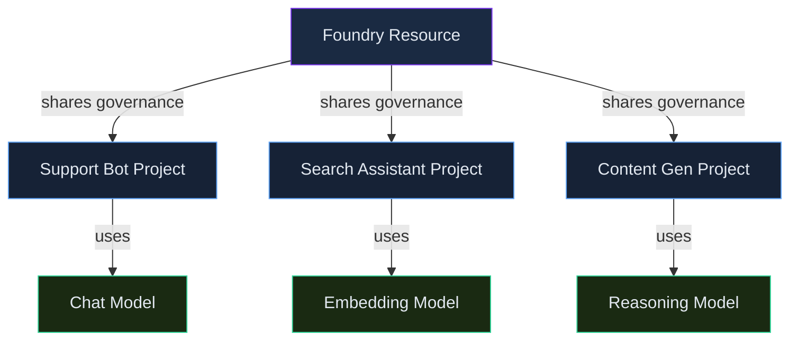

# Projects, Hubs & the Model Catalog

> **Skill track**: Microsoft Foundry Practitioner — Module 1, Lesson 1

## Prerequisites

- An Azure subscription you can create resources in (no prior AI/ML service experience needed)
- Comfortable with the general idea of a cloud "project" or "workspace" grouping related resources together

## Overview

Microsoft Foundry is Microsoft's unified platform for building AI agents, models, and apps. It was previously called Azure AI Foundry (and before that, Azure AI Studio), and the AI services portfolio it absorbed, once Azure AI Services, is now called Foundry Tools. You'll still see the old names in older docs, SDK samples, and the Azure resource type (`Microsoft.CognitiveServices/accounts`). Before you build anything, you need somewhere to build (a Foundry project inside a Foundry resource) and something to build with (a model from the catalog). Get either of those wrong on day one and every deployment you make afterward inherits the mistake.

> 💡 **Human Angle**: *Think of the model catalog as a car showroom and the deployment type as how you pay for the car — lease it by the mile (serverless/pay-per-token), buy it outright and park it in your garage (managed compute), or reserve a dedicated lane on the highway (provisioned throughput).*

## Foundry Projects vs. Hubs

### Key Concept

**Governance lives on the Foundry resource; each team's work lives in its own project underneath it.**

A Foundry resource is the top-level Azure resource where IT manages networking, security, model deployments, and shared connections. A Foundry project is a development boundary inside it: each project keeps its own agents, files, and evaluations, while reusing the deployments and connections the resource already provides. That two-level shape is now how Microsoft expects you to serve several teams under one set of rules, and new investment (including the generally available Foundry Agent Service) lands only on Foundry projects.

Hub-based projects still exist, but only in the Foundry (classic) portal; the current portal doesn't show them at all. You'd create one today only for a classic-only feature such as Prompt flow or managed compute deployments of open models like Hugging Face models. **Think of the Foundry resource as an office building**: security, power, and the front desk are managed once for the whole building, and each team gets its own locked floor.

| Concept | What it is | When to use |
|---|---|---|
| Foundry resource | Top-level governance boundary: networking, security, model deployments, connections | One per environment or business unit that shares the same rules |
| Foundry project | Development boundary inside a Foundry resource: agents, files, evaluations | One per team or use case, recommended default for new work |
| Hub-based project (classic) | A project under a Foundry hub, visible only in the Foundry (classic) portal | Only when you need a classic-only feature (Prompt flow, managed compute) |

*One Foundry resource, three team projects, three chosen models.*

### In Practice

**What breaks without this**: a platform team creates a separate Foundry resource for every new initiative "to move fast," and six months later has a dozen resources, each with its own copy of the Azure AI Search and Key Vault connections and its own network rules. The same governance gets re-implemented, slightly differently, a dozen times.

**Decision trigger**: ask *"will these teams share the same network rules, security settings, and model deployments?"* If yes, give them one Foundry resource with a project each. If a team needs different networking or a different region, that's the signal for a separate Foundry resource.

**When you'd choose differently**: if a team depends on a classic-only feature, such as an existing Prompt flow or a managed compute deployment of an open model, it may still need a hub-based project in the classic portal for now. Treat that as a temporary dependency with a migration plan, not as the default for new work.

### Common Pitfall ⚠️

Don't reach for a hub just because several teams need shared governance. That was the old pattern. In current Foundry, shared governance comes from one Foundry resource with several projects underneath it. Hub-based projects only appear in the classic portal and are for classic-only features.

## Model Catalog

### Key Concept

**The model catalog isn't a passive list — its benchmarks and licensing data are meant to directly drive your deployment decision, not just help you recognize a model's name.**

The catalog is the central place to browse models across providers (Azure OpenAI, Anthropic, Microsoft, Meta, Mistral, Cohere, DeepSeek, xAI, Hugging Face, and more), each with benchmarks, licensing terms, and supported deployment options on its model card. It's split into two categories: **Foundry Models sold by Azure**, which Microsoft hosts, supports, and sells under Microsoft Product Terms, and **Foundry Models from partners and community**, which their providers support.

That split and the deployment options both matter as much as the benchmarks. A model you can't deploy the way you need it, or with the support terms you need, isn't actually a candidate, no matter how good its numbers look.

| Feature | Purpose |
|---|---|
| Benchmarks and leaderboard | Compare quality, cost, and latency/throughput across models before choosing one |
| Sold by Azure vs. partners and community | Tells you who supports the model and how it's billed (Azure meters vs. Azure Marketplace) |
| License info | Understand usage rights per model family (varies — some commercial, some open-weight) |
| Deployment options per model | Not every model supports every deployment type — check the model card |

### In Practice

**What breaks without this**: a team picks the largest, most familiar-name model in the catalog for a simple classification task, without checking whether a smaller, cheaper model clears the same accuracy bar for their specific workload shape — the benchmark page exists precisely to catch this before it becomes a recurring cost problem.

**Decision trigger**: ask *"have I compared benchmark numbers for a workload shaped like MINE, not just the headline scores everyone quotes?"* A model that benchmarks well on general reasoning may be unnecessary overkill (and overspend) for a narrow, repetitive task.

**When you'd choose differently**: sometimes a non-benchmark factor legitimately dominates — an existing vendor relationship, a support SLA, or a licensing term that rules out an otherwise-superior model. That's a valid reason to override the benchmark-driven default, as long as it's a deliberate trade-off and not just familiarity.

## Deep Dive: Making Projects, Hubs & the Model Catalog Click

### 1. The connective narrative

Every decision in this lesson happens before you write a single line of application code, which is exactly why it's easy to underinvest in. The resource/project structure decides *who else this workspace's governance affects* — get it wrong and you're either duplicating security configuration across a dozen separate Foundry resources, or forcing teams with different network and compliance needs into one shared blast radius. The model catalog decides *what you're actually building with* — and its benchmarks and licensing data exist so that decision is made on evidence, not on which model name a team recognizes from the news. Neither choice is glamorous, but both are expensive to unwind once real usage and real teams are depending on them.

### 2. Worked scenario

> **Scenario.** Northwind Traders is standing up its first three generative AI initiatives at once: a customer support chatbot, an internal document-search assistant, and a marketing content generator — each owned by a different team.
>
> Walking the structural decision first:
>
> 1. **All three teams need the same connections** — the same Azure AI Search index (for the support bot's policy docs and the internal search assistant), the same Key Vault, and the same network/security posture mandated by IT. That shared-governance need is exactly the signal for **one Foundry resource**, with each team's work living in its own Foundry project underneath it — not three separate Foundry resources each re-declaring the same connections. (Connected resources such as Azure AI Search and Key Vault keep their own governance boundaries, so IT still locks down their networking separately.)
> 2. **Each team then picks a model independently, from the catalog, based on their own workload shape:**
>    - The support bot needs fast, cheap, high-volume responses to short questions — the team checks benchmarks for latency and cost on short-context tasks, not raw reasoning depth, and picks a smaller, cheaper model that clears their quality bar.
>    - The internal search assistant needs an *embedding* model, not a chat model at all — a different section of the catalog entirely, chosen for retrieval quality benchmarks specific to embeddings.
>    - The marketing content generator produces longer, more nuanced copy where quality matters more than per-token cost — the team checks benchmarks weighted toward reasoning/creativity and accepts a larger, pricier model.
>
> **The lesson**: the resource/project decision is made once, org-wide; the model decision is made per-workload, every time — conflating the two (e.g., assuming "one Foundry resource" means "one model for everyone") produces a worse outcome for at least two of the three teams.

### 3. Memory aid

Before finalizing structure and model choice, check:

1. **Shared governance** — do multiple teams need the exact same connections/networking/security posture? → one Foundry resource, one project per team (hub-based project only for a classic-only feature).
2. **Model card first** — does the model even support the deployment type and region you need?
3. **Benchmark for YOUR shape** — not the headline number, the number for a workload like yours.
4. **License fit** — does the usage-rights term actually permit what you're building?

### 4. Applying this in real projects

- The resource/project structure gets harder to change the more teams onboard under the wrong one — decide deliberately at the start rather than defaulting to "everyone gets their own Foundry resource" out of convenience.
- If you inherit hub-based projects, list which classic-only features they actually depend on. Anything that doesn't need Prompt flow or managed compute is a candidate to migrate to a Foundry project, where new features land.
- The single most common real-world mistake in model selection is picking based on name recognition rather than the catalog's own benchmark data for a comparable workload — five minutes on the benchmark page routinely changes the decision.

## Cheat Sheet 📋

| Concept | Key Rule |
|---|---|
| Naming | Azure AI Studio → Azure AI Foundry → Microsoft Foundry; Azure AI Services → Foundry Tools |
| Recommended new-project default | Foundry project inside a Foundry resource |
| Foundry resource's job | Shared networking, security, deployments, and connections for its projects |
| Hub-based project | Classic portal only; for classic-only features (Prompt flow, managed compute) |
| Model catalog benchmarks | Compare quality/cost/latency for YOUR workload shape, not headline scores |
| Model card | Confirms region and deployment-type support before you commit |
