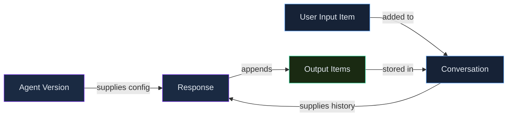

# Agent Service Fundamentals & Built-in Tools

> **Skill track**: Microsoft Foundry Practitioner — Module 2, Lesson 1

## Prerequisites

- Module 1 complete — you should already know how to deploy a model and which SDK does which job
- Comfortable with the general idea of a multi-turn chat conversation (turns, roles: system/user/assistant)
- No prior agent-framework experience needed — this lesson introduces the Agent Service from scratch

## Overview

This lesson covers Microsoft Foundry **Agent Service**: its runtime components, the three kinds of agent it can run, and its built-in tools. These are the pieces you compose before reaching for multi-agent orchestration in the next lesson. Everything here describes the current, generally available Agent Service built on the Responses API. The older "classic" agents API, with threads, messages, and runs, is deprecated and retires on March 31, 2027.

> 💡 **Human Angle**: *A well-tooled single agent is like one very capable generalist employee — give it the right set of tools before assuming it needs a whole team.*

## Core Runtime Components

### Key Concept

**Three components exist because a single model call can't hold a stateful, multi-turn conversation — something has to remember what happened before this turn.**

An **agent** supplies a reusable model, instructions, and tools. A **conversation** persists history across turns as *items*: messages, tool calls, and tool outputs. A **response** is one unit of execution: it runs a model or agent against some input and produces output items. You configure the agent once, add each user turn to the same conversation, and every new response picks up the full history automatically, with no manual resending.

If you've used the classic API, the mapping is direct: threads became conversations, messages became items (a superset of messages), runs became responses (synchronous by default, so no polling loop), and agents became versioned **agent versions**. **Think of it like a recipe card, a notebook, and a cooking session**: the agent is the recipe, the conversation is the notebook of everything said so far, and each response is one session at the stove.

| Component | Role | Classic equivalent |
|---|---|---|
| Agent (versioned) | Reusable model, instructions, and tools | Assistant / agent |
| Conversation | Persists input and output items across turns, server-side | Thread |
| Item | One message, tool call, or tool output inside a conversation | Message |
| Response | One unit of execution that produces output items | Run |

Editing an agent's **instructions** changes its tone/behavior without retraining or redeploying the model. Each change is saved as a new agent version, so you can compare versions or roll back.

*How agent, conversation, and response connect each turn.*

### In Practice

**What breaks without this**: a developer new to the Agent Service manually resends the full conversation history on every call, the way a plain chat-completion API would require. They end up either fighting the conversation abstraction or duplicating state it already manages for free. A second failure is copying a 2025-era sample that polls run status in a loop; that's the classic API, which is on its way out.

**Decision trigger**: ask *"does this feature need to remember earlier turns without me resending them?"* If yes, you want a conversation. If it's a genuinely stateless one-shot task (classify this text, yes/no), a single response with no conversation is simpler and cheaper.

**When you'd choose differently**: you can also carry context forward without a conversation by referencing a previous stored response, or by resending earlier items yourself. That suits short exchanges where you'd rather not keep server-side history at all.

## Prompt, Hosted, or Responses API?

### Key Concept

**The choice is how much of the agent you write versus how much Foundry runs for you.**

A **prompt agent** is pure configuration (instructions, a model, and tools), and Foundry runs it with no code or containers for you to maintain. A **voice-based prompt agent** is the same idea for real-time speech, connected through Voice Live. A **hosted agent** is your own code, built with Agent Framework, LangGraph, the OpenAI Agents SDK, or something else, shipped as a container image or a .zip of source. Foundry gives it a managed endpoint, autoscaling, a dedicated Microsoft Entra identity, and observability.

There's also a fourth path that isn't a Foundry agent resource at all: call the **Responses API** directly from code you already run elsewhere. Microsoft calls this an *ephemeral agent*: its definition lives in your app's source code, but it still uses Foundry models, tools, and project-level observability. **Think of it as renting, leasing, or owning**: a prompt agent is a furnished rental, a hosted agent is a leased building you fit out yourself, and the Responses API is working from your own premises with Foundry's utilities piped in.

| Option | You maintain | Foundry runs | Best for |
|---|---|---|---|
| Prompt agent | Configuration only | Everything | Fast start; production agents without custom orchestration |
| Voice-based prompt agent | Configuration only | Agent plus voice orchestration | Real-time spoken experiences |
| Hosted agent | Your agent code | Endpoint, scaling, identity, observability | Custom code or orchestration you want Foundry to host |
| Responses API (ephemeral) | Your code and its hosting | Models, tools, observability | Agent logic that ships and versions with your app |

### In Practice

**What breaks without this**: a team with a working LangGraph agent rebuilds it as a prompt agent to "get onto Foundry," and loses the custom orchestration that made it work. A hosted agent would have run their existing code as-is.

**Decision trigger**: ask *"does this agent need code that configuration can't express, and who should run that code?"* No custom code → prompt agent. Custom code that Foundry should host → hosted agent. Custom code that already runs in your own service → Responses API.

**When you'd choose differently**: start declarative even if you expect to need code later. Microsoft's guidance is that you can begin with a prompt agent and move to a hosted agent as needs grow, so don't pay the container-maintenance cost before you know you need it.

## Built-in Tools

### Key Concept

**Each built-in tool answers a different question about where the agent's knowledge or capability comes from — your own uploaded docs, the live web, structured data, arbitrary code execution, or an external API.**

| Tool | What it does | Not to be confused with |
|---|---|---|
| Code interpreter | Executes Python in a sandbox — data analysis, calculations, chart generation | File search (retrieval, not execution) |
| File search | Retrieves grounded passages from an uploaded document vector store, with citations | Code interpreter |
| Function calling | Model decides when to invoke a developer-defined function with structured (JSON-schema) arguments | OpenAPI tool |
| OpenAPI tool | Agent calls an external REST API directly from a published OpenAPI 3.0 spec (anonymous / API-key / managed-identity auth) | Function calling (which needs a hand-written wrapper per function) |
| Web search / Grounding with Bing Search | Grounds answers in live web results — for time-sensitive info (both are generally available in the new Agent Service) | File search (only searches your own uploaded docs) |
| Azure AI Search | Retrieves from an existing Azure AI Search index you already manage | File search (Foundry manages the vector store for you) |
| MCP | Connects the agent to a remote Model Context Protocol server's tools (generally available in the new Agent Service) | OpenAPI tool (one REST API described by a spec) |
| Fabric data agent (preview) | Queries structured data already modeled in Microsoft Fabric, without re-exporting it | File search (unstructured documents) |

When the same tools are needed by many agents, put them in a **toolbox**. A toolbox curates tools once and exposes them through a single managed MCP-compatible endpoint, with centralized authentication, guardrails, and versioning. Any MCP-compatible runtime can consume it, so you update a tool in one place instead of rewiring every agent.

### In Practice

**What breaks without this**: a developer reaches for Function calling to wrap an internal REST API that already has a full, published OpenAPI 3.0 spec — hand-writing a JSON-schema function definition for every endpoint, when the OpenAPI tool would have consumed that spec directly with zero wrapper code. Real engineering time lost to picking the more familiar-sounding tool instead of the right one.

**Decision trigger**: ask *"what kind of knowledge or action does this need — my own documents, the live web, structured data already in Fabric, arbitrary code execution, or an external API call?"* That answer picks the tool; for an API call specifically, follow up with *"does a spec already exist?"* — spec exists → OpenAPI tool, no spec / one specific custom action → Function calling.

**When you'd choose differently**: even when an OpenAPI spec exists, Function calling can still be the right call if you need custom validation or logic injected *before* the underlying request fires — the OpenAPI tool's direct pass-through doesn't give you that hook.

### Common Pitfall ⚠️

"Which tool lets the agent call an internal REST API?" has *two* plausible-looking answers: Function calling and the OpenAPI tool. The distinguishing detail: the OpenAPI tool works directly from an existing OpenAPI 3.0 spec with no per-endpoint wrapper code; Function calling requires you to define each function's schema by hand. Look for "already has a published spec" vs. "one specific custom action" to pick correctly.

## Deep Dive: Making Agent Fundamentals & Tools Click

### 1. The connective narrative

The runtime components are the skeleton, the agent type decides who runs it, and tools are what the agent can actually *do* once it's holding a conversation. An agent with excellent instructions but no tools enabled can only talk — it can't look anything up, run any calculation, or take any action. And once tools are in play, picking the wrong one doesn't just under-deliver, it actively misleads: an agent grounded in live web search when it should be citing your own uploaded policy document will confidently answer from the wrong source entirely. The runtime components and the tool choices aren't two separate topics — they're "what remembers the conversation" and "what the conversation can accomplish," and you need both working correctly for an agent to be useful.

### 2. Worked scenario

> **Scenario.** Northwind Traders' internal operations team wants one assistant that can: (a) look up live inventory counts for any SKU via an internal REST API that already has a published OpenAPI 3.0 spec, (b) analyze an ad-hoc uploaded spreadsheet of return-rate data to answer "why are returns up this month?", and (c) check current shipping-carrier delay reports from the public web.
>
> Walking the tool choice for each requirement:
>
> 1. **(a) Live inventory lookup via an existing REST API → OpenAPI tool, not Function calling.** The spec already exists, so the OpenAPI tool consumes it directly — no per-endpoint wrapper code to write or maintain as the API evolves.
> 2. **(b) Ad-hoc spreadsheet analysis → Code interpreter.** This needs actual computation — grouping, filtering, maybe a quick chart — over a file uploaded in the moment. File search would only retrieve passages of text; it can't compute a return-rate trend.
> 3. **(c) Current carrier delays from the public web → Web search (or Grounding with Bing Search).** This is explicitly *not* something in the team's own uploaded documents — it's live, external, time-sensitive information, which is exactly a web-grounding tool's job and exactly where File search would come up empty.
>
> **The gotcha to notice**: three different tools, three different requirements, and none of them is interchangeable with another — swapping File search in for (c), for instance, wouldn't just underperform, it would search the wrong universe of documents entirely (your own uploads, not the live web).

### 3. Memory aid

Ask what kind of knowledge or action the task needs, in this order:

1. **My own uploaded docs** → File search (or Azure AI Search, if the index already exists)
2. **The live web** → Web search or Grounding with Bing Search
3. **Structured data already in Fabric** → Fabric data agent
4. **Run code / analyze an uploaded file** → Code interpreter
5. **Call a REST endpoint that already has a spec** → OpenAPI tool
6. **Tools an MCP server already exposes** → MCP tool
7. **One specific custom action, no spec** → Function calling

### 4. Applying this in real projects

- Under time pressure, teams default to Function calling because it *sounds* the most generic and flexible — check for an existing OpenAPI spec or MCP server first; either is usually the faster, lower-maintenance path when one exists.
- Conversation state is easy to take for granted at small scale and easy to get wrong at real scale — verify you're not accidentally sharing one conversation across multiple concurrent users, which silently leaks one user's history into another's.
- Once three or more agents use the same tools, move them into a toolbox before credentials and tool versions drift apart.

## Cheat Sheet 📋

| Concept | Key Rule |
|---|---|
| Runtime components | Agent (versioned), conversation (items), response |
| Classic API | Threads, messages, runs — deprecated, retires March 31, 2027 |
| Prompt agent | Configuration only; Foundry runs it |
| Hosted agent | Your code in a container; Foundry hosts, scales, and gives it an Entra identity |
| Responses API | Ephemeral agent defined in your own code |
| Code interpreter | Executes Python (analysis, charts) |
| File search | Retrieval + citation over uploaded docs |
| Function calling | Model fills args for a hand-defined function; runs client-side |
| OpenAPI tool | Calls an API directly from its spec, no wrapper needed |
| MCP tool | Uses tools from a remote MCP server |
| Web search / Bing grounding | Live web search grounding |
| Fabric data agent | Query structured Fabric data directly (preview) |
| Toolbox | Shared tools behind one MCP-compatible endpoint |
| Change agent tone/rules | Edit instructions → new agent version, no model redeploy |
