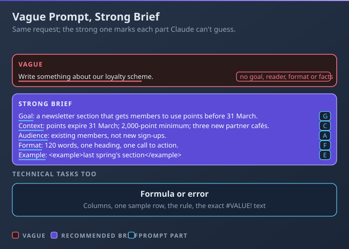
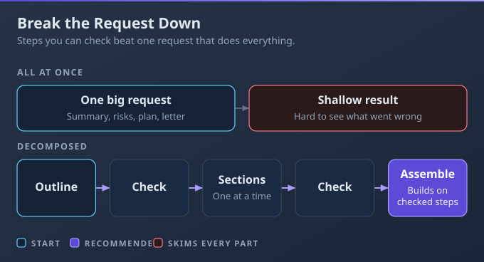
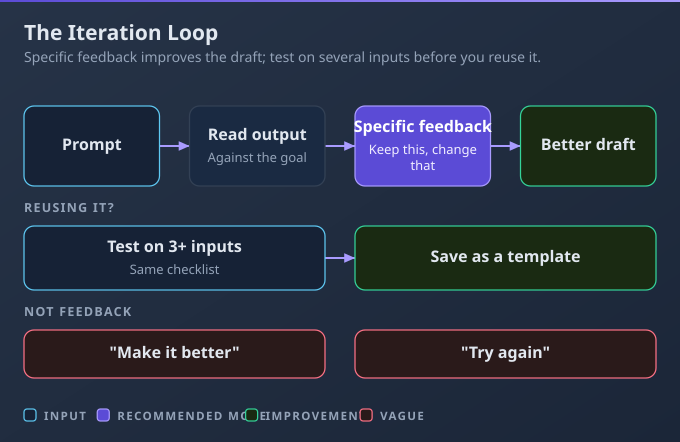

# D1: Prompting and Task Execution

> **Exam weight**: 14% · **Questions**: 25 in the bank

## Overview

This domain is about getting useful work out of Claude on everyday business and technical tasks: briefing it well, splitting big jobs into steps you can check, improving a prompt over a few rounds, and matching the approach to the task type. It exercises **Description**, the AI Fluency competency of telling Claude clearly what you need.

> 💡 **Human Angle**: Claude can't read your mind or your inbox. Most disappointing answers trace back to something the person knew and didn't say.

---

## 1.1 Create effective prompts for business and technical tasks

### Key Concept

**Give Claude what it can't guess: the goal, the context, the audience, the format and an example.**

Claude works only from what's on the page, so it fills every gap with a safe, generic default. Technical tasks are no different: a formula request needs the actual columns, a sample row and the rule.

**Think of briefing a capable new colleague**: sharp, but absent from last week's meeting.

### Real use

A finance assistant at a regional bus operator needs a formula that flags invoices unpaid after 30 days, and the reason her first attempt gave `#VALUE!`. She supplies the column layout, one example row, the rule and the exact error text, and gets a working formula with a plain explanation.

### How it works

A one-line request such as "Write something about our loyalty scheme" comes back generic and twice the length the newsletter allows, because Claude filled every gap with a default.

- **The five parts:** goal, context (facts and decisions Claude can't know), audience, format and length, and an example. Two or three short examples show a house style better than describing it.
- **Technical tasks need no coding:** a formula needs the columns, one example row and the rule; an error needs its exact text; a clean-up needs its rules (dates as YYYY-MM-DD) and a request to list any row it can't fix; pulling details from text needs each field named, plus a rule for clashes (for example, use the latest-dated price). With the setting called Code execution and file creation switched on, Claude can work on an uploaded CSV (a plain file of rows and columns that spreadsheets open); see 3.1.
- **Label what you paste:** use a heading or labelled tags such as `<notes>…</notes>`, so it stays apart from your instructions.
- **Say what to do when information is missing:** "Where a figure isn't in my data, write 'not provided' instead of estimating." Politeness and emphasis ("please", capitals) supply no missing information.

### Choose when

| Option | Choose it when | Trade-off |
|---|---|---|
| Short, direct prompt | Simple, low-stakes task that needs nothing from you | Generic output if context matters |
| Full brief | Anything you'll send, rely on or reuse | A minute longer to write |
| Brief plus 2–3 examples | Style or layout must match exactly | Claude may copy one example too closely |
| Exact error text plus sample data | A formula, error message or data clean-up | Test the result on a few real rows |

### How to do it

1. Start with the goal and the reader.
2. Add the context Claude can't know, including exact error text or column names.
3. State format and length; add examples if style matters.
4. Say what to do when information is missing.

### Exam Trap ⚠️

Adding "please" or "be creative" to a vague prompt changes nothing, because the goal, audience and facts are still missing.

### Go deeper

- [My prompt isn't giving me a helpful answer](https://support.claude.com/en/articles/7996857-my-prompt-isn-t-giving-me-a-helpful-answer)
- [Create and edit files with Claude](https://support.claude.com/en/articles/12111783-create-and-edit-files-with-claude)

---

## 1.2 Apply task decomposition techniques to structure complex requests

### Key Concept

**Split a big job into steps you can check, so each step builds on checked work.**

One giant request makes everything happen at once, so each part gets shallow attention. When one part is wrong, you can't fix it without redoing the lot. Decomposition puts a checkpoint between the steps.

**Think of building a house**: you check the foundations before anyone puts up walls.

### Real use

A programme manager at a city museum is writing a touring-exhibition proposal. She agrees an outline first, drafts each section with only its own material, and assesses three host venues separately against the same four criteria before comparing them. The comparison shows a real trade-off between the venues, and a final assembly pass makes the sections consistent.

### How it works

Ask for a whole quarterly business review in one message and you get eight thin sections; when one figure is wrong, there's no clean way to fix just that part.

- **Plan first:** ask for an outline or a list of steps (or ask Claude to propose them), and edit it.
- **One part per step,** with only the material that part needs.
- **Independent parts:** assess each one separately against the same criteria, then compare the assessments in a final step. Each option gets equal attention; deciding first and justifying afterwards is rationalisation, not analysis.
- **Check between steps, then assemble:** review step one's output before step two builds on it, and finish with a consistency pass. If the steps share files, a Project (a workspace that keeps the same files and instructions for every chat in it) holds them in one place.

### Choose when

| Option | Choose it when | Trade-off |
|---|---|---|
| Single request | Short, well-defined task | Hard to fix if it goes wrong |
| Step-by-step chain | Later parts depend on earlier ones | More turns to manage |
| Separate assessments, then compare | Several independent options judged on the same criteria | One extra combining step |
| Ask Claude to propose the steps | You're unsure how to break it down | Review its plan before following it |

### How to do it

1. Get an outline and edit it.
2. Work one step at a time, and check each before moving on.
3. Assess independent parts on the same criteria, then compare.
4. Do a final assembly and consistency pass.

### Exam Trap ⚠️

Packing every part into one detailed prompt "so Claude sees the whole picture" gets a shallow answer, and an error in one part spreads into the rest unnoticed.

### Go deeper

- [My prompt isn't giving me a helpful answer](https://support.claude.com/en/articles/7996857-my-prompt-isn-t-giving-me-a-helpful-answer)
- [AI Fluency: Framework & Foundations](https://anthropic.skilljar.com/ai-fluency-framework-foundations)

---

## 1.3 Iterate prompts to improve output quality

### Key Concept

**Treat the first answer as a draft: say what to keep, what to change and why.**

Vague feedback gets a random change; specific feedback gets the change you meant. A prompt that worked once isn't proven yet. The AI Fluency course calls this back-and-forth between asking and judging the Description–Discernment loop.

**Think of a tailor's fitting**: you point at the seam that's wrong, not at the whole jacket.

### Real use

A customer-insight analyst at a mobile network refines a prompt that summarises a week of app-store reviews. She tells Claude to keep the theme headings, add a count for each theme and drop the generic opening, then runs the refined prompt on three other weeks' reviews against the same checklist. All three pass, so she saves it as a template.

### How it works

"Make it better" turns a nearly-right draft into a different one, and the paragraph that was already right disappears.

- **Compare to the goal, then be specific:** name the part, the change and the reason, and say what to keep. Saying "try again" or regenerating isn't a method, because nothing tells Claude what missed.
- **Show, don't describe:** paste an example of the tone or layout you want.
- **Edit the original prompt** and resend it when the prompt itself caused the miss.
- **Prove it before reuse:** one excellent result can be luck. Run the refined prompt on several different inputs, check each against the same quality checklist, then save it as a template instead of repeating the rounds or living in one endless chat.

### Choose when

| Option | Choose it when | Trade-off |
|---|---|---|
| Specific feedback in the chat | One output needs adjusting | The fix lives only in this chat |
| Edit and resend the original prompt | The prompt itself caused the miss | You lose the earlier answer |
| Test on several inputs | You plan to reuse the prompt | A few extra runs |
| Save as a template | You'll run the same task again | Update it when needs change |

### How to do it

1. List what to keep and what to change.
2. Give specific feedback, with an example if tone is the issue.
3. Test the refined prompt on 3 or more different inputs against the same checklist.
4. Save it as a template.

### Exam Trap ⚠️

Pressing regenerate until a good version appears wastes rounds, and you can't repeat the result next time because you never learned why the prompt missed.

### Go deeper

- [AI Fluency: Framework & Foundations](https://anthropic.skilljar.com/ai-fluency-framework-foundations)
- [My prompt isn't giving me a helpful answer](https://support.claude.com/en/articles/7996857-my-prompt-isn-t-giving-me-a-helpful-answer)

---

## 1.4 Adapt prompting strategies based on task type (analysis, research, drafting, brainstorming)

### Key Concept

**Name the task type first: analysis, research, drafting and brainstorming each need different inputs.**

Analysis is anchored to your data, research to sources, drafting to the reader and brainstorming to range. Use the wrong prompt shape and you get a confident answer to a different task. A two-part job, such as research followed by a draft, needs two different prompt shapes.

**Think of different tools in one kit**: a ruler, a magnifying glass, a pen and a whiteboard each suit a different job.

### Real use

A grants officer at a community foundation meets all four task types in one week. She analyses application data with the method shown, researches funder trends with sources she can open, drafts a decision letter with the audience, tone and length set, and brainstorms 20 event ideas before shortlisting five.

### How it works

A drafting-style request, "write me a report on the survey", produces confident "findings" with no data behind them and no way to check them.

- **Analysis:** give the data and ask Claude to work only from it, show the figures behind each finding, and keep observations separate from possible explanations.
- **Research:** ask for sources you can open, not answers from memory. For questions spread across many sources, use Research (a paid-plan feature that runs several searches that build on each other; web search must be on; see 3.1).
- **Drafting:** set the audience, purpose, tone and length, and add an example.
- **Brainstorming:** ask for quantity and range (for example 20 ideas across different styles), say unusual ideas are welcome, and judge them in a separate step.

### Choose when

| Option | Choose it when | Trade-off |
|---|---|---|
| Analysis prompt | You have data and a question | The numbers still need checking |
| Research prompt, or Research | The answer is spread across sources | Slower; open the sources |
| Drafting prompt | Someone will read the text | Needs the audience set |
| Brainstorm prompt | You need options, not an answer | Most ideas will be discarded |

### How to do it

1. Name the task type.
2. Include what that type needs: data, sources, audience or range.
3. For brainstorming, generate first and judge second.

### Exam Trap ⚠️

Asking Claude to analyse survey results "from what you know about the sector" swaps your data for general knowledge, so the findings describe someone else's organisation.

### Go deeper

- [Claude 101 (Anthropic Academy)](https://anthropic.skilljar.com/claude-101)
- [Use research on Claude](https://support.claude.com/en/articles/11088861-use-research-on-claude)

---

## Deep Dive: Making Prompting Click

### 1. The connective narrative

Every lesson in this domain is a form of **Description**: telling Claude clearly what you need. Lesson 1.1 describes one task well. Lesson 1.2 describes a plan, so each step can be checked before the next one builds on it. Lesson 1.3 is the Description–Discernment loop: you describe, judge what comes back, and describe again more precisely.

Lesson 1.4 shapes the description to the kind of work, because analysis, research, drafting and brainstorming each need different inputs. What ties them together is that every technique adds information Claude didn't have. None of them adds effort for its own sake.

### 2. Worked scenario

> **Scenario.** A wedding-venue sales manager must answer a corporate enquiry by Friday: 120 guests, two possible dates and a dietary list.
>
> 1. **One big prompt or steps?** She weighed a single "write the full proposal" request against outline, then sections, then assembly. She chose steps because pricing depends on which date the client picks. The outline revealed that the proposal had no accessibility section, so she added one before drafting.
> 2. **How to brief the menu section?** She could describe the house style or paste two past proposals as examples. She pasted the examples, and the tone matched on the first draft.
> 3. **The client's questions about local hotels.** She treated this as research, not drafting, and asked for sources. She opened all three sources before quoting any distances.
> 4. **The first full draft is too formal.** She could regenerate or give keep-and-change feedback. She gave the feedback, one round fixed it, and she saved the final prompt as a template for the next enquiry.

### 3. Memory aid

**GCAFE**: **G**oal, **C**ontext, **A**udience, **F**ormat, **E**xample. For technical tasks, the context is the exact error, the columns and a sample row.

### 4. Exam strategy for this domain

- Wrong options add effort without information: regenerate, be polite, write longer, use a bigger model.
- Right options add what was missing, split the work into steps you can check, or match the prompt to the task type.
- Five minutes before the exam: "If the answer is vague, ask what Claude didn't know."

---

## Cheat Sheet 📋

| Situation | What to do |
|---|---|
| Output is generic | Add the goal, context, audience and format |
| Style must match exactly | Include 2–3 examples |
| Spreadsheet formula or error message | Give the columns, a sample row and the exact error text |
| Some data is missing | Tell Claude to write "not provided" instead of estimating |
| Big multi-part deliverable | Outline first, then one part at a time |
| Comparing independent options | Assess each on the same criteria, then compare |
| Prompt you'll reuse | Test it on several inputs, then save it as a template |
| Analysing data | Use only your data, with evidence for each finding |
| Need many ideas | Brainstorm widely, then judge in a second step |
