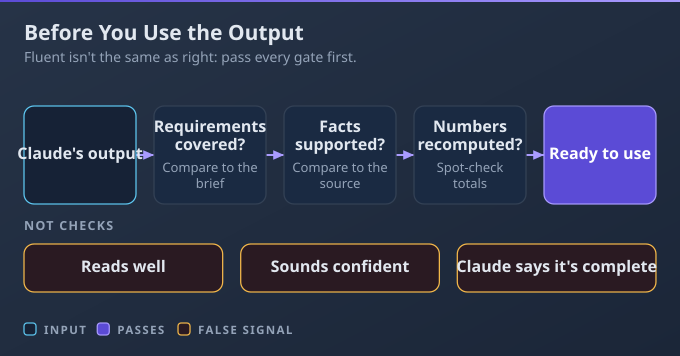
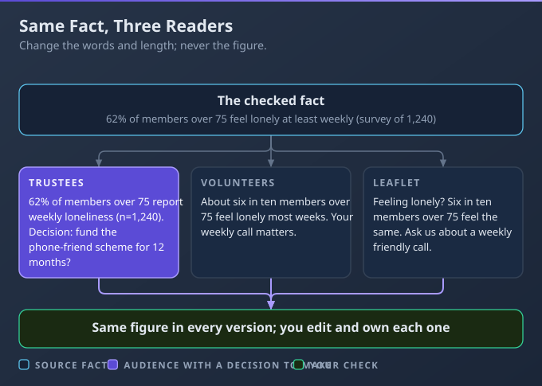
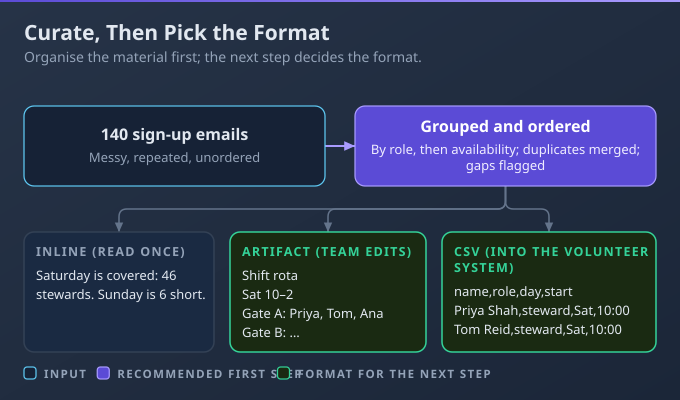

# D2: Output Evaluation and Validation

> **Exam weight**: 21% · **Questions**: 38 in the bank

## Overview

This is the heaviest domain. It covers judging what Claude produces before anyone relies on it: accuracy and completeness, hallucinations, inconsistency and bias, fact-checking, the right level of review, adapting for the audience, and organising and formatting the result. The AI Fluency competency it exercises is **Discernment**, which means judging what comes back.

> 💡 **Human Angle**: Claude writes fluently whether or not it's right. Fluency is not evidence; the source is.

---

## 2.1 Evaluate Claude-generated outputs for accuracy and completeness

### Key Concept

**Check every output twice, against the request for gaps and against the source for errors.**

Accuracy means every statement matches the source; completeness means everything you asked for is there. An answer can be one without the other, and fluent writing proves neither.

**Think of checking a delivery against the order form**: every item present, and every item the right one.

### Real use

A procurement officer at a university asks Claude to summarise a 30-page catering framework agreement against her eight questions. Ticking off the questions shows the price-review clause was skipped, and checking against the agreement shows the notice period is wrong. She fixes both before anyone relies on the summary.

### How it works

A well-written status report reaches the steering group with one workstream missing and a budget total that doesn't match its own lines.

- **Completeness:** tick off each requirement in your request. You can ask Claude to list each requirement and where it answered it, then check that list yourself. Word count or polish tells you nothing about coverage.
- **Accuracy:** check facts, names, dates and terms against the source.
- **Numbers:** recompute totals yourself and spot-check several rows of any generated table against the source data. Claude confirming its own totals isn't an independent check.
- **Omissions:** ask what the reader will expect that isn't there.

### Choose when

| Option | Choose it when | Trade-off |
|---|---|---|
| Quick read-through | Your own low-stakes draft | Errors can slip through |
| Requirement-by-requirement check | The output will be sent or used | A few minutes |
| Line-by-line source check | Figures, terms or names matter (contracts, finance) | Slowest, most reliable |

### How to do it

1. List the requirements from your request and tick each one off.
2. Check facts against the source, and recompute the numbers.
3. Ask Claude to fill any gaps, then check again.

### Exam Trap ⚠️

Treating a fluent, confident summary as accurate lets a missing clause or wrong figure reach the reader, because confidence says nothing about correctness.

### Go deeper

- [AI Capabilities and Limitations (Anthropic Academy)](https://anthropic.skilljar.com/ai-capabilities-and-limitations)
- [AI Fluency: Framework & Foundations (Anthropic Academy)](https://anthropic.skilljar.com/ai-fluency-framework-foundations)

---

## 2.2 Identify hallucinations, inconsistencies, and biases in responses

### Key Concept

**Be most suspicious of the specifics that look authoritative, such as citations, figures, names, dates and quotes.**

A hallucination is confident content that isn't true or isn't in the source. An inconsistency is a contradiction inside the output; bias is one-sided framing, stereotypes, or describing equal things unequally.

**Think of a witness who fills gaps in their memory**: the story flows, but some details were never there.

### Real use

An internal communications manager at an energy company reviews a Claude-drafted intranet article on a safety programme. It has an unsupplied statistic, a chief executive quote not in her notes, a launch date that changes between paragraphs and wording that assumes engineers are men. She traces or cuts the first two, reconciles the date and rewrites the wording.

### How it works

A briefing repeats an unsupplied statistic and section number, and three later documents copy both before anyone checks.

- **Hallucination signals:** exact citations, statistics, quotes, links and names you didn't provide, especially when no source was given.
- **Inconsistency signals:** two figures for one thing, totals that don't match their parts, a changing date. Reconcile against the source; never average or keep the more flattering figure.
- **Bias signals:** equal results described unequally, assumptions about groups, one-sided comparisons. That's bias, not hallucination or formatting; compare like with like.
- **Confidence isn't evidence:** a self-rating comes from the same model. Instead, give the source, ask for answers only from it, and allow "I don't know".

### Choose when

| Option | Choose it when | Trade-off |
|---|---|---|
| Spot-check high-risk specifics | Routine internal output | Misses subtle errors |
| Check every specific claim | External or published content | Time-consuming |
| Like-for-like comparison | The output describes or rates people | Needs the records |
| Second reviewer for bias | It affects people's opportunities | Needs a reviewer |

### How to do it

1. Highlight every citation, figure, name, date and quote.
2. Check each against the source, and totals against parts.
3. Compare how groups are described.

### Exam Trap ⚠️

Trusting Claude's high rating of its own confidence lets an invented citation through, because the same model produced both.

### Go deeper

- [AI Capabilities and Limitations (Anthropic Academy)](https://anthropic.skilljar.com/ai-capabilities-and-limitations)

---

## 2.3 Apply fact-checking and validation techniques

### Key Concept

**Verify against a source outside the conversation; asking Claude "are you sure?" isn't a check.**

Fact-checking means confirming a claim with evidence Claude didn't produce; Claude checking itself is the same source checking itself. Start with the source and the exact passage behind each claim.

**Think of a journalist's two-source rule**: a story runs only when independent sources confirm it.

### Real use

A sustainability lead at a furniture maker checks a recycled-timber emissions saving before it goes in a customer brochure. She asks Claude for the source and exact passage, opens it, checks the year, units and region match, and confirms the figure with a second independent source.

### How it works

A brochure claims a 40% emissions saving from an old study of a different timber in another country; nobody checked that the cited source said what the claim did.

- **Ground it:** ask for the exact passage and section behind each claim, allowing "not stated" where the document is silent.
- **Open the source:** web search answers include citations you can open. Research (Claude's mode that runs many linked searches) gathers many sources; open the ones your conclusions rest on.
- **Check it's comparable:** same date, units, product or plan, region and currency as your claim.
- **Confirm independently:** use a second source for high-stakes facts and recompute numbers. Re-asking, or adding "according to research", isn't verification; correct or remove what you can't confirm.

### Choose when

| Option | Choose it when | Trade-off |
|---|---|---|
| Quote-from-source | You have the authoritative document | Only as good as the document |
| Open the cited sources | Facts came from the web or Research | Each one needs opening |
| Second independent source | High-stakes or published facts | Takes longer |
| Remove or reword the claim | You can't confirm it | The claim goes |

### How to do it

1. Ask for the quote behind each claim.
2. Open the sources and check they're comparable.
3. Confirm key facts with a second source; fix or cut the rest.

### Exam Trap ⚠️

Taking Claude's "yes" to "double-check your answer" as confirmation repeats the error more confidently, because the same source checked itself.

### Go deeper

- [Enable and use web search](https://support.claude.com/en/articles/10684626-enable-and-use-web-search)
- [Use research on Claude](https://support.claude.com/en/articles/11088861-use-research-on-claude)

---

## 2.4 Determine when human review or additional verification is required

### Key Concept

**Scale review to the stakes and the audience; the more that rides on an output, the more qualified its reviewer.**

Ask who will see it and what happens if it's wrong. For uses affecting someone's health, legal rights, finances, livelihood, or access to housing, education or essential services, Anthropic's Usage Policy requires a qualified reviewer who can change the recommendation, and that the person is told AI was involved.

**Think of the "four eyes" rule in finance**: bigger payments need more sign-offs.

### Real use

A claims team lead at a home insurer sets three review levels: a self-check for internal shift notes, and her own review of customer letter templates before use. A qualified claims handler with authority to change it decides each claim-decline letter, and the customer is told AI helped draft it.

### How it works

A team skips review on Claude-drafted refund letters because "it's usually right", and a wrong amount reaches forty customers.

- **Stakes and audience:** money, legal exposure, harm and reputation, and who sees it. Audience size alone isn't the stakes.
- **Expertise:** health, legal or financial content needs someone qualified in that field. A spelling check, a disclaimer, or replying only where Claude marks itself uncertain isn't review.
- **Volume and risk together:** sample routine high-volume output, but fully review every item in a risky category such as refunds.
- **Novelty:** a new use gets more review until it earns trust.

### Choose when

| Option | Choose it when | Trade-off |
|---|---|---|
| Your own read | Personal drafts | Your blind spots remain |
| Author's quick check | Internal, low-stakes output | Small errors slip through |
| Sample review | Routine, high-volume output | Rare errors get through |
| Full review by a qualified person | External, regulated or people-affecting output | Slower; needs that person |

### How to do it

1. Ask who sees it and what happens if it's wrong.
2. Match the review level.
3. For high-risk work, a qualified person with authority decides, and the affected person is told AI was involved.

### Exam Trap ⚠️

Skipping review on customer letters because "Claude is usually accurate" means a customer finds the first error.

### Go deeper

- [Usage Policy](https://www.anthropic.com/legal/aup)
- [2026 Usage Policy update](https://www.anthropic.com/news/2026-usage-policy-update)

---

## 2.5 Edit, adapt, refine, and compare outputs for the intended audience

### Key Concept

**Keep the facts fixed and shape everything else to what each reader knows, decides and has time for.**

Each audience needs a different length, vocabulary, level of detail and call to action. Claude adapts well when you name the reader and their next action, but you stay the editor, and the facts never change between versions.

**Think of telling the same news to your CEO, your team and a customer**: same facts, three different conversations.

### Real use

A research manager at a charity for older people turns one set of survey findings into a trustee summary, a volunteer briefing and a plain-language leaflet. She compares two leaflet versions against members' next steps and keeps the clearer one, adding a line from the other. A final check confirms all three state the same figures.

### How it works

The same 12-page incident report goes to the board, the support team and customers; the board stops at page two and customers get internal jargon.

- **Name the audience** and what they must do with the output.
- **Adjust** length, vocabulary, detail and tone.
- **Compare 2–3 versions** against the audience and the purpose, combine the strongest parts, then edit. The longer version, or the one Claude prefers, isn't the test.
- **Same facts, your voice:** a simpler version may leave detail out but never change it. Edit off-voice passages into your organisation's voice rather than sending them as they are or starting over, and own what goes out under your name.

### Choose when

| Option | Choose it when | Trade-off |
|---|---|---|
| One version for all | Readers have similar needs | Too much for some, too little for others |
| Version per audience | Readers differ in role or expertise | More to check |
| Side-by-side alternatives | You're unsure which approach works | Extra reading |

### How to do it

1. List each audience and its next action.
2. Ask for a version per audience, or two to compare.
3. Check that every version states the same figures, then edit for voice.

### Exam Trap ⚠️

Simplifying a version by rounding figures or dropping caveats changes the facts, so two audiences end up believing different things.

### Go deeper

- [AI Fluency: Framework & Foundations (Anthropic Academy)](https://anthropic.skilljar.com/ai-fluency-framework-foundations)

---

## 2.6 Organize and curate information and select appropriate output formats (artifacts, inline, structured data)

### Key Concept

**Choose the format by what happens to the output next.**

Read once means inline; keep, edit or share means an artifact or file; feeding a spreadsheet or system means structured data. Organise the material before choosing its format.

**Think of sticky notes, a report and a spreadsheet**: each suits a different next step.

### Real use

A volunteer coordinator at a music festival has Claude group and order 140 messy sign-up emails by role, availability, then priority, then picks an inline answer for a quick capacity question, a shift-rota artifact the team edits, and a CSV (a plain file of rows and columns that spreadsheets open) for the volunteer system.

### How it works

A volunteer rota pasted as a long chat message is copied, edited and re-sent four times; by Friday, three versions circulate.

- **Curate first:** ask Claude to group related items, order them (priority, time or owner), merge duplicates, flag gaps and add a summary at the top.
- **Inline:** quick answers you read once, not a full document.
- **Artifact or file:** artifacts open beside the chat for work you'll keep editing or share; Claude can also make Word, Excel, PowerPoint and PDF files. Both need the **Code execution and file creation** setting, which lets Claude run code and make files.
- **Structured data:** a table or CSV, with one row per item and one column per field.

### Choose when

| Option | Choose it when | Trade-off |
|---|---|---|
| Inline | Read once and move on | Hard to reuse |
| Artifact | The team will keep editing or sharing it | Needs the setting turned on |
| Downloadable file | It must leave Claude as Word, Excel, PowerPoint or PDF | Check formatting after export |
| Structured data (table or CSV) | A spreadsheet or system will use it | Less readable |

### How to do it

1. Ask Claude to group, order and summarise the material.
2. Decide what happens to it next.
3. Ask for that format, naming the columns or sections.

### Exam Trap ⚠️

Asking for a polished report when the data is headed for a spreadsheet means someone retypes every row.

### Go deeper

- [What are artifacts and how do I use them?](https://support.claude.com/en/articles/17153992-what-are-artifacts-and-how-do-i-use-them)
- [Create and edit files with Claude](https://support.claude.com/en/articles/12111783-create-and-edit-files-with-claude)

---

## Deep Dive: Making Output Evaluation Click

### 1. The connective narrative

The AI Fluency course names four competencies: Delegation (deciding what work to give AI), Description (telling it clearly what you need), Discernment (judging what comes back) and Diligence (taking responsibility for how it's used). This domain is Discernment. Lessons 2.1 to 2.3 judge the content: did it cover the request, where might it be wrong, and how do you confirm it?

Lesson 2.4 decides how much judging an output needs, and by whom. Lessons 2.5 and 2.6 judge fit: the right reader and the right shape. Running through all six is one refusal: fluency is the thing Discernment won't trust.

### 2. Worked scenario

> **Scenario.** A regulatory affairs associate at a pharmacy chain turns new guidance on medicine storage into instructions for 120 stores.
>
> 1. **Checking the summary.** She could ask Claude to confirm its draft, or ask for the passage behind each of its 14 instructions. She chose quotes, because a self-check is the same source checking itself. One temperature range had no supporting passage, so she removed it.
> 2. **Two fridge-check frequencies.** The draft said daily in one place and weekly in another. Keeping the stricter one felt safe but could still be wrong, so she reconciled against the source instead. It said daily.
> 3. **Review level.** A proofread by her team would be quick, but the instructions change what staff do with medicines. The superintendent pharmacist reviewed them before release.
> 4. **Format.** One long document would be read once and lost. Store managers got a checklist artifact they can keep up to date, and the stock system got a CSV of the 38 affected products.

### 3. Memory aid

Before anything leaves your hands, ask two questions: **"What has this been checked against?"** and **"Who is qualified to sign it off?"**

### 4. Exam strategy for this domain

- Tempting wrong answers trust signals that aren't evidence: confidence, fluency, length, a disclaimer, or Claude checking itself.
- Right answers check against an authoritative source and scale review to the stakes and the expertise needed.
- Five minutes before the exam: find the source, then find the right reviewer.

---

## Cheat Sheet 📋

| Situation | What to do |
|---|---|
| Confident citation or section number | Check it in the official text |
| You're tempted to ask Claude if it's sure | That isn't verification; check an outside source |
| Two figures disagree | Reconcile against the source |
| Equal results described unequally | Treat it as bias: correct it, and check other outputs |
| Statistic from the web or Research | Open the source; check the date, units, region and currency |
| Customer-facing or regulated output | Qualified review before use |
| Decision affects someone's money, health, rights or job | Qualified person with authority, and tell them AI was involved |
| Hundreds of routine replies | Sample them; fully review complaints and refunds |
| Same findings for executives and customers | One version each, with the same facts |
| Data going into a spreadsheet | Table or CSV, one row per item |
