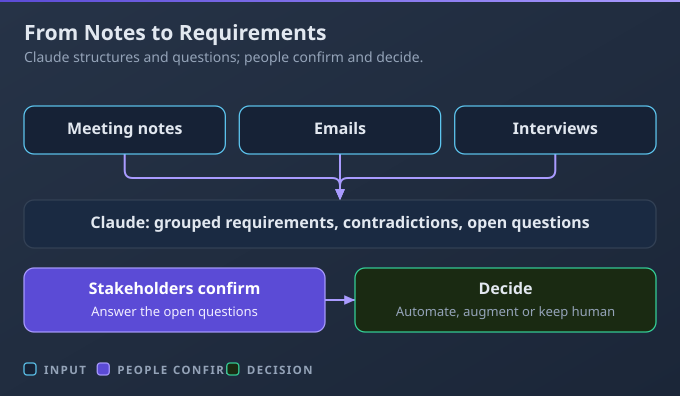
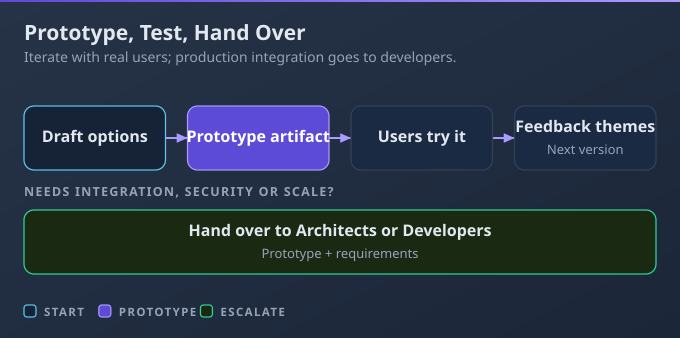
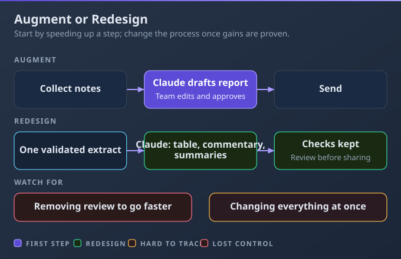
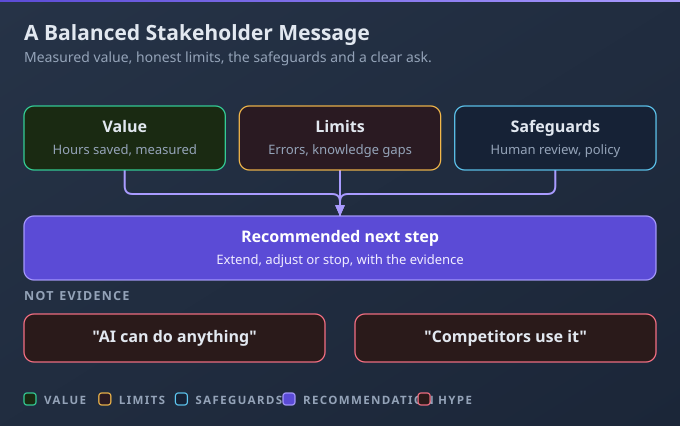

# D4: Workflow Integration and Solution Design

> **Exam weight**: 16% · **Questions**: 29 in the bank

## Overview

This domain moves from single tasks to ways of working: turning messy input into requirements, researching and planning, mapping processes, prototyping, fitting Claude into a team's real workflow, and explaining honestly what it adds. It also covers knowing when work goes to Claude Architects or Developers. It exercises two AI Fluency competencies: **Delegation** (deciding what work to give AI and how) and **Diligence** (taking responsibility for how it's used, which includes being honest about it).

> 💡 **Human Angle**: The best Claude workflows rarely start as a big redesign. They start with one annoying step that someone stopped doing by hand.

---

## 4.1 Apply Claude to analyze requirements and use cases

### Key Concept

**Let Claude turn messy input into requirements and questions; people confirm them and decide what AI does.**

Requirements arrive as notes, emails and interviews. Claude can group the needs, flag contradictions and list open questions, but it knows only what you gave it. Delegation then decides what to automate, what to augment and what stays human.

**Think of a sharp analyst after a day of workshops**: tidy needs, plus the questions nobody answered.

### Real use

A business analyst in city parking services turns notes from six resident-permit interviews into grouped requirements, two contradictions about the renewal window and seven open questions. After follow-up calls confirm the answers, reminder drafting is automated with checks; exemption decisions stay with staff.

### How it works

A team builds a process from Claude's tidy requirements list unchecked, and finds in week three that two departments meant different approval limits.

- **Extract and group:** needs, constraints and the people affected.
- **Flag, then confirm:** contradictions and open questions go back to the people involved; Claude doesn't pick the right stakeholder or invent missing requirements.
- **Success criteria first:** before changing anything, decide how you'll know it worked, such as fewer repeat tickets or accuracy against policy.
- **Delegate each task:** automate repetitive, low-risk, well-defined steps (with checks), augment judgement-heavy ones, and keep accountable or high-risk decisions with people. Good first use cases are frequent, text-heavy, low-risk and reviewed by a person.

### Choose when

| Option | Choose it when | Trade-off |
|---|---|---|
| Claude organises raw input | Lots of unstructured notes | Must confirm with people |
| Automate the step | Repetitive, low-risk, well-defined | Needs checks on the output |
| Augment a person | Judgement matters | The person stays involved |
| Keep it human | Accountable, sensitive or high-risk decisions | No time saved |

### How to do it

1. Ask for requirements, conflicts and open questions.
2. Confirm them with stakeholders.
3. Set success criteria.
4. Mark each task automate, augment or keep human.

### Exam Trap ⚠️

Treating Claude's requirements list as final skips the stakeholders, so the contradictions it flagged as questions become built-in mistakes.

### Go deeper

- [AI Fluency: Framework & Foundations (Anthropic Academy)](https://anthropic.skilljar.com/ai-fluency-framework-foundations)
- [Claude 101 (Anthropic Academy)](https://anthropic.skilljar.com/claude-101)

---

## 4.2 Leverage Claude for research, planning, and process optimization

### Key Concept

**Research gathers sources, planning orders the steps, and optimisation finds the steps worth changing.**

These are three different jobs, each with its own input and its own check. Naming the one you need stops you getting a plan when you wanted facts.

**Think of a researcher, a project planner and a process consultant at one desk.**

### Real use

A veterinary group's practice lead uses Research on how other practices run out-of-hours triage, then gets a phased rollout plan with owners and risks. Mapping the real appointment-reminder process shows the same client details typed into three systems.

### How it works

A process "optimised" from a manager's memory fixes steps nobody actually does, while the real bottleneck stays: the same details retyped into three systems.

- **Research:** runs several searches that build on each other (paid plans, web search on), including connected tools on web and Desktop. Open the sources your key facts rest on; confirm prices and availability with the supplier.
- **Planning:** give the goal, deadline, team, budget and dependencies; get back steps, owners, dependencies and risks. The people doing the work test it; Claude commits nobody to dates.
- **Optimisation:** describe each real step, its time and where it hurts; ask for bottlenecks, duplication and steps to combine. The team tests the redesign; Claude doesn't approve it.
- **Tips aren't analysis:** "be more productive" maps nothing.

### Choose when

| Option | Choose it when | Trade-off |
|---|---|---|
| Research | Many sources, current facts | Slower; open the sources |
| Planning prompt | Turning a goal into steps | Only as good as the constraints you give |
| Process mapping | A process feels slow or repetitive | Needs an honest map of how it really runs |

### How to do it

1. Name the job: facts, a plan or a better process.
2. Give the matching inputs.
3. Verify the sources; test the plan with the people involved.

### Exam Trap ⚠️

Optimising a process described from memory, rather than as it really runs, fixes the wrong steps and leaves the real bottleneck.

### Go deeper

- [Use research on Claude](https://support.claude.com/en/articles/11088861-use-research-on-claude)
- [Enable and use web search](https://support.claude.com/en/articles/10684626-enable-and-use-web-search)

---

## 4.3 Use Claude to support solution design, development, and iteration

### Key Concept

**Prototype early as an artifact, improve it with real users, and hand production work to developers.**

Claude can compare approaches and build a working prototype people can try, with no coding. Real feedback shapes the next version, and anything that must run on company systems belongs to Claude Architects and Developers.

**Think of a cardboard model before the building**: cheap to change, and it shows what people need.

### Real use

A fleet coordinator at a construction-equipment hire firm prototypes a handover checklist as an artifact. Six drivers try it, and their feedback adds a photo step and damage codes. Linking it to the booking system goes to the developers.

### How it works

A prototype that worked for five testers goes company-wide as if finished, and breaks the first time it needs real staff data and company logins.

- **Options first:** two or three approaches with their trade-offs.
- **Prototype before spending money:** an artifact lets people try the idea before budget is committed; it needs Code execution and file creation turned on (see 2.6).
- **Iterate on themes:** group feedback into themes, fix the main ones and retest; don't make every requested change or drop the negative feedback.
- **Hand over:** when it must connect to company systems (an integration, so data moves automatically), use company logins, hold real staff data or serve many users, pass the prototype and requirements to Claude Architects or Developers.

### Choose when

| Option | Choose it when | Trade-off |
|---|---|---|
| Option comparison | You're unsure which approach fits | You still have to choose |
| Artifact prototype | People need to try it before money is spent | Not a production system |
| Hand over to Architects or Developers | It needs company systems, company logins or real data at scale | Longer lead time |

### How to do it

1. Ask for a few approaches and pick one.
2. Build a prototype artifact for real users to try.
3. Group the feedback, fix the main themes, retest.
4. Hand over when production needs appear.

### Exam Trap ⚠️

Extending a prototype artifact until it "connects" to the HR system puts staff data in a tool nobody has secured or supports.

### Go deeper

- [What are artifacts and how do I use them?](https://support.claude.com/en/articles/17153992-what-are-artifacts-and-how-do-i-use-them)

---

## 4.4 Integrate Claude into existing workflows to augment or redesign them

### Key Concept

**Augment one step of today's workflow first; redesign the process once results prove where Claude helps.**

Augmenting speeds up a step people already do and keeps its controls. Redesigning changes the process itself, which pays off when steps exist only because of old manual limits. Measuring tells you when to move from one to the other.

**Think of adding a dishwasher before redesigning the kitchen.**

### Real use

A trade magazine's editorial team starts by augmenting: Claude drafts standfirsts (the short summary under a headline) and social posts from each approved article, and editors edit and approve them. After two measured months, they redesign commissioning so one brief feeds the article plan, social plan and newsletter slot, keeping the editor's sign-off.

### How it works

A department rebuilds its reporting process around Claude in week one, drops the review step to save time, and can't tell which change caused the first wrong figures.

- **Pick one step:** frequent, time-consuming and easy to check; don't change every workflow at once.
- **Augment:** Claude drafts; people edit and approve.
- **Measure and document:** record time, quality and rework before and after, and write down the new steps so everyone works the same way.
- **Redesign on evidence:** target steps that exist only because of manual limits, such as copying details into several forms, and keep the checks that matter. Connectors and shared Projects bring in the team's real material (see 5.2).

### Choose when

| Option | Choose it when | Trade-off |
|---|---|---|
| Augment a step | Starting out, or the process works well | Smaller gains |
| Redesign the process | Augmenting proved its value and steps exist only because of manual limits | Change for the whole team |
| Leave the step as it is | It needs human judgement or is too rare to matter | No time saved |

### How to do it

1. Map today's workflow and pick one step.
2. Run it with Claude for a few weeks and measure it.
3. Document the new steps.
4. Redesign only on evidence, keeping the checks.

### Exam Trap ⚠️

Removing the human review step to speed up a redesigned process trades a time saving for errors nobody catches.

### Go deeper

- [Claude 101 (Anthropic Academy)](https://anthropic.skilljar.com/claude-101)
- [AI Fluency: Framework & Foundations (Anthropic Academy)](https://anthropic.skilljar.com/ai-fluency-framework-foundations)

---

## 4.5 Communicate Claude's value and limitations to stakeholders

### Key Concept

**Show measured results on real work, and say plainly what Claude can't do and who checks it.**

Stakeholders trust evidence, not enthusiasm, and value is a before-and-after measure on the same tasks. Limits belong in the same conversation: Claude can be confidently wrong, knows only what it's given or can reach, and needs review for high-stakes output. Being honest about this is Diligence: taking responsibility for how AI is used.

**Think of a good pilot programme report**: what worked, what didn't, and what happens next.

### Real use

An IT service-desk manager at a hotel group presents an eight-week pilot of Claude-drafted knowledge articles. Drafting time fell from 3 hours to 1, three errors were caught in review, editors still check everything, and Claude can't see the ticket system. She recommends extending the pilot to the guest Wi-Fi FAQs.

### How it works

A pilot is sold to leadership as "removing the need for review", and the first error that reaches a client ends the programme.

- **Baseline, then measure:** the same tasks before and after, shown with real examples, including corrected ones.
- **Limits:** confident errors, and knowing only what it's given or can reach through Projects and connectors. It doesn't automatically know last week's decisions or read everyone's email.
- **Safeguards:** who reviews what, and which data rules were followed.
- **The ask:** a clear recommendation to extend, adjust or stop. Competitors' use and future possibilities aren't evidence.

### Choose when

| Option | Choose it when | Trade-off |
|---|---|---|
| Metrics plus examples | Asking for adoption or budget | Needs a baseline captured first |
| Live demo on real work | Stakeholders are sceptical | Can go wrong live; rehearse it |
| Written limits and safeguards | Others will rely on the output | Less exciting, more trusted |

### How to do it

1. Capture a baseline before Claude joins the work.
2. Report the measured results with real examples, including fixes.
3. State the limits and safeguards, then recommend a next step.

### Exam Trap ⚠️

Promising that Claude "is always accurate" damages trust the first time it's wrong.

### Go deeper

- [AI Capabilities and Limitations (Anthropic Academy)](https://anthropic.skilljar.com/ai-capabilities-and-limitations)
- [AI Fluency: Framework & Foundations (Anthropic Academy)](https://anthropic.skilljar.com/ai-fluency-framework-foundations)

---

## Deep Dive: Making Workflow Integration Click

### 1. The connective narrative

This domain runs on two AI Fluency competencies. **Delegation** is deciding what work to give AI and how: 4.1 sorts out what's worth handing over, 4.2 shapes the approach, 4.3 tests it cheaply as a prototype, and 4.4 brings it into real work one step at a time.

**Diligence** is taking responsibility for how AI is used. Lesson 4.5 is Diligence in public: honest results, honest limits, and a clear line where Claude Architects and Developers take over. The thread through all five lessons is evidence: confirm before you build, measure before you redesign, and report what you measured.

### 2. Worked scenario

> **Scenario.** A primary-school business manager spends 6 hours a week on trip letters and payments.
>
> 1. **Where to start.** She weighed redesigning all parent communications against changing one step. She chose one step, chasing unreturned consent forms, because it was frequent, low-risk and easy to check. Claude drafts the reminders; she approves them.
> 2. **Evidence.** She measured four weeks before and four after. Her time fell from 6 hours to 2, and her review caught one wrong date.
> 3. **Redesign.** The same pupil details were typed into three forms. She could have had Claude fill each form, but the retyping existed only because of manual limits, so one checked list now feeds all three, and the office manager's check stays.
> 4. **Hand-over.** Linking the list to the school's payment system is an integration, so rather than build it herself she sent it to the academy trust's developers with the requirements written up. She then presented the results and limits to governors.

### 3. Memory aid

Before each step, ask three questions: Is it confirmed by the people involved? Is it measured? Who owns the next step: me, or the developers?

### 4. Exam strategy for this domain

- Wrong answers jump too far: automate everything, redesign on day one, remove review, promise no errors, or build integrations yourself.
- Right answers start small, measure, keep people accountable and hand technical work to Architects or Developers.
- The sentence to carry in: "Small, measured, and handed over when it gets technical."

---

## Cheat Sheet 📋

| Situation | What to do |
|---|---|
| Messy interview notes | Ask for requirements, conflicts and open questions; confirm them with people |
| Deciding what to hand to Claude | Automate repetitive work, augment judgement, keep accountable decisions human |
| Before starting anything | Define success criteria |
| Current facts across many sources | Research, then open the sources your facts rest on |
| A process feels slow | Map the real steps; find bottlenecks and duplication |
| People need to try an idea | Build an artifact prototype |
| Needs system integration, company logins or staff data | Hand over to Architects or Developers |
| First rollout | Augment one step and measure it |
| Pitching to leadership | Measured results, honest limits and a clear ask |
