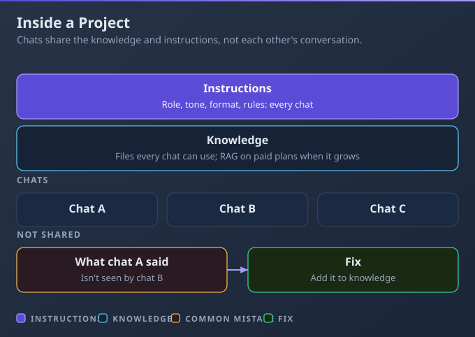
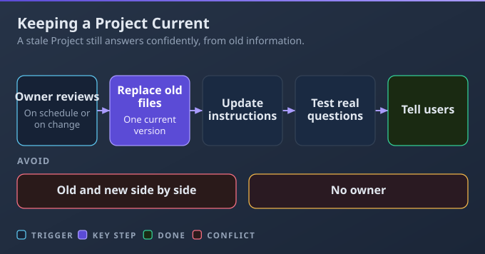

# D5: Configuration and Knowledge Management

> **Exam weight**: 12% · **Questions**: 22 in the bank

## Overview

This domain covers setting Claude up so good results repeat: Projects with instructions and knowledge, uploads versus live connectors, standing instructions and skills at the right level, and keeping all of it current. It exercises the AI Fluency competency of **Description** (telling Claude clearly what you need), written down once so every chat starts from it.

> 💡 **Human Angle**: A well-set-up Project means nobody has to re-explain the brand voice, re-upload the price list or remember the house style ever again, until someone forgets to update it.

---

## 5.1 Configure Claude Projects with instructions and knowledge sources

### Key Concept

**A Project bundles instructions and knowledge so every chat inside it starts from the same context.**

Instructions set how Claude behaves in the Project; knowledge is the files every chat can use. Chats inside a Project don't share each other's conversations unless the information is added to knowledge. **Think of it as a team binder**: the rules on page one and the reference material behind them.

### Real use

A theatre's front-of-house manager builds a "Box office help" Project. Its instructions set role and tone, tell Claude to quote the policy, and say "refer to duty manager" when it doesn't cover a case; knowledge holds the ticket terms, accessibility guide and seating notes. She shares it "Can view" with twelve staff, who now all answer from the same rules.

### How it works

An agent agrees a refund exception in one chat; next morning a colleague's chat in the same Project knows nothing about it.

- **Instructions hold the rules:** role, tone, format, and what to do when the knowledge doesn't cover a case. Claude can't see the Project's name or description, so anything it needs goes here or in the files. This beats pasting the policy into every chat or each person's account instructions.
- **Knowledge holds the reference documents:** one current, clearly named version of each authoritative file; don't paste a 40-page guide into the instructions. On paid plans, as knowledge nears the limit of what Claude can read at once, it switches to searching the files for the relevant parts (retrieval, or RAG), holding up to about 10 times more.
- **Chats share knowledge and instructions, not conversations:** to carry a decision across, add it to knowledge; each Project also has its own memory.
- **Sharing (Team and Enterprise):** "Can view" lets people use and see it but not change it; "Can edit" lets them change instructions and files and manage members.

### Choose when

| Option | Choose it when | Trade-off |
|---|---|---|
| Project | The same rules and files serve many chats or people | Must be maintained |
| Plain chat with an upload | One-off use of a file | Repeat the upload next time |
| Share "Can view" | Colleagues should use it but not change it | They can't fix errors they spot |
| Share "Can edit" | Co-owners maintain it with you | Any editor can change instructions or files |

### How to do it

1. Create the Project and write its instructions.
2. Add one current version of each file, named clearly.
3. Share it at the right level.
4. Test it with a few real questions.

### Exam Trap ⚠️

Assuming what was agreed in one chat is available in the Project's other chats leaves colleagues working from old information; shared context comes only from knowledge and instructions.

### Go deeper

- [How can I create and manage projects?](https://support.claude.com/en/articles/9519177-how-can-i-create-and-manage-projects)
- [Retrieval augmented generation (RAG) for projects](https://support.claude.com/en/articles/11473015-retrieval-augmented-generation-rag-for-projects)

---

## 5.2 Manage uploaded knowledge and connectors (e.g., Google Drive, Gmail)

### Key Concept

**Upload what rarely changes; connect what keeps changing.**

An upload is a fixed copy of a file. A connector reaches live information in Gmail, Calendar, Drive and other tools, but only what the connected account can already open. **Think of a printed handbook versus a live dashboard**: one is fixed and dependable, the other is always current.

### Real use

A lettings agency's property manager uploads the tenancy guide and deposit rules, and connects Google Calendar for viewings and Gmail for enquiries. Claude drafts tenant replies and asks before sending. When the deposit rules change, she removes the old upload before adding the new one.

### How it works

A file uploaded on Monday is already wrong by Wednesday if the source changes, and Claude will quote it with full confidence.

- **Managing uploads:** to update a file, remove the old upload, then add the new one; two versions mean two sources (see 5.4). Name files clearly; each can be up to 30 MB.
- **Live documents:** a Google Doc added from Drive keeps syncing to the latest version, but only in private Projects. In a shared Project, use the Drive connector in the chat, or re-upload when the file changes.
- **Scope and approvals:** Claude inherits your permissions, so it can't reach a colleague's mailbox or a file you can't open, even by its exact title. By default it asks before sending, replying to or forwarding email, and before sharing, moving or deleting Drive files. On Team and Enterprise, owners decide whether members can skip those prompts; Research uses connector tools without asking each time.
- **Retention:** data a connector retrieves is stored with its chat, so deleting the chat deletes it. Anthropic doesn't train on Gmail, Drive or Calendar connector data.

### Choose when

| Option | Choose it when | Trade-off |
|---|---|---|
| Upload to Project knowledge | Stable reference: policies, templates, guides | Goes stale unless you replace it |
| Add a Google Doc from Drive | A private Project needs a document that keeps changing | Private Projects only |
| Connector in the chat | Information changes daily: inbox, calendar, live sheets | Needs access and approvals |
| Both | Fixed rules plus live data | Two things to manage |

### How to do it

1. Upload the stable files.
2. Connect the live tools the task needs.
3. Review each action Claude proposes before approving it.
4. When a source changes, remove the old upload first.

### Exam Trap ⚠️

Re-uploading this week's inbox export every Monday leaves Claude answering from a copy that's out of date by Tuesday, when a connector would read the live inbox.

### Go deeper

- [Use Google Workspace connectors](https://support.claude.com/en/articles/10166901-use-google-workspace-connectors)
- [Upload files to Claude](https://support.claude.com/en/articles/8241126-upload-files-to-claude)

---

## 5.3 Create effective system-level instructions

### Key Concept

**Write each standing rule once, at the level where it applies, so it never leaks into unrelated work.**

Standing instructions set the rules once, so you stop repeating them in every prompt. Good ones are specific and positive, show a short example and say what to do when information is missing. A rule at the wrong level leaks into unrelated work or clashes with another. **Think of a job description, a project brief and a checklist**: general, specific and on demand.

### Real use

A printer manufacturer's technical writer sets account instructions for British spelling and answer-first replies. Her Project for one product line adds naming rules, the warning format and "if a spec is missing, list it under Open questions". A team skill applies the manual layout whenever she asks for a chapter, in any chat.

### How it works

A rule written for one client ("put their product names in capitals") sits in account instructions, so it leaks into every other client's documents.

- **Account instructions** (Settings > Your Claude > Instructions): preferences for every chat, such as spelling, answer-first or your role. They always apply.
- **Project instructions:** rules for one body of work, such as audience, template, terminology and escalation. The Project's knowledge holds the background documents.
- **Skills:** a saved procedure or format that Claude loads only when a task calls for it, in any chat, such as a manual layout or a report format. Skills need Code execution and file creation turned on. Add them in Customize > Skills (simple ones are written instructions, no code needed), or your organisation may provide them.
- **Write well, avoid clashes:** name the audience, the structure and what to do when unsure ("If a requirement is unclear, list it under 'Questions for the client'"). When two levels conflict, make the broader rule conditional or remove it; repeating a rule three times doesn't make it win.

### Choose when

| Option | Choose it when | Trade-off |
|---|---|---|
| Account instructions | A preference for everything you do | Applies even where it doesn't fit |
| Project instructions | Rules for one body of work | Only in that Project |
| Skill | A repeatable procedure or format you need sometimes, in any chat | Someone must build and maintain it; needs code execution |

### How to do it

1. Decide the scope.
2. Write specific, positive rules with a short example and a fallback.
3. Check the levels don't contradict each other.
4. Test with real prompts.

### Exam Trap ⚠️

Vague rules like "be professional" or "never make mistakes" change almost nothing, because they give Claude nothing specific to do.

### Go deeper

- [Understanding Claude's personalization features](https://support.claude.com/en/articles/10185728-understanding-claude-s-personalization-features)
- [Use skills in Claude](https://support.claude.com/en/articles/12512180-use-skills-in-claude)

---

## 5.4 Inform, maintain, and update Claude configurations, knowledge sources, and instructions

### Key Concept

**Give every shared Project an owner and a review date, and keep one current version of each file.**

Configurations go stale quietly: a procedure changes and the Project keeps answering from the old one. Two versions of the same file are two conflicting sources, and Claude may quote either. **Think of a shared spreadsheet with an owner**: someone checks it is right before month-end.

### Real use

A credit union's compliance coordinator owns the shared "Member complaints" Project. At the quarterly review she replaces the superseded complaints procedure, adds a dated change line to the instructions, tests five standard questions and posts a note to the team. Before moving role, she hands ownership to a colleague.

### How it works

A stale Project still answers confidently from last year's procedure, and nobody notices because nothing looks broken.

- **Owner and schedule:** one accountable owner, a regular review, and an extra review whenever a source changes.
- **One version:** remove the superseded file rather than keeping "v1" and "FINAL". Telling users to ignore the old file doesn't work, because Claude can still read it.
- **Record, test, tell:** add a dated change line to the instructions ("Complaints procedure updated 1 October"), test a few standard questions after each change, and tell users what changed instead of waiting for complaints.
- **Hand over or archive:** hand ownership over before you move role. Archiving keeps the Project's members, sharing and knowledge, so remove anyone's access separately in the sharing settings.

### Choose when

| Option | Choose it when | Trade-off |
|---|---|---|
| Scheduled review | A team relies on a shared Project | Recurring time |
| Update when a source changes | Policies, prices or procedures change | Someone must notice the change |
| Hand over ownership | The owner changes role or leaves | The new owner needs a walkthrough |
| Archive the Project | The work has ended but its chats may be needed | Members keep access until removed |

### How to do it

1. Assign an owner and a review date.
2. Replace the outdated files and update the instructions.
3. Test the standard questions.
4. Tell users what changed.

### Exam Trap ⚠️

Adding the new policy alongside the old one "so nothing is lost" gives Claude two conflicting sources, and it may quote either.

### Go deeper

- [How can I create and manage projects?](https://support.claude.com/en/articles/9519177-how-can-i-create-and-manage-projects)
- [Retrieval augmented generation (RAG) for projects](https://support.claude.com/en/articles/11473015-retrieval-augmented-generation-rag-for-projects)

---

## Deep Dive: Making Configuration and Knowledge Click

### 1. The connective narrative

In D1 you practise Description, telling Claude clearly what you need, one prompt at a time. This domain makes that description permanent: you write it down once and every chat starts from it.

Each piece of setup holds one part of the description. Instructions say how to behave, knowledge says what's true, a skill says how to do a recurring procedure, and a connector says where the live facts are. Put each part in the right place and nobody has to repeat it.

Maintenance keeps the description true. A stale setup fails silently, because Claude still answers confidently from whatever it was given.

### 2. Worked scenario

> **Scenario.** An airport passenger-services team of 18 agents builds a shared "Special assistance" Project.

1. **Where does the 24-page assistance policy go?** The options were pasting it into the instructions or uploading it to knowledge. Reference documents belong in knowledge and rules in instructions, so the policy is uploaded and the instructions say "quote the section; escalate anything about an individual passenger to the duty manager". Agents now get answers that cite a section they can check.
2. **Upload or connect the shift roster?** It changes daily, so an upload would be wrong by the next shift. The Project is shared, so a live Drive file can't sit in its knowledge; agents use the Drive connector in the chat and always see today's roster.
3. **Where does the incident write-up format live?** Account instructions were considered, but they would apply to everything each agent writes. A team skill applies the standard layout only when someone asks for a write-up, in any chat.
4. **What happens when the policy is revised?** The owner removes the old file rather than keeping both, adds the new one, adds a dated change line, tests five standard questions and posts to the team channel. All five answers quote the new wording.

### 3. Memory aid

Ask three questions of every piece of setup: "Where does it live?", "Who owns it?" and "When is it next checked?"

### 4. Exam strategy for this domain

- Wrong options treat chats as shared memory, keep old and new versions side by side, put rules at the wrong level, or re-upload live data.
- Right options use knowledge for shared context, connectors for live data, rules at the level where they apply, and a named owner.
- Five minutes before: "If it changes, connect it; if it's shared, own it."

---

## Cheat Sheet 📋

| Situation | What to do |
|---|---|
| Same files and rules for many chats | A Project with instructions and knowledge |
| Chat A's decision missing in chat B | Add it to Project knowledge |
| Very large knowledge on a paid plan | Retrieval switches on automatically and searches the files |
| Colleagues should use it but not change it | Share with "Can view" |
| Information changes daily | Connector (Gmail, Calendar, Drive) |
| Shared Project needs a live Drive file | Use the connector in the chat (Drive add is for private Projects only) |
| Claude is about to send an email | It asks for approval by default |
| Rule for all your chats / one client / an occasional procedure | Account instructions / Project instructions / skill |
| Old and new policy both in knowledge | Remove the old one and add a dated change note |
| Owner moving role | Hand over ownership before leaving |
