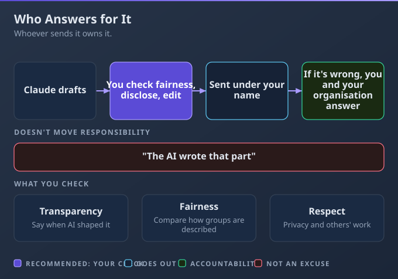

# D6: Governance, Risk, and Responsible Use

> **Exam weight**: 15% · **Questions**: 27 in the bank

## Overview

This domain is about using Claude responsibly at work. It covers which uses are fine, which need a qualified person in the loop and which are off-limits. It also covers handling sensitive and regulated data, following your organisation's policy and admin settings, and the ethics of being open and owning the result. The AI Fluency competency it exercises is **Diligence**, which means taking responsibility for how AI is used.

> 💡 **Human Angle**: Most AI incidents at work aren't dramatic. They're a spreadsheet of customer data pasted into the wrong place, or an AI-drafted decision nobody checked.

---

## 6.1 Identify appropriate and inappropriate use cases

### Key Concept

**Who is affected, and what happens if Claude is wrong, decides whether you go, add a qualified person, or stop.**

Drafting, summarising and research are fine when a person owns the result. Decisions about people need more: the Usage Policy requires a qualified person who can change the recommendation, and the person affected must be told AI was involved. **Think of traffic lights.** Green means go, amber means go with a qualified person in control, and red means stop.

### Real use

A citizens' advice charity's advice team drafts outreach leaflets with Claude (green). For hardship-grant cases, Claude summarises, an adviser decides and the client is told AI helped (amber). A plan to auto-reject applications below a score is stopped.

### How it works

Letting Claude score applications and reject anyone below 60 puts decisions about people's money where no qualified person reviews them.

- **Green:** a person reviews and owns the result, and a mistake would do little harm.
- **Amber:** anything affecting health, legal rights, finances, livelihood, or access to housing, education or essential services. A qualified person (trained or experienced, and licensed where the law requires it) reviews it before anyone acts, can change it and stays responsible, and the person affected is told. Signing without reading isn't meaningful review. Legal advice and medical diagnosis sit here, not in red: they need a qualified review.
- **The exception:** where the law allows, a decision wholly in the person's favour, such as paying an insurance claim, needs no review first. A partial approval or reduced amount does, and disclosure may still apply.
- **Red:** uses the Usage Policy or your organisation prohibits, or that need a certainty nobody qualified can check.

### Choose when

| Option | Choose it when | Trade-off |
|---|---|---|
| Go ahead | Green: low impact, and a person owns the result | Still review before use |
| Qualified person in the loop, plus disclosure | Amber: it affects someone's health, money, rights, livelihood, housing or education | Slower; needs a qualified person |
| Don't use Claude for this step | Red, or certainty is required | Do it another way |

### How to do it

1. Ask who is affected and what happens if it's wrong.
2. Place the use in a zone.
3. For amber, put a qualified person in charge and tell the person affected. The fix isn't a better prompt.

### Exam Trap ⚠️

Trying to fix an automated decision about people with a better prompt misses the point. The requirement is a qualified person who makes the call.

### Go deeper

- [Usage Policy](https://www.anthropic.com/legal/aup)
- [2026 Usage Policy update](https://www.anthropic.com/news/2026-usage-policy-update)

---

## 6.2 Apply data sensitivity, regulatory, and privacy considerations

### Key Concept

**Decide what data may leave your hands before you paste it, not after.**

Once a file is uploaded it has been shared, and no later instruction takes it back. So classify the data, check the rules and plan, then share only what the task needs. **Think of photocopying for an outside meeting.** You black out what the room doesn't need first.

### Real use

A gym chain's marketing analyst wants churn by club from an export holding names, emails, dates of birth and health answers. She keeps only club, month and membership type, drops the health column, and works in the company's Team workspace.

### How it works

Upload the full export and the identities and health answers you didn't need are in a chat; asking Claude to forget them isn't a control.

- **Classify:** personal, sensitive (health, financial), confidential, regulated or public. "It's only internal analysis" isn't an exemption.
- **Know the kind of rule:** personal-data protection laws (for example GDPR in the UK and EU), health-data rules (for example HIPAA in the US), and financial-data and confidentiality rules. Your organisation's policy says what they mean for you; health records need a workspace it has approved.
- **Minimise:** keep only the columns the task needs, and swap names, emails and account numbers for a non-identifying key (a made-up ID that can't be traced back to the person) so records still group.
- **Plans differ:** on Free, Pro, Max and Ultra, training depends on your privacy setting. Team and Enterprise chats aren't used for training by default, but a thumbs up or down sends that chat as feedback. Incognito is never used for training, but it's kept 30 days and appears in Team and Enterprise exports, so it's no way round a policy.

### Choose when

| Option | Choose it when | Trade-off |
|---|---|---|
| Minimise and anonymise first | The task doesn't need identities | A small preparation step |
| Approved workspace only | Policy allows the data only in one plan or workspace | May lack features you have elsewhere |
| Don't upload | Policy forbids it, or identity is essential and not approved | Do the task another way |
| Ask the policy owner | You can't tell which rule applies | A short delay |

### How to do it

1. Identify the kind of data, then check the policy and the plan.
2. Remove or replace identifiers, keeping only what the task needs.
3. Upload only in the approved workspace.

### Exam Trap ⚠️

Pasting the full export and asking Claude to forget it afterwards is too late. The data left your hands at upload.

### Go deeper

- [Is my data used for model training? (consumer plans)](https://privacy.claude.com/en/articles/10023580-is-my-data-used-for-model-training)
- [Is my data used for model training? (Team, Enterprise and API)](https://privacy.claude.com/en/articles/7996868-is-my-data-used-for-model-training)

---

## 6.3 Follow organizational AI policies and governance standards

### Key Concept

**Your organisation's policy decides the tools, data and uses; when it's silent, ask before acting.**

AI policies set which tools and plans are approved, what data may be used, which uses need sign-off and how AI use is disclosed. Following them includes respecting the settings admins chose. **Think of the company expenses policy.** You don't decide alone what's reimbursable.

### Real use

A law-firm paralegal is tempted to use her personal Pro account because the firm hasn't enabled a document connector. Policy keeps client matters in the firm's Enterprise workspace, so she works there, uses "Request" for the connector, and follows the client-disclosure rule.

### How it works

Someone copies client files into a personal account "because it has the feature", and the firm's data is now outside every control it set up.

- **Approved workspace:** company data stays in the company's workspace, not a personal account, even with memory off or a plan to delete the chat. Incognito chats still appear in Team and Enterprise data exports.
- **Admin settings are decisions, not bugs:** Team and Enterprise owners can turn off or restrict code execution, web search, memory, connectors and their actions, Project sharing and skills. On Enterprise, they can also restrict models and effort levels. Browser workarounds and colleagues' accounts are out.
- **Use the proper route:** "Request" on a connector's page sends it to an owner. It's on by default on Team; on Enterprise, only if an owner turns it on.
- **Silence isn't permission:** ask the policy owner, not Claude, which can't tell you what your company allows. "Do it once and decide later" is still acting without approval.

### Choose when

| Option | Choose it when | Trade-off |
|---|---|---|
| Approved workspace and settings | The policy covers the tool and the data | Perhaps fewer features than elsewhere |
| Ask the policy owner | The policy is silent or unclear | A short delay |
| Request a change | A rule or setting blocks legitimate work | Takes time to approve |

### How to do it

1. Check the policy for the tool, data and use.
2. Use the approved workspace.
3. If it's unclear, ask the owner before acting.
4. Request changes through the proper route.

### Exam Trap ⚠️

Treating silence in the policy as permission puts the risk on you, and the policy owner finds out after the fact.

### Go deeper

- [Use connectors to extend Claude's capabilities](https://support.claude.com/en/articles/11176164-use-connectors-to-extend-claude-s-capabilities)
- [Use incognito chats](https://support.claude.com/en/articles/12260368-use-incognito-chats)

---

## 6.4 Understand the ethical implications of AI usage

### Key Concept

**Be open about AI's role, check fairness to the people affected, and own what you send.**

This is Diligence in practice: be transparent where AI materially shaped work others rely on, check outputs about people for fairness, and respect others' privacy and intellectual property. Accountability never moves to the tool. **Think of a ghostwriter's client.** Whoever signs the letter answers for it.

### Real use

A reporter on a local news website drafts a court-story summary with Claude. She follows the newsroom's AI disclosure rule, checks the wording is fair to the people named, and doesn't paste in a rival's paywalled article. When a date turns out wrong, she owns the correction.

### How it works

An AI-drafted line unfair to a named person goes out, and "Claude wrote it" doesn't stop the complaint landing on the reporter and the newsroom.

- **Transparency:** say when AI materially shaped work others rely on, as your context and policy require; for high-risk advice and decisions it's required (see 6.1). Hiding AI's role so people trust the work more is a transparency failure.
- **Accountability:** the person and organisation using the output own it. Not the AI, not Anthropic, not "nobody".
- **Fairness:** compare how outputs describe different groups, such as a neighbourhood or part-time staff. Correct the wording, then check other outputs for the same pattern; a disclaimer fixes nothing.
- **Respect and harm:** don't paste content you have no right to use, or others' data without a reason. Ask who could be hurt if the output is wrong or misused.

### Choose when

| Option | Choose it when | Trade-off |
|---|---|---|
| Disclose AI use | AI materially shaped work others rely on | Some readers may trust it less |
| Extra fairness review | The output describes or judges people | Takes more time |
| Don't use AI for this | Using it would mislead someone, breach their rights or harm them | Do the work yourself |

### How to do it

1. Decide how to disclose AI's role for this audience.
2. Review outputs about people for fairness.
3. Edit, check and stand behind what you send.

### Exam Trap ⚠️

Saying "the AI wrote that part" after an error reaches a client doesn't move responsibility. The sender still answers for it.

### Go deeper

- [AI Fluency: Framework & Foundations](https://anthropic.skilljar.com/ai-fluency-framework-foundations)
- [Usage Policy](https://www.anthropic.com/legal/aup)

---

## Deep Dive: Making Governance and Responsible Use Click

### 1. The connective narrative

This domain is Diligence: taking responsibility for how AI is used. It asks "should we, and how safely?" before it asks "how?". Each lesson answers one part of that question.

Sorting the use (6.1) comes first, because it decides how much human control a task needs. Then comes the data (6.2): what may go in at all, and in what form. Your organisation's policy (6.3) is the local rulebook, with an owner to ask when it's silent. Ethics (6.4) runs through all of it: be open about AI's role, be fair to the people affected, and own what you send.

### 2. Worked scenario

> **Scenario.** A recruitment agency's compliance lead reviews a proposal to use Claude on 340 applications for a client's 12 warehouse-supervisor roles.
>
> 1. **Zone.** *Options:* "Claude ranks them and the top 10 go forward", or "Claude summarises each CV against the client's criteria and a consultant decides". *Why:* shortlisting affects livelihoods, so it's amber, and the first option leaves nobody qualified to change the outcome. *Result:* the second option, and candidates are told AI assisted.
> 2. **Data.** *Options:* upload the CV export as it is, or strip it first. *Why:* the task doesn't need dates of birth or photos. *Result:* those columns are removed, candidates get non-identifying keys, and the work happens in the agency's Enterprise workspace.
> 3. **Policy gap.** *Options:* use the client-supplied assessment scores because the AI policy doesn't forbid them, or ask first. *Why:* silence isn't permission. *Result:* she asks the policy owner before anyone uses them.
> 4. **Fairness.** *Options:* add a disclaimer, or fix the cause. *Why:* a pilot of 60 summaries showed weaker wording for candidates with career breaks, and a disclaimer changes nothing. *Result:* the prompt and the review checklist are changed, and the last 50 summaries are rechecked.

### 3. Memory aid

**ZONE**: **Z**one the use (green, amber, red) · **O**nly approved data and workspace · **N**otify the people affected · **E**thics: own it and check fairness.

### 4. Exam strategy for this domain

- Wrong answers put speed or convenience first: upload as is, use a personal account, let Claude decide, assume silence means yes, or rely on incognito.
- Right answers minimise first, use the approved workspace, keep a qualified person in the loop, disclose, and ask the policy owner.
- Five minutes before: "If a person could be hurt by a wrong answer, a qualified person decides."

---

## Cheat Sheet 📋

| Situation | What to do |
|---|---|
| Automated decision about people | A qualified person with authority to change it, plus disclosure |
| Decision wholly in the person's favour | Review may not be needed first where the law allows; partial approvals still need it |
| Export with identifiers | Keep only the needed columns; use non-identifying keys |
| "Tell Claude not to retain it" | Not a data control; the data was shared at upload |
| Consumer plan (Free, Pro, Max, Ultra) and training | Depends on your privacy setting |
| Team or Enterprise and training | Not by default; thumbs feedback sends the chat |
| Incognito | Not in history or memory; kept 30 days; in organisation exports |
| Personal account has more features | Use the approved workspace and Request the feature |
| Policy doesn't mention the case | Ask the policy owner |
| "The AI is responsible" | No; the sender and organisation are |
