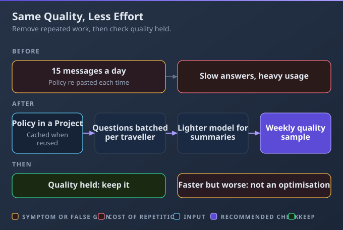

# D7: Troubleshooting and Optimization

> **Exam weight**: 10% · **Questions**: 18 in the bank

## Overview

This domain covers what to do when Claude isn't delivering: working out why a prompt or output falls short, changing the setup based on what the results show, and making workflows lighter without losing quality. It exercises the AI Fluency **Description–Discernment loop**: describe what you need, judge what comes back, then adjust the description.

> 💡 **Human Angle**: The same correction made by hand every week isn't a habit; it's a bug in the setup.

---

## 7.1 Identify, diagnose, and resolve issues with underperforming prompts or poor outputs

### Key Concept

**Diagnose before you fix: trace the symptom to its cause, change one thing, then retest.**

Each symptom has a usual cause. Fixing the wrong layer wastes effort, and a bigger model only repeats a wrong input more fluently. Change one thing at a time, or you won't know what worked.

**Think of a mechanic**: they find the failing part before replacing anything.

### Real use

A hospice fundraising officer's donor thank-you drafts turned generic after she moved from the "Donor care" Project to a plain chat. She traced it to missing context, since Project knowledge only reaches chats inside the Project. She changed one thing, moving back into the Project, and retested on the same donor record: the drafts were personal again.

### How it works

Rewording the question for a week doesn't fix answers drawn from an out-of-date file; a bigger model just repeats the stale figure more fluently.

- **Name the symptom precisely,** with one example output.
- **Check causes in order:** the input (prompt and context: is the chat in the Project that holds it?), the source (missing, stale or duplicate knowledge), the instructions (vague, buried or conflicting across levels), the model and effort, then the chat length. A usage limit, an incognito chat or an artifact doesn't make output generic.
- **Ask Claude which file or passage it used:** quick evidence of a source problem.
- **Change one thing and retest with the same input.** Changing the prompt, model and files at once hides what fixed it, or what broke it.

### Choose when

| Option | Choose it when | Trade-off |
|---|---|---|
| Fix the prompt or context | Output is generic or misses the goal, audience or format | The fix may live in one chat only |
| Fix the source or knowledge | Facts are wrong or out of date | Affects everyone using it; tell them |
| Fix the instructions | A rule is ignored, or applied where it shouldn't be | Check other levels don't conflict |
| Raise effort or step up the model | Reasoning is shallow on a well-briefed task | Slower; uses more of your limit |
| Summarise and restart | Details get mixed up late in a long chat | Detail not in the summary is lost |

### How to do it

1. Describe the symptom with an example.
2. Check the likely causes in order.
3. Change one thing.
4. Retest with the same input.

### Exam Trap ⚠️

Switching to the most capable model when the cause is a stale file gets the same wrong figure, delivered more fluently.

### Go deeper

- [AI Capabilities and Limitations (Anthropic Academy)](https://anthropic.skilljar.com/ai-capabilities-and-limitations)
- [My prompt isn't giving me a helpful answer](https://support.claude.com/en/articles/7996857-my-prompt-isn-t-giving-me-a-helpful-answer)

---

## 7.2 Adjust approach based on feedback and results

### Key Concept

**Fix a problem at the lowest level that stops it recurring; climb only when that level fails.**

Reviewer feedback and results tell you the level: one-offs belong in the chat, recurring issues in the setup, and anything beyond configuration with another team. Sometimes the evidence says Claude shouldn't do that step at all.

**Think of a recipe that keeps coming out salty**: you change the recipe, not each plate.

### Real use

A payroll software company's customer-success lead tracked reviewer edits for two weeks. Typos were fixed in the chat; the recurring "employee → worker" change went into the Project instructions, and those edits stopped. Auto-publishing to the help centre needs an integration (a connection that moves content between systems automatically), so it went to the developers.

### How it works

A team hand-fixes the same table layout every week and calls it "review", and the time Claude saved is quietly spent again.

- **Collect evidence:** what reviewers change, and how often.
- **Climb the ladder:** once, fix it in the chat; recurring, fix the template, instructions or knowledge; a quality ceiling, change the model, effort or feature. Climb only if the lower step doesn't stop it.
- **Escalate what configuration can't do:** integrations and custom tools go to Claude Architects or Developers with clear requirements, not trial and error. Never put passwords in instructions.
- **Stop or narrow:** if results show a step is slower or worse with Claude (a specialist rewrites nearly every draft), remove Claude from it or narrow its role to where it helps. Neither "it'll improve" nor dropping the specialist's review is a plan.

### Choose when

| Option | Choose it when | Trade-off |
|---|---|---|
| Fix it in the chat | It happened once | Doesn't prevent repeats |
| Update the template, instructions or knowledge | The same issue recurs | Affects everyone using the setup |
| Change the model, effort or feature | Quality still falls short after the setup fix | More time and usage |
| Escalate to Architects or Developers | It needs an integration or a custom build | Depends on another team |
| Remove or narrow Claude's role | Results show the step is slower or worse with Claude | You lose the gain in that step |

### How to do it

1. Track what reviewers change.
2. Fix it at the lowest level that stops it.
3. Climb only if that fails.
4. Escalate, or remove Claude, where configuration can't help.

### Exam Trap ⚠️

Building the integration yourself by trial and error, instead of escalating with clear requirements, creates something nobody can support or secure.

### Go deeper

- [AI Fluency: Framework & Foundations (Anthropic Academy)](https://anthropic.skilljar.com/ai-fluency-framework-foundations)
- [Understanding Claude's personalization features](https://support.claude.com/en/articles/10185728-understanding-claude-s-personalization-features)

---

## 7.3 Optimize workflows for efficiency and effectiveness

### Key Concept

**Cut repeated effort without cutting quality: reuse context, batch requests, and right-size the model.**

Efficiency means the same quality for less time and usage; effectiveness means still producing what's needed. Faster but worse isn't an optimisation: it moves the work to whoever fixes the output.

**Think of a well-organised kitchen**: ingredients prepped, tools within reach, nothing done twice.

### Real use

A travel coordinator at an engineering consultancy sent about 15 messages a day about the same travel policy. She moved the policy into a Project, batched each traveller's questions into one message, used a lighter model for itinerary summaries and saved a request template. A weekly quality sample confirms nothing has slipped.

### How it works

Pasting the same brief into every new chat and asking one question per message makes each answer slower to get, and uses far more of the limit than it needs to.

- **Reuse context:** keep reference material in a Project instead of re-uploading it. Project content is cached (stored for quick reuse), so it counts less against usage when reused; the cache expires after a period of inactivity.
- **Batch and plan:** put related questions in one message, complete enough up front to need few follow-ups. A new chat per question, or asking twice "to be sure", wastes usage.
- **Right-size:** a lighter model and lower effort for simple, frequent work (see 3.3); fresh chats from a summary instead of long ones; prompts that work saved as templates.
- **Check effectiveness:** sample quality after every change. Fewer messages alone isn't success.

### Choose when

| Option | Choose it when | Trade-off |
|---|---|---|
| Batch requests | Several related questions about the same thing | One longer reply to review |
| Reuse a Project | The same context across many chats | Needs maintaining |
| Lighter model or lower effort | Simple, frequent tasks | Check quality holds |
| Prompt template | The same request recurs | Update it when needs change |

### How to do it

1. Look for repeated uploads, repeated prompts and many small messages.
2. Move the context into a Project, batch requests and save templates.
3. Right-size the model.
4. Sample quality.

### Exam Trap ⚠️

Calling a change an optimisation because it's faster, while errors rise, just moves the work to whoever fixes the output.

### Go deeper

- [Usage limit best practices](https://support.claude.com/en/articles/9797557-usage-limit-best-practices)
- [Change the model, effort, and thinking settings](https://support.claude.com/en/articles/8664678-change-the-model-effort-and-thinking-settings)

---

## Deep Dive: Making Troubleshooting and Optimization Click

### 1. The connective narrative

The AI Fluency course names four skills: Delegation (deciding what work to give AI and how), Description (telling it clearly what you need), Discernment (judging what comes back) and Diligence (taking responsibility for how it's used). This domain runs on the middle two, in a loop. Diagnosis (7.1) is Discernment applied to a failure: what kind of wrong is this, and where did it come from?

Adjusting (7.2) turns that judgement into a better Description at the right level, or into a decision that Claude shouldn't do the step at all. Optimising (7.3) removes waste once things work, and keeps judging quality so the savings are real. That is how this domain closes the loop on the other six: most fixes point back to an earlier lesson, whether the prompt (D1), the model and effort (D3) or the Project setup (D5).

### 2. Worked scenario

> **Scenario.** A solar-panel installer's operations coordinator uses Claude to draft installation summaries for customers, and they have started going wrong.
>
> **Decision 1: diagnose.** The summaries now leave out the panel count. *Options considered:* a bigger model, a full prompt rewrite, or checking what had changed. *Why this one:* the task hadn't got harder, so something in the input had probably moved. *What happened:* the job-sheet export had gained two new columns, and the prompt's column references were out of date. She corrected the prompt only, retested on last week's three jobs, and the panel count was back in all three.
>
> **Decision 2: adjust.** The installers' manager still rewrites the warranty paragraph every time, because the legal wording varies by product. *Options considered:* more instructions, a different model, or taking Claude out of that paragraph. *Why this one:* the results showed Claude added nothing there. *What happened:* the paragraph now comes from the approved template, and Claude no longer drafts it.
>
> **Decision 3: optimise.** Each job took five separate messages. *Options considered:* leave them, or batch them and right-size. *Why this one:* the questions were related and the task is routine. *What happened:* the five messages became one, and summaries moved to a lighter model after a 20-job sample matched quality. A weekly 10-job sample checks that the change holds.

### 3. Memory aid

**Symptom → cause → one change → retest; fix it at the lowest level that holds.**

### 4. Exam strategy for this domain

- Wrong options treat symptoms: reword the question, upgrade the model, fix each output by hand, change everything at once, or send more small messages.
- Right options find the cause, change one thing, fix the setup at the right level, escalate technical builds and keep checking quality.
- The one sentence to carry in: find the cause before you touch anything.

---

## Cheat Sheet 📋

| Situation | What to do |
|---|---|
| Wrong facts in a Project | Check its knowledge for stale or duplicate files |
| Generic output after moving chats | Check whether the context came with it |
| Several changes made at once | Undo them; change one thing and retest |
| Same edit every week | Fix it at the lowest level that stops it |
| Shallow analysis on a good brief | Raise effort, or step up the model |
| Long chat getting confused | Summarise and restart |
| Needs integration with another system | Escalate to Architects or Developers |
| Specialist rewrites almost every draft | Remove or narrow Claude's role in that step |
| Many small messages | Batch related requests |
| Faster but worse | Not an optimisation |
