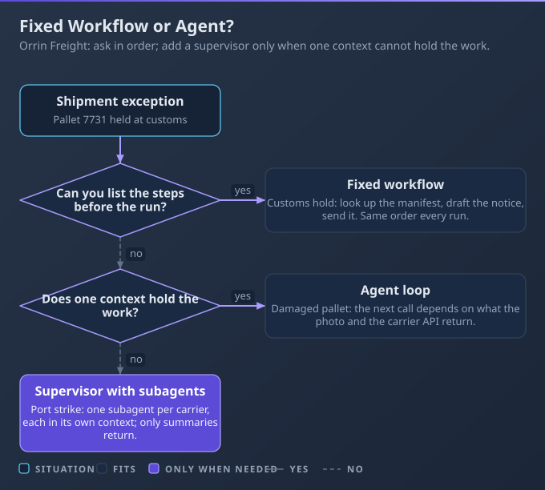
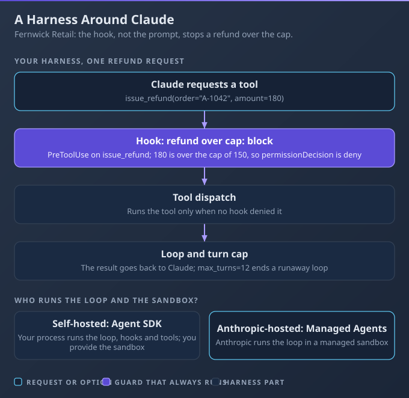
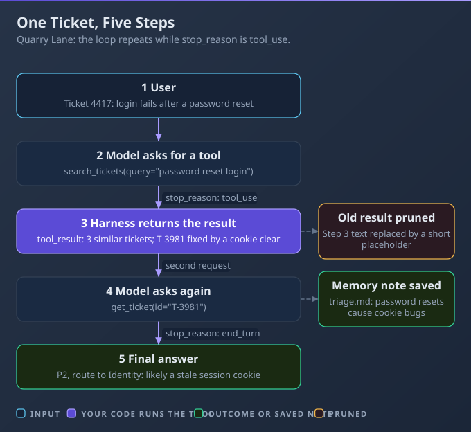

# D1: Agents and Workflows

> **Exam weight**: 14.7% · **Questions**: 36 in the bank

## Overview

This domain is about choosing the least autonomy that works and then building it with control. You decide whether a job needs a fixed workflow, one agent or a supervisor with subagents, you put limits and rules around the loop, and you adopt a framework only when it earns its place.

> 💡 **Human Angle**: An agent is a workflow that was allowed to improvise. Allow it only where the job needs improvising.

---

## 1.1 Agent Architecture

### Key Concept

**Choose a workflow when steps are known in advance and an agent when the path depends on results.**

A workflow runs predefined code paths around model calls. An agent lets the model choose the next step from what its tools return. That freedom costs tokens and lets errors compound, so add it only when needed.

**Think of a recipe versus a chef**: a recipe is right until the ingredients vary.



### Real use

An operations engineer at Orrin Freight handles shipment exceptions: damage, delay and customs holds. Each needs the same three steps: classify, apply policy, draft the notice with an audit entry. She builds a fixed workflow, so the audit entry is written every time.

### How it works

An open-ended agent given that fixed three-step job loops on extra lookups, burns tokens and sometimes skips the audit step.

- **Four criteria:** how predictable the steps are, what a wrong step costs, your latency and cost budget, and how much flexibility the job needs.
- **Start simple:** try a single call, then a chain, route or parallel split in ordinary code. Move to an agent loop only when the path depends on results.
- **Supervisor and subagents:** a supervisor delegates to subagents (helper agents it starts, see 1.3). They give context isolation, parallel independent work and specialised instructions or tools, and each returns a summary.
- **A hierarchy has a price:** Anthropic's multi-agent research system used about 15 times the tokens of a chat, against about 4 for a single agent. Each hand-off is another place to fail.

### Choose when

| Option | Choose it when | Trade-off |
|---|---|---|
| Single call | One task fits one prompt | No recovery from a bad answer |
| Fixed workflow (chain, route, parallel) | Steps are known, mistakes costly | Rigid on unexpected cases |
| Single agent loop | Path depends on tool results | Higher cost, errors compound |
| Supervisor with subagents | Work is broad and exceeds one context | Most tokens, most failure points |

### How to do it

1. List the steps; if you can, write them as code.
2. Use a small, fast model to classify.
3. Keep must-run steps, such as the audit entry, in code.
4. Promote a step to an agent only after the workflow fails on real cases.

```python
import anthropic
client = anthropic.Anthropic()  # reads ANTHROPIC_API_KEY from the environment

def ask(model, prompt):
    msg = client.messages.create(model=model, max_tokens=400,
                                 messages=[{"role": "user", "content": prompt}])
    return msg.content[0].text

def handle(report):
    kind = ask("claude-haiku-5-5", f"One word: damage, delay or customs?\n{report}").strip().lower()
    policy = {"damage": "claims", "delay": "rebooking", "customs": "broker"}.get(kind, "manual")
    return ask("claude-sonnet-5-5", f"Draft a customer notice using the {policy} policy.\n{report}")
```

### Exam Trap ⚠️

<div class="note-trap">Building a multi-agent hierarchy for a job a fixed chain already handles adds token cost and coordination failure points without adding capability.</div>

### Go deeper

- [Building effective agents](https://www.anthropic.com/engineering/building-effective-agents)
- [How we built our multi-agent research system](https://www.anthropic.com/engineering/multi-agent-research-system)

---

## 1.2 Agent Construction with Claude

### Key Concept

**Pick the Agent SDK, a custom loop or a hosted deployment by who must control the loop and runtime.**

The Claude Agent SDK gives you Claude Code's tools, loop and context management as a library. A custom loop gives total control for more effort. A hosted agent hands the loop to Anthropic. Always limit the loop.

**Think of renting, leasing or buying a delivery van**: you trade control against upkeep.



### Real use

A platform engineer at Fernwick Retail builds a returns agent that looks up orders and issues refunds. She uses the Agent SDK, caps the turns, and enforces the refund limit in a hook rather than the prompt.

### How it works

A hand-written loop with no turn cap keeps calling tools after the model is stuck, and runs hundreds of calls overnight.

- **SDK versus custom:** the Agent SDK embeds Claude Code's agent in your process, with built-in tools and sessions. A custom loop on the Messages API means you write all that, for fine-grained control.
- **Loop controls:** set a maximum number of turns, a spend budget and a stop condition. In the SDK, hitting the turn cap ends the run with an error result and no final answer, so handle it.
- **Who runs it:** self-hosted, you own the loop, sandbox, state and uptime. Claude Managed Agents (beta) is a harness Anthropic runs, with sessions stored server-side; check its data terms for regulated data.
- **Hooks:** a hook is code the harness runs at a lifecycle point, such as before a tool call (see 7.3). A rule that must always hold, like a refund cap, belongs in a hook.

### Choose when

| Option | Choose it when | Trade-off |
|---|---|---|
| Agent SDK | You want Claude Code's loop in your app | Less control of loop internals |
| Custom loop | You need control of every step | You write limits and retries |
| Anthropic-hosted | Long or async work, no harness to run | Beta; you give up runtime control |
| Self-hosted | You must control where the loop runs | You operate and monitor it |

### How to do it

1. Choose the loop owner.
2. Set a turn cap and budget before the first run.
3. Write each must-hold rule as a PreToolUse hook that denies.
4. Test that the hook blocks, then test the cap.

```python
from claude_agent_sdk import HookMatcher

async def cap_refund(input_data, tool_use_id, context):
    if input_data["tool_input"].get("amount", 0) > 100:
        return {"hookSpecificOutput": {
            "hookEventName": "PreToolUse",
            "permissionDecision": "deny",
            "permissionDecisionReason": "Refunds over 100 need a human."}}
    return {}

hooks = {  # pass as hooks=... in the SDK options, with max_turns=20
   "PreToolUse": [HookMatcher(matcher="mcp__returns__issue_refund", hooks=[cap_refund])]}
```

### Exam Trap ⚠️

<div class="note-trap">Writing a hard business rule only in the system prompt and assuming it always holds leaves the rule to the model's judgement, so one bad turn can break it.</div>

### Go deeper

- [Agent SDK overview](https://code.claude.com/docs/en/agent-sdk/overview)
- [SDK hooks](https://code.claude.com/docs/en/agent-sdk/hooks)

---

## 1.3 Agent Patterns and Frameworks

### Key Concept

**Build the tool-use loop first; adopt a framework only when it removes work you would otherwise write.**

Every agent framework wraps the same loop: send, run tools, return results, repeat. Frameworks add structure but also indirection and dependencies. Anthropic advises starting with direct API calls and understanding any framework's code.

**Think of learning to drive a manual before using cruise control.**



### Real use

A developer at Quarry Lane Software builds a ticket-triage assistant with two tools: search past tickets and read the customer record. She writes the loop by hand, keeps a running note, and prunes old search results as the conversation grows.

### How it works

A team adopts a graph framework for a two-tool agent, and when a step runs twice nobody can explain why.

- **Loop anatomy:** send messages and tools; the model requests a tool (stop reason `tool_use`); your harness runs it; you return a `tool_result` carrying the request id; repeat until the model answers without a request.
- **Memory kinds:** in-context history, an external store or files for notes that survive a reset, and summaries of older turns. Context-window management adds clearing stale tool results (see 6.1).
- **Subagent pattern:** hand a self-contained subtask to a fresh context and take back a summary (see 1.1).
- **Frameworks:** Strands, LangGraph and PydanticAI abstract the same loop. They add state graphs, typed outputs and tracing, and cost indirection and dependency churn.

### Choose when

| Option | Choose it when | Trade-off |
|---|---|---|
| Raw loop | A few tools; you must see each step | You write limits and tracing |
| Agent SDK | You want a maintained loop and tools | Less control of internals |
| Graph-style framework | Long, stateful flows with branches | Extra concepts, harder debugging |
| Typed-output framework | Validated typed results matter most | Another dependency to maintain |

### How to do it

1. Write the loop with a turn cap first.
2. Log every tool request and result.
3. Store durable notes outside the message list.
4. Adopt a framework only if you can name the code it deletes.

```python
import anthropic
client = anthropic.Anthropic()

def run(messages, tools, run_tool):
    for _ in range(8):  # turn cap
        resp = client.messages.create(model="claude-sonnet-5-5", max_tokens=1024,
                                      tools=tools, messages=messages)
        messages.append({"role": "assistant", "content": resp.content})
        if resp.stop_reason != "tool_use":
            return resp
        results = [{"type": "tool_result", "tool_use_id": b.id, "content": run_tool(b.name, b.input)}
                   for b in resp.content if b.type == "tool_use"]
        messages.append({"role": "user", "content": results})
    raise RuntimeError("turn cap")
```

### Exam Trap ⚠️

<div class="note-trap">Using a framework to avoid understanding the loop leaves you unable to debug it when a step misbehaves, because you cannot tell the framework's behaviour from the model's.</div>

### Go deeper

- [How the agent loop works](https://code.claude.com/docs/en/agent-sdk/agent-loop)
- [Effective context engineering for AI agents](https://www.anthropic.com/engineering/effective-context-engineering-for-ai-agents)

---

## Deep Dive: Making Agents and Workflows Click

### 1. The connective narrative

The spine of this domain is least autonomy. Lesson 1.1 starts you at a fixed workflow and gives four criteria for moving up to a single agent, and then to a supervisor with subagents. Each step up buys flexibility and costs tokens, latency and predictability.

Lesson 1.2 is how you keep that autonomy safe. You choose who owns the loop, cap its turns and budget, and put must-hold rules in hooks. Lesson 1.3 is how you keep it understandable: write the loop first, and let a framework in only when it removes real work.

### 2. Worked scenario

> **Scenario.** Pelham Bookings reschedules about 6,000 appointments a week with a three-step chain: read the request, find slots, confirm. About 1 in 5 requests fall out, such as "move both of us to the same day" or "anything after my other booking".
>
> 1. **Workflow or agent?** The team weighed widening the chain with more branches against giving the model a slot-search tool and a calendar tool. They chose an agent, because the failing requests depended on what the calendar returned. Fall-outs dropped, but average tool calls per request rose from 3 to 9.
> 2. **Where does the cancellation rule live?** The business rule is no free cancellation within 24 hours. They could add it to the prompt or write a hook. In week one the prompt version waived the fee on 14 requests. They moved the rule into a hook that denies the cancel tool inside the window, and waivers fell to zero.
> 3. **Framework or none?** A graph framework was proposed to track state. With two tools and a turn cap of 10 in a hand-written loop, they declined it, and the logs showed why each step ran.
> 4. **Back to a chain for the easy majority.** Cost per request had tripled. They routed the routine 80% back through the chain and sent only the odd cases to the agent. Average cost fell by about half, and coverage stayed.

### 3. Memory aid

Before adding autonomy, ask four questions:
- Can I list the steps in advance?
- What does a wrong step cost?
- Which rules must hold every time, and are they in code?
- Can I explain every step the loop took?

### 4. Exam strategy for this domain

- Wrong options add autonomy, agents or frameworks the scenario does not need, or trust a prompt to enforce a hard rule.
- Right options choose the simplest design that handles the stated variability, and add limits or a hook where failure is costly.
- Five minutes before the exam: "Fixed steps mean a workflow; a must-hold rule means a hook."

---

## Cheat Sheet 📋

| Situation | What to do |
|---|---|
| Steps are known in advance | Build a fixed workflow (chain, route or parallel) |
| Path depends on tool results | Use a single agent loop |
| Work is broad, parallel and too big for one context | Use a supervisor with subagents, and budget the extra tokens |
| Agent runs far too long | Set a maximum number of turns and a spend budget |
| A rule must always hold | Enforce it in a hook, not only in the prompt |
| Need Claude Code's loop and tools in your app | Use the Claude Agent SDK |
| Want Anthropic to run the harness | Consider Claude Managed Agents (beta), after checking data terms |
| Tempted to adopt a framework | Write the loop first; adopt only if it removes work you would write |
