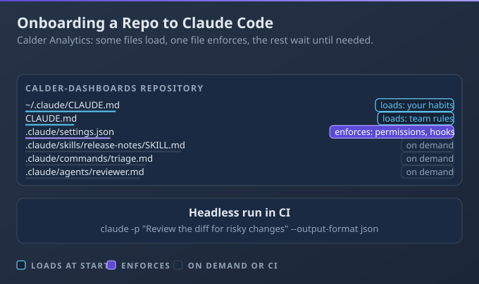

# D3: Claude Code

> **Exam weight**: 3.1% · **Questions**: 7 in the bank

## Overview

This domain is about giving Claude Code durable context, bounded permissions and reusable workflows. You decide what it reads at the start of every session, what it may do without asking, and which repeatable jobs become a skill, a command or a subagent. It also covers running Claude Code unattended in CI.

> 💡 **Human Angle**: CLAUDE.md is a memo to a colleague; settings.json is the lock on the door.

---

## 3.1 Claude Code Operation

### Key Concept

**Put durable guidance in CLAUDE.md, permissions in settings.json and repeatable workflows in skills, commands and agents.**

CLAUDE.md is context that Claude reads and weighs, while permission rules in settings.json are enforced by the tool itself. Occasional workflows belong in files that load on demand.

**Think of a new hire's desk**: a memo, a lock on the cabinet, a binder of procedures.



### Real use

A platform engineer at Calder Analytics onboards a reporting repository: `/init` drafts CLAUDE.md, a committed settings.json sets permissions, and a headless review step runs in CI. Reviews follow house rules unprompted.

### How it works

A developer re-explains the test command every morning, and one afternoon Claude edits a generated file nobody wanted touched.

- **Hierarchy:** CLAUDE.md files in the working directory and every directory above it load at launch, concatenated from the root down. Subdirectory files load on demand; keep each under 200 lines.
- **Components:** Rules (`.claude/rules/`) can be scoped to paths. Skills load only their description until invoked. Commands were merged into skills, so the skill wins a clash. Agents (`.claude/agents/`) are subagents with their own context; Agent Memory is their `memory` field. See 8.3.
- **Enforcement:** settings.json holds permission rules and hooks (scripts run at lifecycle events). Deny rules block in every mode; a hook blocks with exit code 2, not 1.
- **Sessions and modes:** `/clear` resets, `/compact` summarises, `-c` or `-r` resume. `stream-json` output streams events. Auto mode uses a classifier to approve actions.

### Choose when

| Option | Choose it when | Trade-off |
|---|---|---|
| CLAUDE.md | Every session needs the same conventions | Guidance only; Claude can ignore it |
| settings.json | An action must be allowed or blocked | Literal patterns need testing |
| Skill | A workflow is needed sometimes | Loads on invocation, so Claude must choose it |
| Slash command | A person triggers a fixed prompt by name | Overlaps skills; a same-named skill wins |
| Subagent | A side task would flood the main context | Separate context shares less detail |

### How to do it

1. Run `/init`, then cut CLAUDE.md to real conventions.
2. Put prohibitions in `.claude/settings.json`.
3. Move rare procedures into skills or agents.
4. Resume with `claude -c`; `/clear` between tasks.
5. In CI, run `claude -p` and test the exit code.

```bash
mkdir -p .claude/rules .claude/skills .claude/agents
cat > .claude/settings.json <<'JSON'
{"permissions": {
  "allow": ["Bash(npm test *)"],
  "deny": ["Bash(git push *)", "Bash(rm *)"]}}
JSON
claude -p "Review this diff against CLAUDE.md" \
  --output-format json --max-turns 5 \
  --permission-mode dontAsk --allowedTools "Bash(git diff *)"
```

### Exam Trap ⚠️

<div class="note-trap">Writing "never run git push" only in CLAUDE.md relies on Claude obeying, so one ignored line ships a push. A deny rule in settings.json blocks it regardless.</div>

### Go deeper

- [How Claude remembers your project](https://code.claude.com/docs/en/memory)
- [Run Claude Code programmatically](https://code.claude.com/docs/en/headless)

---

## Deep Dive: Making Claude Code Click

### 1. The connective narrative

Everything in this domain answers two questions: what does Claude Code read, and what may it do? Reading is shaped by CLAUDE.md, rules and skill descriptions. Doing is bounded by permission rules, modes and hooks.

Keep the two apart. Reading is persuasion, so it suits conventions and context. Doing is enforcement, so it suits anything with a cost when it goes wrong. Skills and agents sit between: they load only when needed, which keeps the always-on context small.

### 2. Worked scenario

Thistle Games QA runs a 40-person test team. Their repository holds a generated localisation bundle that testers kept hand-editing.

**Decision 1: where to record the test command.** Options: the team wiki, each tester's prompt, or the shared CLAUDE.md. They chose CLAUDE.md at 60 lines, because it loads every session without anyone remembering it.

**Decision 2: how to protect the bundle.** Options: a CLAUDE.md warning, or a deny rule. The warning was cheap but only guidance. They added a rule in settings.json, because a mistake in that folder cost half a day of regeneration.

**Decision 3: the 12-step release checklist.** Options: paste it into CLAUDE.md or make it a skill. They made it a skill, so only its description (one line) loads until a tester runs it.

**What happened:** hand edits to the bundle fell from about five a week to zero, and sessions started with 60 lines of context instead of 200.

### 3. Memory aid

- Is it advice? Put it in CLAUDE.md or a rule.
- Is it a hard limit? Put it in settings.json.
- Is it occasional? Make it a skill, command or agent.
- Is it unattended? Run `claude -p` and check the exit code.
- Is the task finished? `/clear` before the next one.

### 4. Exam strategy for this domain

Ask whether the scenario needs persuasion or enforcement before reading the options. Treat "CLAUDE.md" as the answer for shared conventions and "settings.json" for blocking. Check precedence order: managed beats command line, then local, shared project and user.

---

## Cheat Sheet 📋

| Situation | What to do |
|---|---|
| Team conventions every session | CLAUDE.md in the project root, under about 200 lines |
| Personal notes for one repo | CLAUDE.local.md, kept out of git |
| Convention for one part of the codebase | Path-scoped file in `.claude/rules/` |
| An action must never happen | Deny rule or blocking hook in settings.json |
| Rare, multi-step procedure | Skill; only its description loads until used |
| Noisy side task | Subagent in `.claude/agents/` |
| Unrelated task next | `/clear`; use `/compact` to keep a long one going |
| Run in CI | `claude -p` with `--output-format json`; set permissions explicitly |
