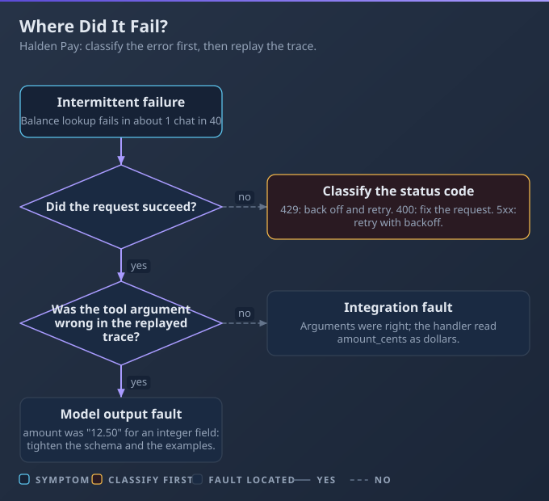

# D4: Eval, Testing, and Debugging

> **Exam weight**: 2.6% · **Questions**: 6 in the bank

## Overview

This domain exercises one habit: find the failing layer before you change anything. A bad answer can come from the request you built, the API's response to it, the tool that ran, or the model's own output. You classify the failure, isolate it by replaying the same input, fix that layer, and keep the case as an eval so it cannot return unnoticed.

> 💡 **Human Angle**: Before you blame the model, read the request.

---

## 4.1 Debugging and Error Handling

### Key Concept

**Classify the error first, then decide whether the fault is in your integration or in the model's output.**

Each failure class has its own recovery. A malformed request fails identically on every retry, while an overloaded server usually succeeds on the next.

**Think of a triage desk**: sort first, treat second.



### Real use

A support engineer at Halden Pay inherits a payment assistant that fails "sometimes". She adds a wrapper that logs the request id and classifies each outcome, and the failures sort into buckets, each with an owner.

### How it works

A team rewrites a prompt for a week, yet answers stay cut off because `max_tokens` was too low and nobody read `stop_reason`.

- **Classes:** invalid request (fix the request), authentication or permission (fix the credential), rate limit and server or overloaded (back off, retry, then fall back), truncation (raise the limit), refusal (fall back or escalate), tool error (return an instructive `is_error` result), validation failure (repair and retry).
- **Exceptions:** a spend-cap 429 has no `retry-after`, so retrying fails until the cap resets. Errors can also arrive mid-stream after a 200.
- **Trace analysis:** log the request id, input, tool calls and outputs; find the first divergence.
- **Isolation:** replay the same input against a fixed request; a repeat failure points at the integration.

### Choose when

| Option | Choose it when | Trade-off |
|---|---|---|
| Retry | Transient: 429 with `retry-after`, 500, 529 | The SDK already retries twice; stacked loops multiply waits |
| Fix the request | Status 400 or truncation | Needs a change |
| Fall back | Refusal or sustained overload | A second model may behave differently |
| Repair prompt | Valid request, output fails validation | Extra call; cap the loop |
| Escalate | Spend cap, 401, repeated failure | Needs a human |

### How to do it

1. Log the request id.
2. Check `stop_reason` before parsing output.
3. Map each exception class to one recovery.
4. Replay the failing input against a fixed request.
5. Save the case as an eval.

```python
import logging, anthropic
log = logging.getLogger("halden")
client = anthropic.Anthropic()  # key comes from the environment

def ask(messages):
    try:
        r = client.messages.create(model="claude-sonnet-5-5",
                                   max_tokens=1024, messages=messages)
    except anthropic.BadRequestError as e:
        log.error("fix_request %s", e.message); raise
    except (anthropic.RateLimitError, anthropic.InternalServerError):
        log.warning("retries exhausted: fall back or escalate"); raise
    log.info("id=%s stop=%s", r._request_id, r.stop_reason)
    return r
```

Trace excerpt, read top to bottom:

| Step | Logged | Finding |
|---|---|---|
| 1 | `req_001`, refund question | Valid, `end_turn` |
| 2 | `req_002`, `get_balance(id="")` | First divergence: empty argument |
| 3 | replay of step 2 | Fails 1 time in 5: output variance |

### Exam Trap ⚠️

<div class="note-trap">Retrying a 400 invalid request repeats a fault that cannot change, so cost and latency grow while the failure stays identical.</div>

### Go deeper

- [API errors](https://platform.claude.com/docs/en/api/errors)
- [Stop reasons](https://platform.claude.com/docs/en/build-with-claude/handling-stop-reasons)

---

## Deep Dive: Making Eval, Testing, and Debugging Click

### 1. The connective narrative

The whole domain is a loop with four verbs: classify, isolate, fix, pin. Classifying uses the status code and `stop_reason`, which are cheap signals you already receive. Isolating replays one input against a fixed request until you know which layer owns the fault.

Fixing is then small, because you changed one thing. Pinning is the step teams skip: the fixed case goes into an eval set with a clear success criterion, so the same fault cannot return unseen after a prompt edit or a model change.

### 2. Worked scenario

Ember Streaming ran a viewer-help assistant that returned cut-off answers for about 8 percent of chats.

**Decision 1: what to check first.** Options: rewrite the prompt, or read logs. They classified 200 failed requests by `stop_reason` and found 164 ended in `max_tokens`. That pointed at the request, not the prompt.

**Decision 2: how to confirm.** Options: change the limit in production, or replay the 164 inputs against a fixed request. They replayed with `max_tokens` raised from 256 to 1024, and 161 completed.

**Decision 3: the other 36 failures.** Options: raise the limit again, or classify them. Thirty-two were 529 errors that cleared on retry, and 4 were bad tool arguments, which went to the tool-description owner.

**Decision 4: how to stop a repeat.** They saved 20 of the replayed inputs as an eval, graded by code on whether the answer ended cleanly. **What happened:** cut-off answers fell from 8 percent to under 1 percent, and the eval caught a regression two weeks later.

### 3. Memory aid

- What status or `stop_reason` came back?
- Is the class transient, or does the request need fixing?
- Did I log the request id and the first divergence?
- Does the same input fail again against a fixed request?
- Is the fix pinned as an eval case?

### 4. Exam strategy for this domain

Read the symptom for a status code or `stop_reason` before choosing an answer. If the options include rewriting a prompt, check whether the stem shows a valid request with a bad answer; if it does not, the fault is elsewhere. Prefer the option that changes one layer and adds an eval over the one that changes several.

---

## Cheat Sheet 📋

| Situation | What to do |
|---|---|
| 400 invalid request | Fix the request; do not retry |
| 401 or 403 | Fix the key, scope or permission; escalate if it persists |
| 429 with `retry-after` | Wait that long, then retry; SDK retries twice by default |
| 429 spend cap, no `retry-after` | Stop retrying; escalate until the cap resets |
| 500 or 529 | Back off and retry, then fall back |
| `stop_reason` is `max_tokens` | Raise the limit or shorten the task; check before parsing |
| Refusal (HTTP 200) | Fall back to another model or escalate; do not retry the same request |
| Output fails validation | Repair and retry with a cap, then pin the case as an eval |
