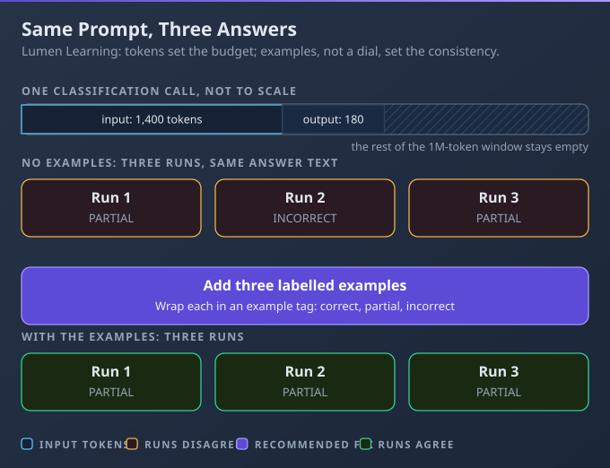
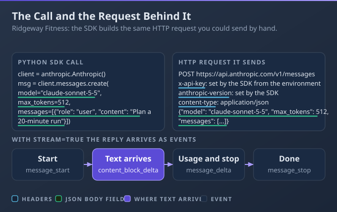
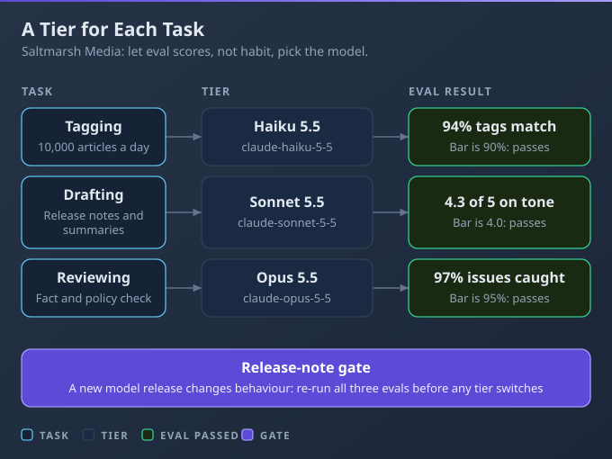
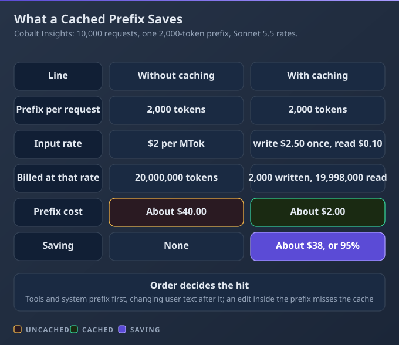

# D5: Model Selection and Optimization

> **Exam weight**: 16.8% · **Questions**: 41 in the bank

## Overview

This domain is about spending tokens and model capability where they buy quality. You learn how a model produces output, how the SDK and the wire relate, how to pick a tier with an eval, and how to model and cut the cost of a request. It exercises the habit of measuring before you upgrade, cache or batch.

> 💡 **Human Angle**: The cheapest model that passes your eval is the right model.

---

## 5.1 LLM Fundamentals

### Key Concept

**Claude predicts tokens inside a context window, so outputs vary and every input token counts against the budget.**

Claude generates one token at a time, each drawn from a probability distribution over what could come next, so two runs on the same input can differ. The window holds everything in the request plus the output, thinking included, and the current models have a 1M-token window.

**Think of a very well-read autocomplete**: strong, but not a lookup table.



### Real use

A developer at Lumen Learning labels free-text quiz answers as correct, partly correct or incorrect. She adds three worked examples and a low effort level. Repeated eval runs now agree, and each label costs less.

### How it works

A classifier labels a borderline quiz answer "partly correct" in testing and "incorrect" in production, with no code change between the two.

- **Tokens and the window:** text is split into tokens. The window counts the system prompt, messages, tool definitions and the output. Models from Claude 4.7 on produce roughly 30% more tokens for the same text.
- **Sampling:** you cannot tune it. Non-default `temperature`, `top_p` or `top_k` return a 400 on current models, and under API version 2026-10-21 any value does. Steer with examples and check outputs in code.
- **Model options:** adaptive thinking lets Claude decide how much to think, and `output_config.effort` (low to max) guides the depth. Manual extended thinking with `budget_tokens` is rejected on newer models. Fast mode (`speed: "fast"`) is the same model, faster, at a premium price, generally available on Opus 5.5 only.
- **Shots:** zero-shot gives an instruction alone, single-shot adds one example, multi-shot several. The docs suggest 3-5 varied examples in `<example>` tags.

### Choose when

| Option | Choose it when | Trade-off |
|---|---|---|
| Zero-shot | The task is simple and obvious | Borderline cases drift |
| Few-shot | Edge cases must follow your rule | Examples cost input tokens |
| Adaptive thinking (replaces extended thinking) | The task needs multi-step reasoning | Thinking bills as output |
| Higher effort | An eval shows reasoning errors | Slower, costlier, only soft guidance |

### How to do it

1. Write the label set and rule in the system prompt.
2. Add 3-5 varied examples, including a borderline one.
3. Keep the learner's answer in the user turn.
4. Start at low effort; raise it only if an eval shows a gap.
5. Run the eval several times and measure agreement.

```python
import anthropic
client = anthropic.Anthropic()  # the key comes from ANTHROPIC_API_KEY
SHOTS = """<examples>
<example>Answer: "Two cells result." Label: partly_correct</example>
<example>Answer: "Cells just split." Label: incorrect</example>
<example>Answer: "Two identical diploid cells." Label: correct</example>
</examples>"""
reply = client.messages.create(
    model="claude-haiku-5-5", max_tokens=1000,
    system="Label the quiz answer: correct, partly_correct or incorrect. Label only.\n" + SHOTS,
    messages=[{"role": "user", "content": 'Answer: "Mitosis copies a cell."'}],
    thinking={"type": "adaptive"}, output_config={"effort": "low"})
print(next(b.text for b in reply.content if b.type == "text"))
```

### Exam Trap ⚠️

<div class="note-trap">Sending temperature 0 to make a classifier repeatable fails twice: current models reject the parameter with a 400, and outputs can still vary without it.</div>

### Go deeper

- [Thinking](https://platform.claude.com/docs/en/build-with-claude/thinking)
- [Effort](https://platform.claude.com/docs/en/build-with-claude/effort)

---

## 5.2 Technical Fundamentals

### Key Concept

**SDKs wrap REST calls; know the raw request so you can debug streaming, websockets and failures.**

The SDK call is a POST to `/v1/messages` with an API key header, a version header and a JSON body of model, `max_tokens` and messages. With `stream: true` the reply comes back as server-sent events. Knowing this lets you replay any failing call with plain HTTP.

**Think of the SDK as a power adaptor**: handy, but you should know the socket underneath.



### Real use

A mobile developer at Ridgeway Fitness builds a coach chat that streams each reply. When a user reports a stall, she replays the exact request with plain HTTP and sees a 429. She fixes the retry handling instead of guessing.

### How it works

A developer sees "request failed" from the SDK in production and cannot reproduce it, having never seen the headers or body the SDK sent.

- **The mapping:** POST to `/v1/messages`, the key in an `x-api-key` header read from the environment, a required `anthropic-version` header, and a JSON body. SDKs updated for API version 2026-10-21 send the key in an `Authorization` header instead.
- **Streaming transport:** events run `message_start`, content block events, `message_delta`, then `message_stop`. An error can arrive mid-stream after a 200, so handle error events and ignore unknown types.
- **Websocket or request/response:** a websocket is a persistent two-way channel, which fits a client that sends while it receives, such as live voice. A chat turn sends one request and reads one stream, so streaming covers it.
- **Timeouts and retries:** the SDK timeout is 10 minutes, and transient failures (connection errors, 429, 5xx) are retried twice with backoff. A spend-cap 429 has no `retry-after`, so retries fail until the cap resets.

### Choose when

| Option | Choose it when | Trade-off |
|---|---|---|
| SDK | Normal application code | Hides the request |
| Raw HTTP | Reproducing a failure from a shell | You write retries and parsing |
| Server-sent streaming | Users watch tokens arrive | Errors can follow a 200 |
| Websocket | Both sides must send at any time | An extra connection to run |

### How to do it

1. Reproduce the failing call as raw HTTP, key from the environment.
2. Compare its body and headers with what the SDK sends.
3. Add `stream: true` only where users watch output.
4. Set `max_retries` and a timeout deliberately.
5. Log the `request-id` header on every failure.

```python
import json, os, urllib.request
import anthropic
body = {"model": "claude-haiku-5-5", "max_tokens": 200,
        "messages": [{"role": "user", "content": "Plan a 20-minute warm-up."}]}
req = urllib.request.Request(
    os.environ["API_BASE_URL"] + "/v1/messages", data=json.dumps(body).encode(),
    headers={"x-api-key": os.environ["ANTHROPIC_API_KEY"],
             "anthropic-version": "2023-06-01", "content-type": "application/json"})
raw = json.load(urllib.request.urlopen(req))
client = anthropic.Anthropic(max_retries=2, timeout=600.0)  # the SDK defaults
sdk = client.messages.create(**body)
print(raw["usage"], sdk.usage)
```

### Exam Trap ⚠️

<div class="note-trap">Building a websocket relay for a chat that only needs one-way token streaming adds a second connection to run and secure, for no gain.</div>

### Go deeper

- [Streaming messages](https://platform.claude.com/docs/en/build-with-claude/streaming)
- [Python SDK](https://platform.claude.com/docs/en/cli-sdks-libraries/sdks/python)

---

## 5.3 Model Selection and Tradeoffs

### Key Concept

**Pick the cheapest tier that passes your eval, and upgrade only where the eval shows a gap.**

Haiku-class models suit high-volume classification and routing, Sonnet-class balances speed and intelligence, and Opus-class handles long-running agentic coding and knowledge work. Price rises with the tier, from $0.10 per million input tokens on Haiku 5.5 to $4 on Opus 5.5.

**Think of staffing**: you do not send a senior engineer to file the tickets.



### Real use

A platform engineer at Saltmarsh Media routes article tagging to a small model, drafts to a mid tier and final review to the largest, each with an eval floor. The bill drops and review quality holds.

### How it works

A model upgrade ships on Monday, and by Tuesday the headline parser fails because the new model wraps its JSON in a sentence of preamble.

- **The triangle:** quality, latency and cost trade off. Haiku is fastest and cheapest, Sonnet is fast, Opus is moderate, and a task rarely needs the top of all three.
- **Thinking support differs:** Opus 5.5 always thinks and rejects `disabled`. Sonnet 5.5 rejects `disabled` but accepts `between_tools`. Haiku 5.5 accepts `disabled` at high effort or below. The 4.5 generation accepts only manual `budget_tokens`, and adaptive returns a 400.
- **Releases change behaviour:** read the release notes and migration guide first. Opus 5.5, for example, rejects sampling parameters, prefilled replies and forced `tool_choice`. Dateless ids from 4.6 on are pinned snapshots, not "latest" aliases, so pin and re-run evals before moving.
- **Route by task:** send each task to the cheapest tier whose eval passes, and keep the routing table in version control.

### Choose when

| Option | Choose it when | Trade-off |
|---|---|---|
| Haiku-class | High-volume tagging, extraction, routing | Weaker on ambiguous reasoning |
| Sonnet-class | Drafting needing speed and quality | Dearer than Haiku |
| Opus-class | Long agentic coding where evals show a gap | Costliest and slower |
| Route by task | Steps differ in difficulty | More ids to pin and test |

### How to do it

1. List each task; build a labelled eval that checks format too.
2. Run the cheapest tier first and record its score.
3. Move up only for tasks that miss the floor.
4. Pin the ids in the routing table.
5. On every release, read the notes and run the gate in CI.

```python
ROUTES = {            # task -> (pinned model id, minimum eval score)
    "tag": ("claude-haiku-5-5", 0.93),
    "draft": ("claude-sonnet-5-5", 0.90),
    "review": ("claude-opus-5-5", 0.95),
}

def gate(task, run_eval):
    model, floor = ROUTES[task]
    score = run_eval(task, model)  # your labelled cases, format check included
    if score < floor:
        raise SystemExit(f"{task}: {model} scored {score:.2f}, floor {floor}")
    return model
```

### Exam Trap ⚠️

<div class="note-trap">Treating a new release as a drop-in replacement lets a changed output shape or a rejected parameter reach production, because no eval ran first.</div>

### Go deeper

- [Models overview](https://platform.claude.com/docs/en/about-claude/models/overview)
- [Model deprecations](https://platform.claude.com/docs/en/about-claude/model-deprecations)

---

## 5.4 Cost and Token Management

### Key Concept

**Count tokens, cache what repeats, batch what can wait and model the cost per request before launch.**

Every response reports its `usage`, and the token-counting endpoint estimates a request before you send it, at no charge. A cache read costs a fraction of normal input, 0.05 times on Sonnet 5.5, so a long repeated prefix is where savings hide.

**Think of a phone plan**: you cost it before you sign.



### Real use

A backend engineer at Cobalt Insights runs a report assistant with a long, fixed system prompt. She models one request's cost across input, output, cache write and cache read, and puts the stable prompt first. The projected bill falls enough to approve launch.

### How it works

A team adds the current time to the first line of a long system prompt, and the bill triples because no request ever matches a cached prefix.

- **Usage fields:** `input_tokens`, `output_tokens`, `cache_creation_input_tokens` and `cache_read_input_tokens`. Total input is the three input fields added together. Thinking tokens bill as output.
- **The cost model:** four rates per million tokens. On Sonnet 5.5 they are $2 input, $10 output, $2.50 for a 5-minute cache write and $0.10 for a cache read.
- **Caching:** the prefix order is tools, system, messages. Put stable content first and end it with a `cache_control` check-point. The default lifetime is 5 minutes, refreshed on each use, with an optional 1-hour setting. Current models need at least 512 tokens, and changing tool definitions invalidates everything.
- **Batch and caps:** the Batch API takes 50% off input and output, most batches finish within an hour, and they expire after 24 hours. Cap output with `max_tokens`, the strict limit.

### Choose when

| Option | Choose it when | Trade-off |
|---|---|---|
| Cache | A long prefix repeats | A change before the check-point misses |
| Batch | Results can wait, as overnight | Not interactive |
| Smaller tier | An eval passes on the cheaper model | Needs an eval per task |
| Shorter prompt | Instructions carry stale detail | Trimming can lose context |

### How to do it

1. Count tokens for a typical request; note the stable prefix.
2. Move anything that changes (dates, names) after it.
3. Add a `cache_control` check-point at the end of the stable block.
4. Read `usage` on every response and compute its cost.
5. Compare projected totals with and without caching.

```python
import datetime
RATES = {"in": 2.00, "out": 10.00, "write": 2.50, "read": 0.10}  # USD per MTok, Sonnet 5.5

def cost(u):
    return (u.input_tokens * RATES["in"] + u.output_tokens * RATES["out"]
            + u.cache_creation_input_tokens * RATES["write"]
            + u.cache_read_input_tokens * RATES["read"]) / 1_000_000

STABLE = open("policy.txt").read()  # long and identical on every request
system = [{"type": "text", "text": STABLE, "cache_control": {"type": "ephemeral"}},
          {"type": "text", "text": "Today is " + datetime.date.today().isoformat()}]
```

### Exam Trap ⚠️

<div class="note-trap">Putting a timestamp or request id before the stable prefix gives every request a different prefix, so nothing is ever read from cache.</div>

### Go deeper

- [Pricing](https://platform.claude.com/docs/en/about-claude/pricing)
- [Prompt caching](https://platform.claude.com/docs/en/build-with-claude/prompt-caching)

---

## Deep Dive: Making Model Selection and Optimization Click

### 1. The connective narrative

Every lever in this domain answers one question: what does this request need, and what is the cheapest way to supply it? Tier sets how much capability you rent. Effort sets how hard that model thinks. Cache decides how much of the prompt you pay for again. Batch decides how long you are willing to wait.

The levers stack. A Haiku-class model at low effort with a cached prefix, run as a batch, costs a small fraction of the same task on a top tier at default settings. But each lever carries a risk that only an eval can measure: a cheaper tier may miss, low effort may under-think, a cache may never hit, and a batch may arrive too late.

So the order of work is fixed. Define the eval, find the cheapest tier that passes, set effort from the eval, shape the prompt so the prefix is stable, then batch whatever is not interactive. Re-run the eval whenever a model release changes the ground.

### 2. Worked scenario

Zephyr Mobility rents e-scooters, and its rider-support assistant handles 20,000 chats a day. The team had one model, one prompt and a rising bill.

- **Decision 1, tier (5.3).** Options: keep Sonnet 5.5 for everything, or move ticket tagging to Haiku 5.5. The eval gave Haiku 94% on tagging against a 93% floor, and Sonnet 96%. Haiku wins on cost at 20,000 tags a day, so tagging moved. Drafting stayed on Sonnet, where Haiku scored 84% against a 90% floor.
- **Decision 2, effort (5.1).** Options: default effort everywhere, or low effort for tagging and high for refund-dispute drafts. Tagging at low effort held 94%, so it stayed low. Disputes at high effort lifted the draft eval from 88% to 92%, above the floor.
- **Decision 3, cache (5.4).** The drafting prompt had a 3,000-token policy block, and a timestamp sat on its first line. Uncached, 20,000 drafts read 60 million input tokens a day, $120 at $2 per million. After moving the timestamp last and adding a check-point, about 300 cache writes and the rest reads cost roughly $8 a day.
- **Decision 4, batch (5.4).** The weekly review of 40,000 old tickets (60 million input tokens, 12 million output) cost $240 synchronously. It is not urgent, so it moved to the Batch API at half price, $120, and finished overnight.

The daily bill fell by more than $100 from caching alone, and no rider saw a slower reply. When a later model release arrived, the gate re-ran all four evals before the routing table changed.

### 3. Memory aid

Before you ship a model change, ask:
- Which task is this, and what is its eval floor?
- Is this the cheapest tier that clears the floor?
- Is effort set from the eval, not from habit?
- Does the stable prefix come first, with a check-point after it?
- Can this wait for a batch?
- Did I read the release notes, pin the id and re-run the gate?

### 4. Exam strategy for this domain

Read each scenario for the lever it hides: a flaky label points to examples or a validation step (never a sampling parameter), a surprise bill points to prefix order or missing cache check-points, and a broken parser after an upgrade points to pinning and re-running evals. When two options both work, prefer the one that measures first. Watch for answers that raise a tier or effort without an eval, and for any answer that sets temperature on a current model.

---

## Cheat Sheet 📋

| Situation | What to do |
|---|---|
| Same input, different labels | Add 3-5 varied examples and validate output in code; do not rely on sampling settings |
| Need deeper reasoning | Use adaptive thinking and raise `output_config.effort` after an eval shows a gap |
| Cannot reproduce an SDK error | Replay the request as raw HTTP with the key from the environment and log the `request-id` |
| Users should see tokens as they arrive | Stream with server-sent events; use a websocket only for true two-way traffic |
| Choosing a model for a task | Start with the cheapest tier and move up only where its eval misses the floor |
| A new model release arrives | Read the notes, keep the pinned id, and re-run the evals before switching |
| Long prompt repeated on every request | Put the stable prefix first and end it with a `cache_control` check-point |
| Work that can wait | Send it through the Batch API for 50% off input and output |
| Forecasting spend | Count tokens, then apply input, output, cache write and cache read rates per request |
