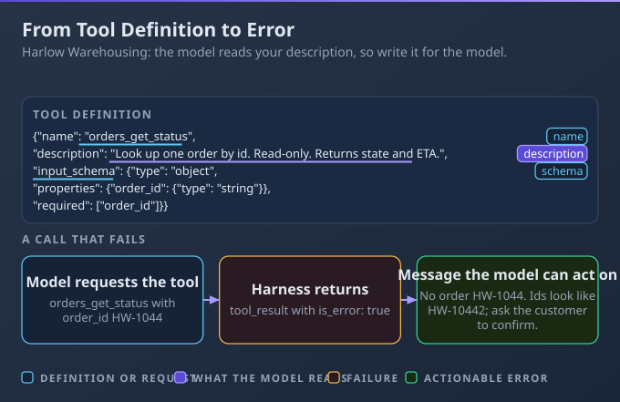
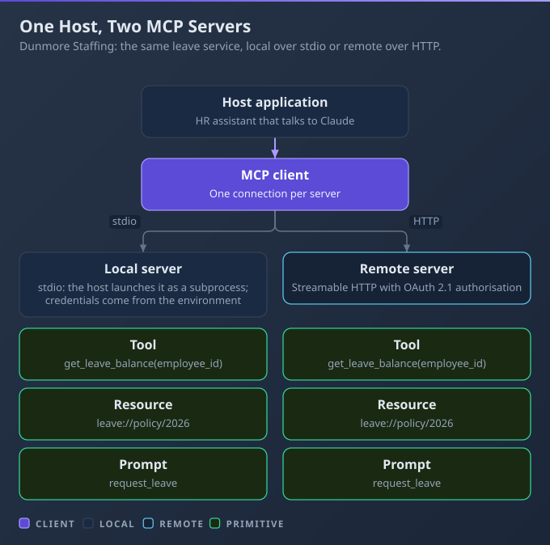
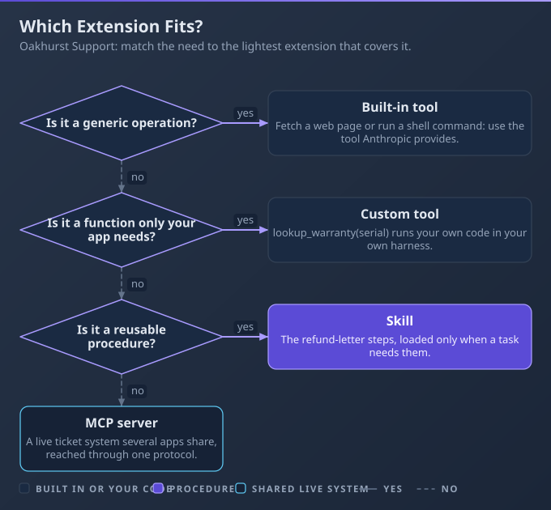

# D8: Tools and MCPs

> **Exam weight**: 10.6% · **Questions**: 27 in the bank

## Overview

This domain is about giving Claude the right capabilities through the lightest mechanism that works. You write tool definitions and the harness code that runs them, build an MCP server (Model Context Protocol, an open standard for connecting applications to tools and data) when several applications need the same capability, and decide when a built-in tool, a custom tool or a Skill is enough.

> 💡 **Human Angle**: A tool description is the only documentation Claude ever reads about your tool.

---

## 8.1 Tool Implementation

### Key Concept

**Write tool descriptions like onboarding notes, validate inputs and return errors the model can act on.**

Claude never runs a tool itself. It emits a structured request, and your code executes it and sends back a result. So the description is the whole manual: it says what the tool does, when to use it and when not to. The docs call detailed descriptions the most important factor in tool performance.

**Think of a handover note for a new starter**: they only know what the note tells them.



### Real use

A backend developer at Harlow Warehousing gives a support assistant two order-status tools and one refund tool. She rewrites each description to say when to use it, validates the order id before the lookup, and holds the refund for a human click. Customers get the right answer on the first call, and no refund goes out unapproved.

### How it works

Two tools described as "gets order information" and "looks up an order" overlap, so Claude picks between them almost at random and the support team sees inconsistent answers.

- **Definition:** a name, a description and an `input_schema` (a JSON Schema object). Add `input_examples` only if they validate against the schema.
- **Dispatch loop:** the response carries `stop_reason` of `tool_use` with a block holding an id, name and input. Your harness (the code around the model) runs the function, then replies in a user message with a `tool_result` carrying the matching `tool_use_id`. Results come before any text. Repeat until the model stops asking.
- **Client or server:** client tools run in your application, and server tools such as web search run on Anthropic infrastructure. Even Anthropic-schema tools like bash or the text editor are executed by your code.
- **Errors and approval:** on failure return `is_error: true` with what went wrong and what to try next, not "failed". For write actions, have the harness pause for human approval before it executes. Keep the set small, distinct and clearly named, for example `orders_get_status`.

### Choose when

| Option | Choose it when | Trade-off |
|---|---|---|
| Client tool | The logic touches your own data or systems | You write the execution and error handling |
| Server tool | You need web search or code execution without hosting it | Usage charges and less control over the run |
| Read-only tool | Lookups where a wrong call costs nothing | Cannot complete the task alone |
| Approval-gated tool | The action changes money, records or customers | A human wait adds latency |

### How to do it

1. Name the tool by service and action.
2. Write a description of at least three or four sentences covering use, non-use and parameters.
3. Validate the input before touching the system.
4. Return `is_error` results that say what to try next.
5. Gate write tools behind a human approval step.

```python
ORDER_TOOL = {
    "name": "orders_get_status",
    "description": "Look up one order by its order id. Use it for shipping "
        "and delivery questions. Do not use it for refunds.",
    "input_schema": {"type": "object", "required": ["order_id"],
        "properties": {"order_id": {"type": "string"}}},
}
def run_tool(block, db):
    oid = block.input.get("order_id", "")
    if not oid.startswith("ORD-"):
        return {"type": "tool_result", "tool_use_id": block.id, "is_error": True,
                "content": "order_id must look like ORD-1234. Ask the customer."}
    return {"type": "tool_result", "tool_use_id": block.id, "content": db.status(oid)}
```

### Exam Trap ⚠️

<div class="note-trap">Giving two tools short, overlapping descriptions and hoping the model works out the difference; it cannot, so calls go to the wrong tool.</div>

### Go deeper

- [Define tools](https://platform.claude.com/docs/en/agents-and-tools/tool-use/define-tools)
- [Handle tool calls](https://platform.claude.com/docs/en/agents-and-tools/tool-use/handle-tool-calls)

---

## 8.2 MCP Server Development

### Key Concept

**Expose a capability once as an MCP server and any MCP-capable application can reuse it.**

MCP separates the host application, which contains an MCP client, from servers that offer capabilities over JSON-RPC. A server exposes tools (model-controlled functions), resources (data the application chooses to load) and prompts (templates a user triggers). Write the integration once, and every compatible host connects to it.

**Think of a standard power socket**: any appliance fits, and nobody rewires the house.



### Real use

A platform engineer at Dunmore Staffing turns the leave-balance service into an MCP server. The first version runs locally over stdio for developers, and a second runs remotely behind sign-in for the HR assistant and the manager dashboard. Both applications reuse one implementation instead of two private integrations.

### How it works

A server that publishes read-only reference data, such as the list of leave types, as a tool forces the model to spend a call on every lookup it could have simply had in context.

- **Three primitives:** tools are controlled by the model, prompts by the user, and resources are driven by the application. Choose by who decides when it is used. Some clients support only tools, so check before relying on resources.
- **Roles and transports:** the client lives inside the host and talks to each server. Two standard transports exist: stdio, where the client launches the server as a subprocess, and Streamable HTTP for remote servers. A stdio server must never write to stdout, so log to stderr.
- **Build and register:** use an official SDK (Python and TypeScript are both top-tier). In Claude Code, register with `claude mcp add`; scope decides whether the setting is personal or shared in `.mcp.json`.
- **Auth and trust:** authorisation is optional, applies to HTTP transports, and uses OAuth 2.1 with the server as resource server. Stdio servers take credentials from the environment. Install only servers you trust, since tool results can carry prompt injection (see 7.1).

### Choose when

| Option | Choose it when | Trade-off |
|---|---|---|
| Stdio local server | One developer or one machine needs it | Every user installs and updates it |
| Remote server | Several applications or teams share it | You run it, secure it and add authentication |
| Resource | Reference data the application can load | Not every client surfaces resources |
| Tool | The model must act or query on demand | Each call costs a round trip and tokens |

### How to do it

1. List the capabilities and label each tool, resource or prompt.
2. Pick the transport: stdio for local, Streamable HTTP for shared.
3. Build with an official SDK.
4. Register it with the host.
5. Add authentication before any remote exposure.

```bash
claude mcp add --transport stdio leave-balance -- python leave_server.py
claude mcp add --transport http leave-remote https://example.com/mcp
claude mcp login leave-remote
claude mcp list
```

### Exam Trap ⚠️

<div class="note-trap">Putting a remote MCP server on the network without authentication, so anyone who finds the URL can call its tools with your data.</div>

### Go deeper

- [Build an MCP server](https://modelcontextprotocol.io/docs/develop/build-server)
- [MCP authorization](https://modelcontextprotocol.io/specification/2026-07-28/basic/authorization)

---

## 8.3 Agentic Customization

### Key Concept

**Pick the lightest extension that fits: built-in tool, custom tool, Skill or MCP server.**

Each step up the ladder adds context cost, maintenance and trust to review. A built-in tool needs nothing from you. A Skill is a folder of instructions loaded on demand, and an MCP server is a running service. Start at the cheapest rung that meets the need.

**Think of choosing between a note, a tool and a workshop**: build the workshop only when many people need it.



### Real use

An engineering lead at Oakhurst Support has four needs: edit files, call the internal ticket API, follow the escalation procedure and read the shared CRM. She picks the built-in text editor, a custom tool, a Skill and an MCP server in turn. Each need gets one mechanism, and nothing heavier than it requires.

### How it works

A team spends two weeks building and hosting an MCP server to deliver a one-page escalation procedure that a Skill file would have covered in an afternoon.

- **Built-in tools:** bash, the text editor and web search handle generic operations. Anthropic-schema tools use schemas Claude is trained on, so it calls them more reliably than an equivalent custom tool.
- **Custom tools:** app-specific functions inside your own harness, where you control execution and approval.
- **Skills:** a directory with a `SKILL.md` of YAML frontmatter plus instructions, loaded on demand. Only the name and description sit in context until triggered. The `name` takes lowercase letters, numbers and hyphens, and `description` says what it does and when to use it.
- **MCP:** a live integration reused across applications. Weigh context cost, reuse, maintenance, trust and latency. Skills and third-party servers both need review before you trust them.

### Choose when

| Option | Choose it when | Trade-off |
|---|---|---|
| Built-in tool | The operation is generic, such as editing files | Limited to what the tool does |
| Custom tool | The function is specific to one application | Only that harness can use it |
| Skill | You have a reusable procedure or reference | Instructions, not a live connection |
| MCP server | A live system is shared across applications | Hosting, authentication and upkeep |

### How to do it

1. State the need in one sentence.
2. Ask whether a built-in tool already does it.
3. If it is a procedure, write a Skill.
4. If a live system is shared by several applications, use MCP.
5. Record the choice and its reason.

```markdown
---
name: escalation-procedure
description: Steps for escalating a support ticket. Use when an agent asks how or when to escalate.
---
Need: escalate P1 tickets within 30 minutes.
Considered: built-in tool (no), MCP server (no live system).
Chosen: Skill, because it is a procedure.
Review: revisit if a second application needs live ticket data.
```

### Exam Trap ⚠️

<div class="note-trap">Building an MCP server for a static procedure, which adds hosting, authentication and upkeep that a Skill avoids.</div>

### Go deeper

- [Agent Skills overview](https://platform.claude.com/docs/en/agents-and-tools/agent-skills/overview)
- [Connect Claude Code to MCP](https://code.claude.com/docs/en/mcp)

---

## Deep Dive: Making Tools and MCPs Click

### 1. The connective narrative

Every capability decision in this domain turns on two questions: who reuses it, and how far do you trust it. A tool definition (8.1) is the cheapest answer, since one harness owns it and you control the execution. A Skill (8.3) is the next, because a person writes instructions and no process runs. An MCP server (8.2) is the heaviest, justified only when several applications share a live system.

Trust grows with each rung. A tool you wrote is yours to audit. A Skill or a third-party server arrives from someone else, so you read its files and its descriptions before it reaches production. Description quality links all three: the model decides from text alone.

### 2. Worked scenario

**Ashgrove Retail** runs a web assistant and a store-staff app, with 40 stores.

**Decision 1 (8.1).** The assistant had `get_stock` and `check_stock`, both described as "stock information". About a third of lookups went to the wrong one. Options: merge them, or rewrite the descriptions. They merged into `stock_get_level` with a location parameter and a four-sentence description. Wrong-tool calls stopped.

**Decision 2 (8.3).** Staff wanted the returns procedure, a single page, in the assistant. Options: an MCP server, a custom tool or a Skill. They chose a Skill because it is static text and one team owns it. It shipped in a day.

**Decision 3 (8.2).** Both apps needed live stock from the same warehouse system. Options: two private integrations, or one remote MCP server. They built one remote server with OAuth, and the 12-item reference list of store codes became a resource, not a tool.

**Decision 4 (trust).** A supplier offered a free reviews server. Options: install it, or review it first. They reviewed the tool descriptions and results, then ran it in a test project only.

### 3. Memory aid

- Does a built-in tool already do it?
- Is it a procedure? Write a Skill.
- Do several applications share a live system? Build an MCP server.
- Is it read-only reference data? Make it a resource.
- Did I describe each tool as an onboarding note?
- Does any remote endpoint require authentication?

### 4. Exam strategy for this domain

- Read the scenario for the reuse clue: one app means a custom tool, many apps means MCP.
- Treat "procedure" or "guidelines" as the signal for a Skill.
- For tool bugs, check the description and the error message before the code.
- For write actions, look for the human approval step.

---

## Cheat Sheet 📋

| Situation | What to do |
|---|---|
| Model picks the wrong tool | Rewrite descriptions to say when to use and not use each |
| Tool input is invalid | Return `is_error: true` with what to fix and try next |
| Tool would change money or records | Pause for human approval before executing |
| Read-only reference data in MCP | Expose it as a resource, not a tool |
| Local, single-user integration | Use a stdio server |
| Shared across applications | Use a remote Streamable HTTP server with authentication |
| One-page procedure or guideline | Write a Skill, not an MCP server |
| Third-party server or Skill | Review it and its descriptions before trusting it |
