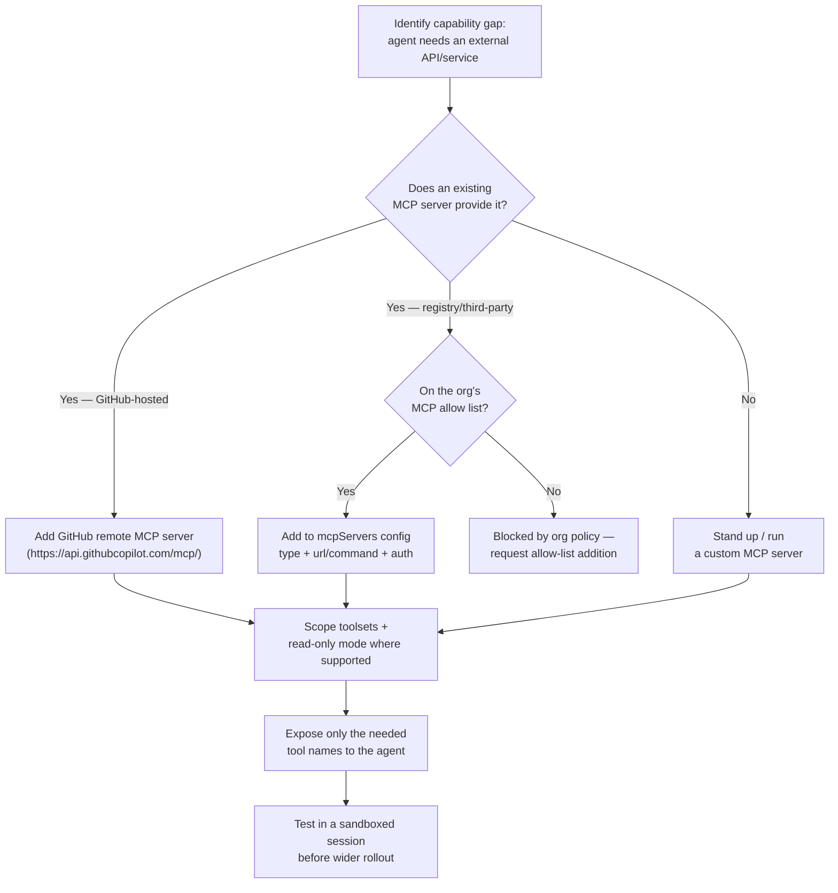
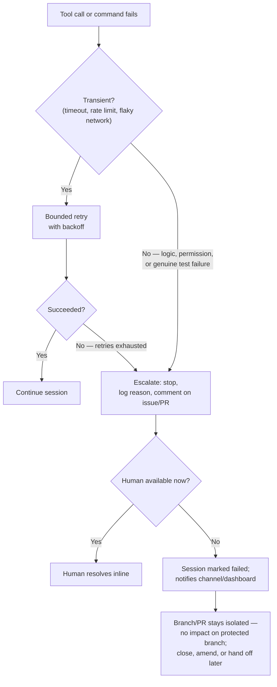

# D2: Implement Tool Use and Environment Interaction

> **Exam weight**: 23% · **Questions**: ~35 of 133

## Overview

This is the largest domain on the exam, and for good reason: it's where an agent stops being a conversational model and starts being able to *do* things — read a repo, call an external API, run a command, open a pull request. Every capability you grant is also a risk surface, so the domain is really about one repeated discipline applied across four layers: deciding exactly which tools an agent needs, wiring those tools in safely (including MCP servers), running the agent inside a scoped development environment, and handling the moment something goes wrong without losing control or the audit trail. GitHub's hosted agent appears here under its current name, Copilot cloud agent; earlier docs and courseware call it Copilot coding agent.

> 💡 **Human Angle**: Giving an agent tool access is like issuing a new hire a keycard — it should open exactly the doors their job requires on day one, not the whole building "just in case they need it later."

## Selecting and Configuring Agent Tools

### Key Concept

**An unused tool isn't a convenience held in reserve — it's risk and ambiguity with no offsetting benefit.**

Tool selection starts from the task, not from the catalog. For a given agent role — a code-review agent, a triage agent, a release-notes agent — you list the concrete actions it must be able to perform (read files, run tests, comment on a PR, query an issue tracker) and map each one to the smallest tool that satisfies it. This is the same discipline as the plan/act boundary from Domain 1, applied one level lower. The more tools an agent can see in a given turn, the more chances there are for it to pick the wrong one on an ambiguous instruction — a triage agent that can also merge PRs will occasionally try to, even though "triage" never implied "merge." **An unused tool sits there like a spare key nobody remembers cutting** — useless until the day it opens a door it shouldn't.

### In Practice

**What breaks without this**: a documentation agent that also has `bash` access runs an arbitrary shell command because a prompt-injected issue body asked it to, when it should have had no code-execution path at all — that's what happens when an agent is configured with a broad, copy-pasted toolset because auditing the task felt like more work than reusing an existing list.

**Decision trigger**: for every tool under consideration, ask "does this agent's task literally require this action to complete, or would the task still fully succeed without it?" If the task succeeds without it, leave it out — you can always add it later with evidence, but you can't un-ring a tool call that already happened.

**When you'd choose differently**: for a general-purpose "assistant" agent meant to handle open-ended, unpredictable requests from developers (not a narrow single-purpose agent), a broader toolset is a legitimate design choice — but it should be paired with tighter permission scoping and human review on anything destructive, since you're trading predictability for flexibility on purpose.

### Key Concept

**Reference the specific server-qualified tool name — MCP tools are namespaced to the server that exposes them, never a generic capability label.**

Once required tools are identified, configuration happens through the agent's `tools` property, an explicit allowlist: start from nothing and add only what's needed. In a custom agent profile (`.agent.md`), omitting `tools` or using `tools: ["*"]` enables every available tool, `tools: []` disables all of them, and the built-in aliases are `read`, `edit`, `search`, `execute` (also accepted as `shell` or `Bash`), `web`, `agent` and `todo`. The denylist alternative, `excludedTools`, is a Copilot SDK setting at the session or `defaultAgent` level rather than a profile property; it subtracts specific tools from an inherited set.

MCP-provided tools sit alongside the built-ins and are namespaced to the server that exposes them. A profile references them as `server-name/tool-name`, or `server-name/*` for every tool on that server, so a GitHub MCP server's issue tools are distinct from a Slack MCP server's `post_message` tool even if both are loosely "communication" actions. An allowlist entry therefore has to reference the specific server-qualified tool name, not a generic capability label. **It's like calling two different plumbers "the plumber"** — the label doesn't tell you which one actually shows up.

### In Practice

**What breaks without this**: nobody notices until a session log shows an unexpected tool call — teams that reuse one broad `tools` list across every custom agent in the org, because maintaining a separate list per agent feels like overhead, end up with narrow-purpose agents that can silently invoke tools nobody intended for them.

**Decision trigger**: ask "if I inherit the platform's default toolset, will next month's newly-added default tool automatically become available to this agent too?" If yes and that's not acceptable for a sensitive agent, use an explicit `tools` allowlist instead of relying on `excludedTools` against a moving default.

**When you'd choose differently**: `excludedTools` is the more maintainable choice when you're removing a small, known number of capabilities (e.g., "everything except `bash`") from an otherwise-good default set — rebuilding a full allowlist by hand for a broadly-scoped agent adds maintenance risk of its own if the platform's default toolset changes.

### Key Concept

**Default to read-only wherever a tool supports it — permission is a spectrum, not a has-it-or-doesn't switch.**

Most tools (and MCP servers in particular) support finer scoping: read-only vs. read-write modes, per-toolset enablement (e.g., an `issues` toolset without a `pull_requests` toolset), and repository- or org-level constraints on what the underlying credential can reach. A planning-phase or review agent should default to read-only wherever the tool supports it, even if the same tool is also available in write mode elsewhere in the pipeline for the execution phase — matching Domain 1's plan/act split at the tool-configuration layer. **It's a museum guide badge vs. a curator's master key** — both let you into the building, only one lets you touch the art.

### In Practice

**What breaks without this**: a subtly wrong prompt or an injected instruction in a PR description could cause a review agent to push a commit or close an issue — actions a reviewer was never supposed to be able to take — when it's granted a GitHub tool in full read-write mode because "it's the same tool the execution agent uses anyway."

**Decision trigger**: before granting a tool, ask "does this agent's job ever require *mutating* state, or does it only need to observe it?" If it only observes, configure the read-only variant even when a write-capable variant is available and would technically also work.

**When you'd choose differently**: a triage agent whose entire job is applying labels and assigning issues genuinely needs write access to a narrow slice of the issue-tracking surface — the point isn't "always read-only," it's scoping write access to exactly the mutation the role requires and nothing wider.

### Exam Trap ⚠️

The exam likes to offer "grant the tool, then instruct the agent not to use it destructively" as a distractor next to a correctly-scoped read-only or allowlisted answer. As with Domain 1's plan/act boundary, an instruction is something the model can be talked out of by ambiguous or adversarial input; a tool that isn't in the `tools` list, or an MCP server running in read-only mode, physically cannot be misused that way. If a question asks how to <em>guarantee</em> a tool won't be misused, the answer is a configuration change to what's available — not a prompt asking nicely.

## Configuring MCP Servers

### Key Concept

**A server offering thirty tools doesn't mean an agent should receive all thirty — least privilege applies at the MCP layer too.**

The Model Context Protocol lets an agent call tools exposed by an external server — local (run as a subprocess, e.g., a Docker-packaged server started with a command and args) or remote (an HTTP endpoint the agent connects to directly). For Copilot cloud agent, a repository administrator adds this as JSON under the repository's **Settings > Copilot > MCP servers** (a custom agent profile can also carry its own `mcp-servers`).

The JSON must contain an `mcpServers` object. Each entry names the server, its `type` (`local`, `stdio`, `http` or `sse`), how to reach it (`command`/`args` for local, `url` for remote), any required authentication, and, critically, a required `tools` array saying which of the server's tools are exposed to the agent. GitHub strongly recommends allowlisting specific read-only tools; `"*"` enables them all. The cloud agent uses only MCP **tools**: it doesn't support MCP resources or prompts, or remote servers that authenticate with OAuth. **It's a rented office suite where you only get keys cut for the rooms your team actually uses, not the whole floor.**

*Deciding whether an MCP server is needed and scoped.*

### In Practice

**What breaks without this**: the agent ends up with tools nobody scoped or reviewed, some of which may be destructive (delete, force-push, send-message) and were never part of its task — that's the result of adding an MCP server with its full default toolset exposed because scoping individual tool names felt like unnecessary setup.

**Decision trigger**: when adding any MCP server, ask "which specific tools does this agent's task require from this server?" and enumerate them explicitly, rather than accepting the server's full default exposure.

**When you'd choose differently**: for an internal, fully-trusted server built in-house specifically to back one narrow agent (nothing else will ever consume it), exposing its complete toolset can be reasonable — the server's entire surface area was already designed around exactly that agent's needs, so there's nothing extra to trim.

### Key Concept

**Scope by toolset and read-only mode — the same read/write discipline applied to GitHub's own API surface.**

GitHub hosts its own remote MCP server (reachable at `https://api.githubcopilot.com/mcp/`) that exposes GitHub platform capabilities — issues, pull requests, repositories, Actions, code security — as MCP tools, authenticated via a bearer token (OAuth or PAT) sent with the request. Copilot cloud agent gets this server built in and enabled by default, using a specially scoped token with read-only access to the current repository only; widening that access means supplying your own personal access token or GitHub App token and choosing toolsets with the `X-MCP-Toolsets` header.

Two configuration levers matter most: **toolsets**, which group related tools (e.g., `issues`, `pull_requests`, `actions`) so you can enable only the groups a given agent needs instead of the entire surface; and a **read-only mode**, which restricts the server to non-mutating operations only. **It's a security badge that opens the mailroom but not the server room.**

### In Practice

**What breaks without this**: the agent now technically has a code path to modify Actions workflows or push commits, even if the task never called for it — enabling every toolset on the GitHub remote MCP server for an agent that only needs to read issue context turns a narrow research task into one with a much larger blast radius.

**Decision trigger**: ask "does this agent's task require any GitHub mutation at all?" If not, enable read-only mode and only the toolsets the task actually touches (e.g., `issues` and `pull_requests`, not `actions` or `code_security`), rather than defaulting to the full authenticated surface.

**When you'd choose differently**: an execution-phase coding agent that needs to push commits and open PRs genuinely needs a write-capable configuration — the goal isn't "always read-only," it's matching the server's mode to the phase the agent is actually operating in.

### Key Concept

**Registry presence answers "does it exist," not "should we trust it."**

An MCP registry is a catalog — a place to discover servers that expose a given capability — not an approval mechanism. A server appearing in a registry tells you it exists and roughly what it does; it says nothing about whether your organization has vetted its data handling, its authentication model, or the blast radius of the tools it exposes. Treating "it's in the registry" as equivalent to "it's safe to connect" skips the actual review step organizations need before granting any external server access to agent context (which may include repository contents, issue text, or credentials). **A business listed in the phone book hasn't been vetted by anyone — it's just findable.**

### In Practice

**What breaks without this**: repository contents or issue text an agent passed through it are now outside the org's control, with no one having evaluated that trade-off — a developer discovers a convenient third-party MCP server in a registry and wires it directly into a production agent workflow without review, and if that server logs request payloads or has an overly broad tool surface, the exposure is silent.

**Decision trigger**: before connecting any newly-discovered MCP server, ask "has this specific server been vetted by someone with authority to approve it for this org, independent of it being listed in a registry?" Registry presence answers "does it exist," not "should we trust it."

**When you'd choose differently**: for a low-stakes local experiment in a sandbox with no real repository data or credentials in play, a developer trying out a registry-listed server for evaluation purposes doesn't need the same review bar as a production rollout — the distinction is what's actually exposed to the server, not the server's popularity.

### Key Concept

**An org-level MCP allow list moves the trust decision from "did this repo's maintainer make a good call" to "did security actually approve this server."**

Because any developer could otherwise wire an arbitrary MCP server into their Copilot client, enterprises can define an **MCP allowlist**. GitHub's recommended method is the enterprise's `managed-settings.json` file (usually kept in a `.github-private` repository), with `allowedMcpServers` and `deniedMcpServers` entries that match servers by name, server URL or command. A deny rule from any source wins, and once an allowlist exists, anything that doesn't match it is blocked; built-in default servers such as the GitHub MCP server are always allowed. GitHub's August 2026 changelog lists the Copilot app, Copilot CLI and VS Code as the clients that enforce it. The older alternative, a private MCP registry with a "Registry only" policy, is in public preview and matches on server name or ID only, which users can bypass by editing configuration files.

Copilot cloud agent is governed differently. The "MCP Registry URL" and "Restrict MCP access to registry servers" policies don't apply to it. Instead, the "MCP servers in Copilot" policy decides whether third-party MCP servers can run at all (in an enterprise, cloud agent and third-party MCP servers start disabled), and each repository's MCP configuration, with its required `tools` list, decides which servers and tools a session gets. This matters because a compromised or malicious MCP server has a direct path to whatever context and credentials the agent session holds. **It's a corporate vendor-approval list, not a suggestion box.**

### In Practice

**What breaks without this**: one developer or repo wiring in an unreviewed server creates an exfiltration path that has nothing to do with that repo's own code quality. Without a central allowlist for clients, and without the "MCP servers in Copilot" policy plus reviewed repository MCP settings for cloud agent, the org's practical security posture is only as strong as its least-careful configuration.

**Decision trigger**: ask "if any contributor in the org could add an MCP server config to any repo today, would that be an acceptable security posture?" If not, enforce it centrally rather than relying on repo-by-repo review discipline, and check which surface each control actually covers: a client allowlist doesn't govern cloud agent sessions.

**When you'd choose differently**: a small, security-mature team with tight repository access control and a very short list of contributors might reasonably treat repo-level review as sufficient without a separate org-level allow list — but that's a calculated risk acceptance for a specific context, not a substitute for the mechanism existing at scale.

### Exam Trap ⚠️

Watch for questions that treat "the MCP server is listed in a registry" as sufficient justification to connect it, or that describe an org relying on individual repo maintainers to vet MCP servers instead of a central allow list. Both are the "convenient but ungoverned" answer. A second trap: assuming a "Registry only" policy also locks down Copilot cloud agent. It doesn't; the cloud agent is controlled by the "MCP servers in Copilot" policy and the repository's own MCP configuration. Think of an MCP allow list like a vendor-approval list in procurement: the vendor being easy to find in a catalog was never the question — whether someone with authority signed off on trusting them is.

## Integrating Agents into Development Environments

### Key Concept

**Prepare the environment before the agent's first tool call — don't burn session budget on setup the agent has to redo itself.**

Cloud agent sessions run inside an isolated, ephemeral compute environment rather than on a developer's machine or a shared long-lived box — each session starts clean and is discarded afterward. Teams can customize what that environment looks like before the agent's first tool call using a dedicated setup workflow, `.github/workflows/copilot-setup-steps.yml`, whose single job must be named `copilot-setup-steps` or Copilot won't pick it up. Only `steps`, `permissions`, `runs-on`, `services`, `snapshot` and `timeout-minutes` (maximum 59) are honoured, and if a setup step exits non-zero, Copilot skips the remaining setup steps and starts work with the environment as it is. The workflow installs dependencies, sets up language toolchains, or seeds any state the agent's later work will assume is already present — the same way a CI job's setup phase prepares an environment before the actual build/test steps run. **It's arriving at a hotel room that's already made up, not one where you have to bring your own furniture.**

### In Practice

**What breaks without this**: an agent session that has to install dependencies itself, inside its own bounded execution window, spends part of its limited time and tool-call budget on environment setup instead of the actual task — and if setup is nondeterministic (a flaky install step), the session's core work becomes harder to reproduce and debug after the fact.

**Decision trigger**: ask "does every session for this repo need to redo the same setup work before it can start the actual task?" If yes, that setup belongs in a pre-session setup workflow, not repeated inline inside every agent session.

**When you'd choose differently**: a repository with no build step and no dependencies beyond what's already in the base image (e.g., a docs-only repo) doesn't need a custom setup workflow at all — the ephemeral default environment is already sufficient, and adding one would just be unnecessary maintenance.

### Key Concept

**One session, one repository, one branch — that's what makes a session's diff reviewable as a single coherent unit.**

A cloud agent session is scoped to a single repository and operates on one branch: a new `copilot/` branch it creates, or the branch of the existing pull request it was asked to work on. It can push only to that branch, stays subject to branch protections and required checks, and it cannot span multiple repositories within one session (the same constraint Domain 1 covers for task decomposition, expressed here as an environment-level fact rather than a planning choice). Everything the session touched is confined to one branch in one repo, so a reviewer never has to reason about partial, cross-repository side effects from a single session. **It's one contractor, one job site, one set of blueprints — not five sites managed off memory.**

### In Practice

**What breaks without this**: the requester may not notice the other repos were never touched until something downstream breaks — assuming a single session can coordinate changes across a library repo and its downstream consumers produces a task that silently only completes the portion scoped to whichever repo the session was actually attached to.

**Decision trigger**: before assigning any task, ask "does this change require edits in more than one repository?" If yes, decompose it into one session per repository up front, rather than discovering the scope limit mid-task.

**When you'd choose differently**: there's no legitimate exception here within a single session — cross-repo work always needs decomposition into separate sessions; the only design choice is how those sessions coordinate (e.g., a tracking issue linking the per-repo PRs), not whether the single-repo constraint can be worked around.

### Key Concept

**An agent-authored PR is exactly the diff you don't want CI executing unreviewed — the same approval gate as a first-time external contributor applies.**

An agent-opened PR triggers the repository's CI the same way a human-opened PR would, but with one important gate. By default, GitHub Actions workflows don't run when Copilot pushes changes: someone with write access has to click **Approve and run workflows** in the PR's merge box, much like the approval step for first-time external contributors. A repository administrator can turn off **Require approval for workflow runs** in the repository's Copilot cloud agent settings, and GitHub warns that this lets unreviewed Copilot code gain write access to the repository or reach Actions secrets. This exists because a PR whose diff came from an autonomous process is exactly the scenario where you don't want CI (which can have write-capable secrets and deploy permissions) executing unreviewed instructions with no human checkpoint at all. **It's the same background check you'd run on a first-day contractor, not a return visitor.**

### In Practice

**What breaks without this**: a malicious or injected change could reach a workflow with real secrets before anyone reviewed the code — auto-approving Actions runs on every agent-opened PR (to "keep things fast") removes the one CI-level checkpoint that exists specifically to catch a scenario where the diff itself is untrusted.

**Decision trigger**: ask "would I auto-approve CI runs on a PR from a first-time external contributor without looking at the diff first?" If not, don't configure agent PRs to skip that same gate just because the author is a trusted agent product rather than an unknown human.

**When you'd choose differently**: a repository whose workflows are all narrowly scoped and low-privilege (lint and unit-test checks with no secrets, no write-capable token and no deploy step) can reasonably turn the approval requirement off, because a compromised run has no meaningful blast radius. The setting covers the whole repository, not individual workflows, so judge it by the most privileged workflow the agent's push could trigger.

### Key Concept

**Draft status is itself a checkpoint — it separates "the agent finished" from "a human agreed it's ready."**

Once execution is unlocked, the agent creates its own working branch off the base branch, commits incrementally, and opens a pull request as a **draft**, signaling it isn't yet ready for merge consideration even though the code changes are complete. Copilot can't mark its own draft ready for review, and it can't approve or merge pull requests; a human does those steps. This mirrors Domain 1's plan/act/review boundary at the Git level. **It's a draft manuscript, not a published book** — the label alone tells the reader not to cite it yet.

### In Practice

**What breaks without this**: reviewers either waste time on PRs the requester hasn't even glanced at, or a rushed merge happens before anyone confirms the PR matches intent — that's what happens when an agent-opened PR is treated as ready-for-review the instant it appears, skipping the draft-to-ready transition.

**Decision trigger**: ask "has a human confirmed this PR is what was actually asked for, or only that the agent believes it finished?" If only the latter, the PR should stay in draft until someone makes that call explicitly.

**When you'd choose differently**: for a task class with a very tight, mechanically verifiable acceptance criterion (a single dependency version bump with no API changes, validated automatically), a team might configure automatic draft-to-ready transition once CI passes — a deliberate, narrow exception, not a default assumption that CI-green implies ready-for-merge.

### Key Concept

**Default-deny network egress is what makes a successful prompt injection a contained failure instead of a leaked-secret incident.**

The agent's execution environment sits behind a firewall that limits internet access by default. It always allows the hosts Copilot needs to work with GitHub, plus a recommended allowlist (also on by default) of OS package repositories, container registries, language package registries and certificate authorities, and blocks everything else. This exists specifically to reduce the blast radius of a prompt-injection attack that tries to get the agent to exfiltrate data to an arbitrary external endpoint. Organization owners and repository administrators extend it under **Settings > Copilot > Internet access**; organization and repository rules are combined.

Know the firewall's limits. It applies only to processes the agent starts through its Bash tool inside the GitHub Actions appliance, so MCP server processes and processes started by `copilot-setup-steps` aren't covered, and GitHub says it shouldn't be treated as a comprehensive security solution. Secrets reach the agent only as dedicated **Agents** secrets and variables, set at repository or organization level. The agent can't read GitHub Actions, Codespaces or Dependabot secrets, only `COPILOT_MCP_`-prefixed values are passed to MCP configuration, and secret values are masked in session logs. A credential the agent's task doesn't need therefore isn't sitting in its environment where a misbehaving tool call could reach it. **It's a building's card-access system that only opens the doors a badge is scoped for, not every door because it's simpler to configure.**

### In Practice

**What breaks without this**: an unrestricted network egress path turns any successful prompt injection (a malicious instruction hidden in an issue body or a fetched web page) into a data-exfiltration path — the firewall's default-deny posture is what makes "the agent read something malicious" a contained failure instead of a leaked-secret incident.

**Decision trigger**: before adding a new domain to the allowlist, ask "does this repository's actual build or test process require reaching this domain, or is this a one-off convenience?" Extend the allowlist only for genuine build/test dependencies, not for general internet access "in case it's useful."

**When you'd choose differently**: there's rarely a good reason to disable the firewall outright — the closest legitimate exception is a tightly-scoped, fully-audited internal tooling repository where the team has already accepted the trade-off and documented exactly why the default posture doesn't fit that one case.

### Exam Trap ⚠️

A frequent distractor pairs "the agent's session log shows tests passing" with "therefore the PR is ready to merge." Passing tests confirm the completed diff is internally consistent — not that CI has run and been approved, not that the PR left draft state, and not that a human confirmed it matches intent. Track these as three separate checkpoints (session-level test pass → CI workflow approval and run → human review/ready-for-review), and don't let one satisfied checkpoint stand in for the others.

## Operating Agents with Safe Execution Paths and Robust Error Handling

### Key Concept

**Retry only what's transient — retrying a deterministic failure just burns the session budget and delays the human it actually needs.**

Not every failure means the same thing, so a robust agent doesn't respond to every failure identically. Transient failures — a network timeout, a rate limit, a flaky test — are reasonable to retry a bounded number of times with backoff, because the underlying action is likely to succeed on a later attempt with no change in approach. Failures that reflect a logic error, a missing permission, or a genuinely failing test are not retry candidates — retrying the same failing action without changing anything just burns the session's execution budget and delays the point where a human actually needs to get involved. **It's banging on a stuck door harder instead of checking whether it's locked from the other side.**

*Transient failures retry; everything else escalates to a human.*

### In Practice

**What breaks without this**: the session eventually stops for running out of time rather than for the actual, diagnosable reason, making the resulting log far less useful to whoever investigates it — an agent configured to retry indiscriminately on any failure, including a genuinely failing test it cannot fix by trying again, burns its bounded execution window on the same unproductive action.

**Decision trigger**: for any failure type the agent might hit, ask "would retrying this exact action with no change in approach plausibly succeed?" If the failure is environmental and likely to resolve on its own (timeout, rate limit), retry is appropriate; if the failure is deterministic given the current state (a test the code doesn't satisfy), escalate instead of retrying.

**When you'd choose differently**: for a deterministic failure the agent has tool access to actually fix (a lint error with an auto-fixable rule), the right response isn't "retry the same action" or "escalate immediately" — it's applying a different, corrective action and then re-attempting, which is a distinct pattern from blind retry.

### Key Concept

**Because nothing ever landed on the protected branch, "rollback" is just not merging — not a destructive undo.**

Because execution happens on the agent's own branch rather than directly on a protected branch, a "rollback" from a failed or unwanted session is rarely a destructive undo operation — it's simply not merging. Closing the PR, deleting the branch, or leaving it as an inspectable record of what was attempted costs nothing to the target branch's history, because nothing ever landed there. This is the direct payoff of the repository/branch scoping covered earlier in this domain. **It's a sketch on a whiteboard, not a signed contract** — erasing it costs nothing.

### In Practice

**What breaks without this**: the cost of a mistake goes from "close a tab" to "coordinate an emergency revert" — a workflow that applies agent-generated changes directly to a protected branch, bypassing the branch-and-PR flow to save time, turns every failed or wrong session into an actual revert operation against production history.

**Decision trigger**: ask "if this session's output turns out to be wrong, what does undoing it require?" If the answer is more than closing a PR or deleting a branch, the execution path isn't isolated enough yet.

**When you'd choose differently**: there's no good reason to skip branch isolation for agent-authored changes — the closest exception is a fully separate, already-audited automation pipeline (e.g., a config value flip recorded in its own system of record) that isn't really "agent code changes" in the same sense at all.

### Key Concept

**Escalation doesn't require a human watching live — only that the failure is discoverable the next time someone checks in.**

When an agent hits a failure it can't resolve through retry or self-correction, the productive move is to stop cleanly and leave a legible trail for a human — a comment on the issue or PR explaining what blocked it (a firewall-blocked domain, a failing test it couldn't diagnose, a permission it doesn't have), plus a session-failed lifecycle event that a monitoring integration can route to a dashboard or chat channel. This is the same asynchronous, checkpoint-based oversight model from Domain 1 applied to the failure case specifically. **It's a voicemail, not a phone that has to be answered live.**

### In Practice

**What breaks without this**: a stalled task looks indistinguishable from "still in progress" until someone manually checks the session — which can take hours or days in a team not actively watching every session — when an agent fails silently, stopping without a clear comment explaining why and without emitting a lifecycle event anyone is subscribed to.

**Decision trigger**: ask "if this session fails at 2 a.m., how does the right person find out before it matters?" If the answer relies on someone happening to check, wire the lifecycle event to an actual notification channel rather than treating the session log as sufficient on its own.

**When you'd choose differently**: for a low-priority, non-time-sensitive background task (e.g., a periodic documentation-freshness sweep), routing failures to a low-urgency digest rather than an immediate alert is a reasonable calibration — the principle is matching escalation urgency to actual task stakes, not that every failure needs a page.

### Key Concept

**Traceability is what turns "an agent did something" into "we can determine exactly what it did, when, and why."**

Every action an agent takes should be reconstructable after the fact: session logs capturing what the agent reasoned and which tools it called, commits attributed to the agent's identity (Copilot cloud agent's commits are authored by Copilot, co-authored by the developer who assigned the task, and signed so they show as Verified), and organization-level audit log entries recording session starts, tool invocations against sensitive resources, and outcomes. **It's a flight recorder, not a shrug** — the difference between an incident being investigable and being a mystery.

### In Practice

**What breaks without this**: the investigation has nothing concrete to work from — the same failure mode as bypassing the PR flow entirely in Domain 1 — when, without clear commit attribution and session-log retention, a problem discovered weeks later (a subtly wrong config change, an unexpected API call) can't be traced back to which session caused it, what the agent's reasoning was at the time, or which tools it had access to.

**Decision trigger**: ask "if this specific change turns out to be wrong six months from now, can someone reconstruct exactly what the agent did and why, using only what the platform already records?" If not, traceability is a gap to close now, not after an incident forces the question.

**When you'd choose differently**: there isn't a legitimate reason to reduce traceability for cost or convenience — the closest real trade-off is retention *duration* for very high-volume, low-risk agent activity, where an org might reasonably keep detailed logs for a shorter window while still keeping the durable Git history (commits, PRs) indefinitely.

### Exam Trap ⚠️

The exam sometimes frames "the agent retried until it succeeded" as evidence of robust error handling. Retrying isn't robust by itself — it's only correct for transient failures, and indiscriminate retry on a deterministic failure just delays escalation while consuming the session's execution budget. If a scenario question shows a genuine logic or permission failure being retried rather than escalated, that's very likely the wrong-answer pattern, not the good one.

## Deep Dive: Making Tool Use and Environment Interaction Click

### 1. The connective narrative

Every sub-topic in this domain is the same question asked at a different layer: *what is this agent actually able to do, and who decided that?* At the tool layer, the question is which built-in and MCP tools are exposed at all. At the MCP-server layer, it's which external servers are trusted enough to connect and which of their tools are actually granted. At the environment layer, it's what the sandbox itself permits — which repository, which branch, which network destinations, which secrets. And at the operations layer, it's what happens when something the agent tried to do doesn't work — does the system fail safely, leave a trace, and reach a human, or does it fail silently or dangerously?

The reason these four areas share a domain (and the largest weight on the exam) is that they compose into a single blast-radius calculation. A tool that's over-granted, connected to an under-vetted MCP server, running with unrestricted network egress, with no escalation path when something goes wrong, is a worst-case stack — each layer's looseness compounds the others. Conversely, a narrowly-scoped tool list, a reviewed and allow-listed MCP server in read-only mode, an isolated branch behind a default-deny firewall, and a clean escalation-and-audit trail is a best-case stack where even a bad outcome at any single layer is caught, contained, and traceable rather than becoming an incident.

The unifying principle underneath all four areas is **least privilege as a default, with explicit, reviewed exceptions** — never the reverse. Tools start from an empty allowlist and get things added because the task needs them, not from a broad default that gets things removed if someone objects. MCP servers require allow-listing before connection, not disconnection after a problem. The firewall defaults to deny, with additions requiring justification. And error handling defaults to "stop and escalate" for anything non-transient, rather than "keep trying and hope."

### 3. Memory aid

**LEAST** — the throughline for every configuration decision in this domain:

- **L**ocate the exact capability the task needs (tool selection starts from the task, not the catalog).
- **E**valuate the source before connecting it (MCP registry presence is discovery, not trust — allow-list it).
- **A**ssign the minimal scope available (read-only toolsets, narrow `tools` allowlists, scoped write access).
- **S**andbox execution (branch isolation, default-deny firewall, environment-scoped secrets).
- **T**race everything (session logs, commit attribution, audit log, escalation on failure — never silent).

If a scenario question describes any step skipping straight to "grant broad access because it's convenient" or "connect because it was easy to find," it has skipped a LEAST letter — and that's almost always the point being tested.

### 4. Exam strategy for this domain

- The exam's favorite distractor pattern here is "grant broadly, restrict later" — a broad tool allowlist, an unreviewed MCP server because it appeared in a registry, disabling the firewall for convenience, retrying a deterministic failure instead of escalating. The correct answer is almost always the narrower, reviewed-first option, even when the broad option sounds faster.
- Distinguish MCP *registries* (discovery) from MCP *allow lists* (policy/trust) — the exam will test whether you know these are two different mechanisms solving two different problems, not synonyms.
- Know the difference between a session-level test pass, a CI workflow run/approval, draft-to-ready PR transition, and human review — they're four separate checkpoints, and a question may satisfy one to make you assume the others are also satisfied.
- The one sentence to remember five minutes before the exam: **every tool, server, and environment permission should be traceable to a specific task requirement — if you can't say why the agent needs it, it shouldn't have it.**

## Cheat Sheet 📋

| Concept | Key Rule |
|---------|----------|
| Tool selection | Start from an empty set; add only tools the task literally requires |
| `tools` vs `excludedTools` | Explicit allowlist for precision/stability; denylist (Copilot SDK session/`defaultAgent` setting) for trimming a known-good default. Profile: omitted or `["*"]` = all tools, `[]` = none |
| MCP tool names | Namespaced to their server: `server-name/tool-name` or `server-name/*`, not a generic label |
| Tool permission scoping | Default to read-only wherever supported; grant write access only for the specific mutation needed |
| Adding an MCP server | Cloud agent: repo **Settings > Copilot > MCP servers**; `mcpServers` with `type` (local/stdio/http/sse), url/command, auth and a required `tools` list. Tools only: no resources, prompts or OAuth remotes |
| GitHub remote MCP server | `https://api.githubcopilot.com/mcp/`; scope by toolset (issues, pull_requests, actions, code_security) + read-only mode. Built into cloud agent with a read-only token for the current repo |
| MCP registries | Discovery mechanism only — presence in a registry is not equivalent to organizational trust |
| MCP allow lists | Enterprise `managed-settings.json` (`allowedMcpServers`/`deniedMcpServers`), enforced in Copilot clients, not per-repo. Registry policies don't apply to cloud agent; use the "MCP servers in Copilot" policy there |
| Execution context | Ephemeral, Actions-powered session (max 59 min); `.github/workflows/copilot-setup-steps.yml` with a job named `copilot-setup-steps` prepares it |
| Repository/branch scope | One session = one repository, one `copilot/` branch (or the existing PR's branch); never a protected branch directly, never cross-repo |
| CI invocation | By default, workflows on Copilot's pushes wait for **Approve and run workflows**; the repo-level opt-out risks secrets and write access |
| Autonomous PR creation | Opens as **draft** by default — draft-to-ready is itself a human checkpoint |
| Network firewall | Default-limited internet + recommended allowlist; extend in **Settings > Copilot > Internet access**. Covers the agent's Bash-tool processes only, not MCP servers or setup steps |
| Secrets scoping | **Agents** secrets/variables (repo or org); no access to Actions, Codespaces or Dependabot secrets; `COPILOT_MCP_` prefix for MCP |
| Retries | Bounded, with backoff, for transient failures only (timeout, rate limit, flaky network) |
| Non-transient failures | Escalate, don't retry — a deterministic failure won't resolve by trying the same action again |
| Rollback | Branch isolation makes rollback = close/discard, not a destructive undo against a protected branch |
| Escalation paths | Comment explaining the blocker + a `failed` lifecycle event routed to a monitoring channel |
| Traceability | Session logs + commit attribution + audit log = a reconstructable trail, months later, from GitHub alone |

## What to Remember

- This domain's largest exam weight reflects that it covers every layer where an agent's *capability* is decided: which tools, which MCP servers, which environment constraints, and what happens on failure.
- Least privilege is the load-bearing principle across all four sub-areas — start from nothing and add with justification, never start broad and restrict reactively.
- MCP registries and MCP allow lists are two distinct mechanisms: one is a catalog for discovery, the other is enforced organizational policy for trust. Don't conflate them.
- Branch/repository scoping isn't just an organizational convenience — it's the mechanism that makes rollback cheap and makes an agent's diff independently reviewable.
- Robust error handling means matching the response to the failure type: retry only what's transient, escalate everything else, and never let a silent failure stand in for a resolved one.
- Traceability (session logs, commit attribution, audit trail) is what turns "the agent did something wrong" from an unanswerable mystery into an investigable, correctable incident.
