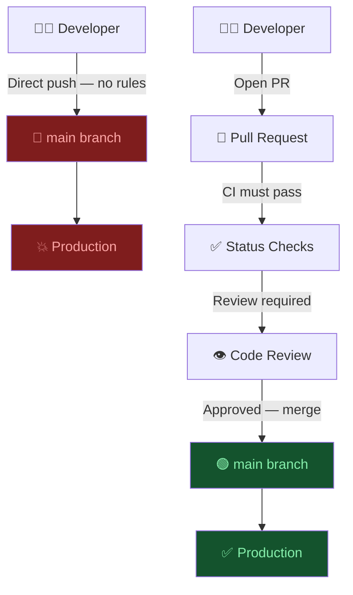
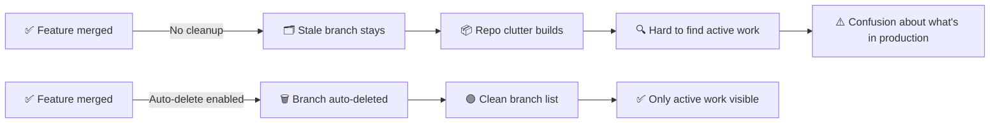

# D1: Branch Management & Protection

> **Exam weight**: 33% · **Questions**: ~28 in the bank

## Overview

This domain covers how a team keeps its important branches trustworthy: which changes are allowed in, who has to look at them first, and what evidence must exist before a merge. On GitHub that means two enforcement systems, classic **branch protection rules** and **repository rulesets**. Around them sit CODEOWNERS for routing reviews, required checks and deployments as merge gates, and a branching strategy that keeps branches short-lived enough for all of this to stay cheap.

> 💡 **Human Angle**: Protect main like a production server. Every unreviewed commit to main is a change to production that nobody signed for.

<div class="note-important"><strong>Branch protection is one of the most impactful controls GitHub offers.</strong> An unprotected main branch means any collaborator, or anyone holding a stolen credential, can push code straight to production. Audits routinely rate it as a Critical or High finding.</div>

---

## 1.1 Branch Protection Rules: The Core Controls

### Key Concept

**A protected branch only accepts changes that arrive the way you said they must: reviewed, tested and current.**

A branch protection rule matches one or more branches by name pattern and attaches requirements to them. The main ones are: require a pull request, require N approvals, dismiss stale approvals, require review from code owners, require approval of the most recent reviewable push, require status checks, require conversation resolution, require signed commits, require linear history, require deployments, require a merge queue, and lock the branch. Force pushes and deletions are blocked on protected branches by default.

Only one classic branch protection rule can apply to a branch at a time, so the most specific match wins and the other rules are ignored. **Think of each requirement as a separate lock on the same door**: adding locks makes the door harder to open, but leaving one off tells you exactly where someone will get through.

### The Story: "The Midnight Push"

A team ships a microservices platform with no branch protection on main. On a Friday night an engineer pushes a hotfix directly to main, skipping review. The fix introduces a race condition, and by Monday the production database has duplicate records. It takes three engineers two days to untangle.

The bug wasn't the root cause. The root cause was that **nothing stopped the direct push**.



### The Controls Every Protected Branch Needs

| Control | What it does | Default when you create a rule | Should be |
|---|---|---|---|
| **Require a pull request before merging** | Blocks direct pushes; changes must arrive via PR | Off | **On** |
| **Required approvals** | Minimum number of approving reviews from people with write access | Set when you enable PRs | **1–2** |
| **Dismiss stale approvals** | Approvals are dismissed when new commits change the PR diff | Off | **On** |
| **Require approval of the most recent reviewable push** | The latest push must be approved by someone other than the person who pushed it | Off | **On** for regulated repos |
| **Require status checks** | Named checks must pass; "strict" also requires the branch to be up to date | Off | **On** |
| **Require conversation resolution** | All review comment threads must be resolved | Off | **On** |
| **Allow force pushes** | Lets selected people rewrite history | Off (force pushes blocked) | **Leave off** |
| **Allow deletions** | Lets people with write access delete the branch | Off (deletion blocked) | **Leave off** |
| **Do not allow bypassing the above settings** | Applies the rule to admins and "bypass branch protections" roles too | Off | **On** |

### In Practice

**What breaks without this**: Approvals go stale without anyone noticing. A PR approved on Monday picks up fifteen more commits on Tuesday, and without stale-approval dismissal Monday's approval still counts for code nobody reviewed. That is the most common gap auditors find in repos that think they are protected.

**Decision trigger**: Ask: "If this branch received a bad commit, would we be able to show who reviewed the final version and which checks passed?" If the answer depends on people behaving well instead of on a setting, a control is missing.

**When you'd choose differently**: Throwaway prototype repositories, personal sandboxes and documentation-only repos with a single maintainer often run with a lighter rule (PR required, zero approvals, checks only). Heavy review rules on a one-person repo create self-approval workarounds and teach people to route around controls.

### Exam Trap ⚠️

<div class="note-trap">
"Dismiss stale approvals" and "Require approval of the most recent reviewable push" are different controls. Dismissing stale approvals forces a re-review after new commits, but the person who pushed those commits can still be one of the re-approvers. Only the most-recent-push setting requires someone <em>other than the last pusher</em> to approve. When a scenario says "a reviewer pushed a fix and then approved it", the answer is the most-recent-push setting, not stale dismissal.
</div>

---

## 1.2 Bypass, Admins and Break-Glass Access

### Key Concept

**By default, repository admins are not bound by branch protection; you have to opt them in.**

Classic branch protection does not apply to people with admin permission on the repository, or to custom roles with the "bypass branch protections" permission, unless you enable **Do not allow bypassing the above settings**. A compromised admin credential therefore skips every control on an otherwise well-protected branch. "Restrict who can push to matching branches" narrows who may push at all, but repository admins can always push when bypass is allowed.

Rulesets handle this differently. Nobody bypasses a ruleset unless they are on its **bypass list**, which can name roles, teams, GitHub Apps or Dependabot, and each entry can be "Always allow" or "For pull requests only". **Think of the bypass list as the building's master-key register**: master keys exist, but the register says exactly who holds one, and you can hand out keys that only open the door from the inside.

### In Practice

**What breaks without this**: An admin force-pushes over three days of merged work during a "quick cleanup", or a stolen admin token pushes a backdoor straight to main. Both happen without a single review, because admin bypass was left at its default.

**Decision trigger**: Ask: "Who can change this branch without going through the gate, and would we notice?" If the honest answer is "any admin, silently", enable no-bypass (classic) or move the branch to a ruleset with a small, named bypass list.

**When you'd choose differently**: An emergency path is legitimate, but it should be a deliberate break-glass design: a ruleset bypass entry for a small incident team, ideally "For pull requests only" so even emergency changes leave a PR trail. Temporarily disabling protection is the wrong tool, because it opens the door for everyone and is easy to forget to close.

### Exam Trap ⚠️

<div class="note-trap">
Distractors suggest "temporarily disable branch protection" or "add the on-call engineer to the admin team" for incidents. Both widen access for everyone or forever. The exam rewards a scoped bypass on a ruleset. Remember: classic protection uses an on/off "do not allow bypassing" switch, while rulesets use an explicit bypass list. Don't mix their vocabulary.
</div>

---

## 1.3 Repository Rulesets vs Branch Protection Rules

### Key Concept

**Rulesets stack; classic branch protection rules don't, so with rulesets the strictest requirement always wins.**

A ruleset is a named set of rules targeting branches, tags or (for push rulesets) every push to the repository. Unlike classic rules, **multiple rulesets can apply at once**. They have no priority order: GitHub aggregates them, and where the same rule is defined differently the most restrictive version applies. Rulesets also layer with any classic branch protection rule on the same branch. Each ruleset has an enforcement status (Active or Disabled, plus Evaluate for testing on plans that offer it), and anyone with read access can see which rulesets are active.

Organization rulesets (GitHub Team and GitHub Enterprise plans) let one configuration target all repositories, selected repositories, repositories matching a name pattern, or repositories filtered by **custom properties**. **Think of rulesets like building codes from city, state and federal authorities**: each layer adds requirements, and a building must meet the strictest of them, not just the one issued last.

### Ruleset capabilities that classic protection lacks

| Capability | Classic branch protection | Rulesets |
|---|---|---|
| More than one rule on a branch | No, one rule applies | Yes, aggregated, most restrictive wins |
| Organization-wide targeting | No, per repository | Yes: all, by name, by custom property |
| Turn off without deleting | No | Yes, change the enforcement status |
| Tag protection | No | Yes, tag rulesets (they replaced the old tag protection rules, sunset in 2024) |
| Push rules (file path, extension, size) | No | Yes, push rulesets for private and internal repos and their forks |
| Commit metadata and branch name patterns | No | Yes, metadata restrictions ("Restrict commit metadata", "Restrict branch names") |
| Code scanning / secret scanning merge gates | Via required checks only | "Require code scanning results" rule; secret scanning rule in preview |
| Required reviewers by path | No | Yes, required reviewers by path (team-based, not for user-owned repos) |
| Bypass model | Admin on/off switch | Bypass list, "Always allow" or "For pull requests only" |

### In Practice

**What breaks without this**: Branch protection drifts in a 200-repo organization. Every new repo starts unprotected until someone remembers to configure it, and per-repo API scripts only fix the repos that existed when the script last ran.

**Decision trigger**: Ask: "Does this requirement apply to one repo or to a class of repos?" If it applies to a class ("every production service", "every repo with `tier=critical`"), write an organization ruleset targeted by custom property and let repository admins add stricter local rules on top.

**When you'd choose differently**: For a single personal or small-team repository, a classic branch protection rule is perfectly adequate and is what many tools and tutorials still configure. There is no need to migrate working classic rules just for the sake of it, and because the two systems layer, you can add rulesets alongside them gradually.

### Exam Trap ⚠️

<div class="note-trap">
The trap is "the repository rule overrides the organization ruleset" or "the newer rule wins". Neither is true. All applicable rulesets plus any branch protection rule are combined, and the most restrictive version of each rule applies. If the org ruleset requires 2 approvals and the repo rule requires 1 approval plus code owner review, the PR needs 2 approvals <em>and</em> code owner review. Second trap: org rulesets target repos by name or <strong>custom property</strong>, not by topic.
</div>

---

## 1.4 CODEOWNERS: Automated Expert Review

### Key Concept

**CODEOWNERS routes reviews automatically; "Require review from Code Owners" is what turns routing into a gate.**

A `CODEOWNERS` file maps path patterns to users or teams. GitHub looks for it in `.github/`, then the repository root, then `docs/`, and uses the first one it finds. When a PR touches matching files, the owners are requested as reviewers automatically, except on draft PRs, where they're requested once the PR is marked ready. Owners must have write access (teams must be visible and have write access), the file must be under 3 MB, and invalid lines are skipped.

Order matters: **the last matching pattern wins**, so put broad defaults first and specific paths later. The PR uses the CODEOWNERS file **on its base branch**, so editing CODEOWNERS in a PR doesn't change who must review that PR. **Think of CODEOWNERS like a hospital's on-call rota**: it pages the right specialist automatically, but the surgery only waits for them if policy says sign-off is mandatory.

```
# .github/CODEOWNERS

# Default: every PR needs at least one lead review (listed first so later rules override it)
*                     @team-lead

# Infrastructure: always needs DevOps review
/terraform/           @team-devops
/k8s/                 @team-devops

# Security-critical code
/src/auth/            @security-lead @team-lead
/src/payments/        @security-lead

# Database migrations: always need DBA sign-off
/migrations/          @dba-team

# Protect the rules themselves
/.github/CODEOWNERS   @security-lead
/.github/workflows/   @team-devops
```

<div class="note-scribble">CODEOWNERS removes the "I forgot to add a reviewer" problem. The moment you open a PR touching /migrations/, the DBA team is automatically requested. Note the order: in the original version of this file, the catch-all <code>*</code> line sat at the bottom, and because the last match wins, it silently overrode every specific rule above it.</div>

CODEOWNERS syntax follows `.gitignore` with three exceptions: no `!` negation, no `[ ]` character ranges, and no `\#` escaping of a leading hash.

### In Practice

**What breaks without this**: Database migrations get merged with an approval from a frontend developer because they were the first person free. Or a catch-all `*` line placed at the bottom of the file silently overrides every specific rule above it.

**Decision trigger**: Ask: "Is there a path where a mistake is expensive and only certain people can judge it?" If yes, give that path an owner and turn on "Require review from Code Owners". For large owner teams, enable the team's automatic review assignment (round robin or load balance) so one or two people are requested instead of fifteen.

**When you'd choose differently**: In small, high-trust teams where everyone reviews everything, a single catch-all owner adds friction without routing value. Required approvals alone are enough there. Also, CODEOWNERS doesn't follow files when they move, so very volatile directory structures need regular CODEOWNERS maintenance or broader patterns.

### Exam Trap ⚠️

<div class="note-trap">
Three classic traps: (1) <strong>last match wins</strong>, not first match and not "most specific"; (2) owners are only <em>required</em> when "Require review from Code Owners" is enabled, otherwise they are just requested; (3) the <strong>base branch's</strong> CODEOWNERS applies, so a PR that adds its author as owner still needs the existing owners' approval.
</div>

---

## 1.5 Status Checks, Deployments and Merge Automation

### Key Concept

**A check that isn't marked required is only advice; it never blocks a merge.**

Required status checks name the checks that must succeed before a merge. With **strict** mode ("Require branches to be up to date before merging") the PR branch must also contain the latest base commit, so it was tested against what it will merge into. **Require deployments to succeed** goes further and gates the merge on a successful deployment to named environments such as `staging`. A **merge queue** gives busy branches the safety of strict mode without making every author rebase repeatedly.

Auto-merge is the author-side convenience: enable it on a PR and GitHub merges once every requirement is met, without bypassing any of them. **Think of required checks like a pre-flight checklist**: the plane can technically take off without it, which is exactly why the checklist has to be mandatory and not a suggestion pinned to the cockpit wall.

```yaml
# Checks you would mark as required on main
- build          # Does it compile?
- test           # Do all tests pass?
- lint           # Code style / quality gate
- security-scan  # Code scanning or dependency review
```

<div class="note-important"><strong>A check only blocks merges if it actually runs on the PR and is listed as required.</strong> The workflow must trigger on <code>pull_request</code> (or <code>merge_group</code> when using a merge queue), and its check name must be selected under required status checks in the branch protection rule or ruleset.</div>

### In Practice

**What breaks without this**: CI goes red on a PR and someone merges anyway, because "Merge" was still green. Or two PRs that each pass alone are merged in quick succession and break main together, because neither was tested against the other (no strict mode or merge queue).

**Decision trigger**: Ask: "Which signals must be green before a human is even allowed to press Merge?" Those are your required checks. If main breaks from interactions between PRs more than about once a month, add strict mode or a merge queue.

**When you'd choose differently**: On very high-throughput monorepos, strict mode creates an endless "update branch" treadmill, so use a merge queue instead. On low-traffic repos, loose mode (no up-to-date requirement) is usually fine, and requiring deployments can be excessive when there is no staging environment worth gating on.

### Exam Trap ⚠️

<div class="note-trap">
"Require deployments to succeed before merging" is distinct from required status checks. If a question is about gating a merge on a successful <em>environment deployment</em> such as staging, the deployments setting is the native answer. Second trap: renaming a workflow job renames its check, and the old required check then waits forever as "Expected".
</div>

---

## 1.6 Branching Strategies and Merge Methods

### Key Concept

**Short-lived branches make every other control cheap; long-lived branches make every merge an incident.**

**GitHub flow** is one long-lived branch (main), with short-lived feature branches merged by PR and deployed from main. **Trunk-based development** is the same idea pushed further: branches live for hours, and incomplete work ships dark behind feature flags. **GitFlow** adds `develop`, `release/*` and `hotfix/*` branches, which suits scheduled, versioned releases but slows teams that deploy many times a day.

Merge method shapes history. A merge commit keeps every commit plus a merge bubble. Squash merging produces one commit per PR (good for Conventional Commits release tooling). Rebase merging replays commits linearly. "Require linear history" allows only squash or rebase. **Think of a long-lived branch like a letter written over three months**: by the time you post it, half the addresses have changed.

| Strategy | Branch lifetime | Release style | Best fit |
|---|---|---|---|
| Trunk-based | Hours to 1–2 days | Continuous, feature flags | High-frequency delivery, strong CI |
| GitHub flow | Days | Deploy from main after merge | Most web services and SaaS teams |
| GitFlow | Weeks (develop/release) | Scheduled, versioned | Packaged or installed software with support branches |

### In Practice

**What breaks without this**: A three-month feature branch diverges so far from main that the final merge takes a week of conflict resolution, and integration bugs that would have surfaced in week one surface in month three.

**Decision trigger**: Ask: "How often do we deploy, and do we have to support old versions?" Deploying daily with one supported version points to trunk-based or GitHub flow. Shipping versioned releases with maintained older lines points to GitFlow-style release branches, which you lock once they're end-of-life.

**When you'd choose differently**: Squash merging loses individual commits, which hurts when a PR deliberately contains several meaningful, bisectable commits. Rebase merging suits those teams. Required signed commits can also interact with merge methods: unsigned commits on a PR's head branch can block a squash merge even though GitHub signs the squash commit itself.

### Exam Trap ⚠️

<div class="note-trap">
"Require linear history" blocks merge commits; it doesn't enforce review and doesn't lock tags. And Draft PRs, not "WIP:" title prefixes, are GitHub's native way to share unfinished work: drafts can't be merged and don't request code owners until they're marked ready.
</div>

---

## 1.7 Branch Naming Conventions

### Key Concept

**A naming convention is only real when something rejects names that break it.**

Prefixes such as `feature/`, `fix/`, `hotfix/` and `release/` make intent visible and allow pattern-based rules (for example, a ruleset that protects `release/**`). Without enforcement, branches like `johns-stuff` and `temp2` accumulate within weeks.

There are two enforcement points. Rulesets can **restrict branch names** with a metadata pattern, rejecting the branch at push time. A PR workflow that validates `github.head_ref` and is a required check blocks the merge instead. **Think of the convention as a dress code**: posting it on the door informs people, but only the doorman checking names actually enforces it.

| Prefix | Purpose | Example |
|---|---|---|
| `feature/` | New functionality | `feature/user-authentication` |
| `fix/` or `bugfix/` | Bug fixes | `fix/login-redirect-loop` |
| `hotfix/` | Critical production fix | `hotfix/payment-null-reference` |
| `release/` | Release preparation | `release/v2.4.0` |
| `chore/` | Non-functional changes (deps, config) | `chore/upgrade-node-22` |
| `docs/` | Documentation only | `docs/api-reference-update` |

```yaml
# .github/workflows/branch-naming.yml
name: Branch Naming Convention
on:
  pull_request:
    branches: [main, develop]

permissions:
  contents: read

jobs:
  check-branch-name:
    runs-on: ubuntu-latest
    steps:
      - name: Validate branch name
        env:
          BRANCH: ${{ github.head_ref }}   # pass via env: branch names are attacker-controllable
        run: |
          PATTERN="^(feature|fix|hotfix|release|chore|docs)/.+"
          if ! echo "$BRANCH" | grep -qE "$PATTERN"; then
            echo "Branch '$BRANCH' does not match convention: $PATTERN"
            exit 1
          fi
```

<div class="note-scribble">The branch name is passed through <code>env:</code> rather than interpolated straight into the script. A branch name is attacker-controlled input for PRs from forks; see the script-injection section in D2.</div>

### In Practice

**What breaks without this**: Pattern-based protection silently misses branches. If your rule protects `release/*` and someone creates `Release-2.4`, it isn't protected, and nobody notices until a force-push lands on it.

**Decision trigger**: Ask: "Do any rules, automations or deploy filters depend on branch names?" If yes, naming is a control, not a style choice, and needs enforcing.

**When you'd choose differently**: Trunk-based teams whose branches live for hours often skip naming rules, because nothing keys off them and the branches are deleted on merge.

### Exam Trap ⚠️

<div class="note-trap">
Classic branch protection patterns choose <em>which</em> branches are protected; they don't validate the names of new branches. "Configure a branch protection regex to restrict names" is a distractor. Name validation is a ruleset metadata restriction or a required CI check.
</div>

---

## 1.8 Branch Lifecycle and Read-Only Branches

### Key Concept

**Delete branches when they merge, lock branches you must keep, and protect tags you release from.**

Every merged branch left behind is clutter that hides active work. "Automatically delete head branches" removes PR branches the moment they merge, and a scheduled job can report branches that have been inactive for weeks. For branches you must keep but never change, such as an end-of-life `v1.x`, **Lock branch** makes the branch read-only (optionally still allowing fork syncing).

Release tags deserve the same care: a **tag ruleset** on `refs/tags/v*` restricting updates and deletions stops anyone outside the bypass list from moving `v1.0.0` to a different commit. **Think of a locked branch as a museum exhibit**: everyone can look at it and photograph it, but nobody gets to rearrange it.



| Layer | Mechanism | When |
|---|---|---|
| **Auto-delete merged** | Setting: "Automatically delete head branches" | Immediately after merge |
| **Stale detection** | Scheduled workflow listing branches with no commits for 30+ days | Weekly |
| **Abandoned cleanup** | Notify the owner; delete if there's no response in 14 days (excluding `release/*`, `hotfix/*`) | Monthly |
| **Keep but freeze** | Lock branch on end-of-life lines | When support ends |

```yaml
# .github/workflows/stale-branches.yml
name: Stale Branch Report
on:
  schedule:
    - cron: '0 9 * * 1'  # Monday 09:00 UTC

jobs:
  detect-stale:
    runs-on: ubuntu-latest
    permissions:
      contents: read
    steps:
      - uses: actions/checkout@11bd71901bbe5b1630ceea73d27597364c9af683  # v4.2.2
        with:
          fetch-depth: 0
      - name: Find stale branches
        run: |
          CUTOFF=$(date -d '30 days ago' +%Y-%m-%d)
          git branch -r --sort=committerdate \
            --format='%(refname:short) %(committerdate:short)' \
            | awk -v cutoff="$CUTOFF" '$2 < cutoff && $1 !~ /HEAD|main|develop|release\// {print $1}'
```

### In Practice

**What breaks without this**: A blunt "delete everything older than 90 days" job deletes a `release/2023-lts` branch that customers still receive patches from. Or a developer moves a release tag, and downstream builds that pin `v1.0.0` silently pick up different code.

**Decision trigger**: Ask: "Is this branch or tag something people or systems depend on staying put?" If yes, lock it (branch) or ruleset-protect it (tag). If no, it should be deleted automatically.

**When you'd choose differently**: To retire a whole repository rather than one branch, archive the repository. Archiving makes everything read-only, including issues and PRs, which lock branch doesn't do.

### Exam Trap ⚠️

<div class="note-trap">
"Tag protection rules" are the old feature; GitHub sunset them in 2024 and migrated them to tag rulesets. If an option mentions tag protection by ruleset (targeting <code>refs/tags/...</code> with restrict updates/deletions), prefer it. And "lock branch" means read-only for that branch; "archive" means read-only for the whole repository.
</div>

---

## 1.9 Signed Commits and the Risk Matrix

### Key Concept

**Signing proves who made a commit; it says nothing about whether anyone reviewed it.**

"Require signed commits" accepts only commits that are signed and verified against a GPG, SSH or S/MIME key on the committer's GitHub account. Git otherwise trusts whatever name and email a developer configures, so without signing, anyone can author commits "as" a colleague. Vigilant mode only *labels* unsigned commits as Unverified; it enforces nothing.

Because signing and review answer different questions, compliance regimes usually want both. **Think of a signature on a cheque**: it proves who wrote it, but someone still has to check the amount.

```bash
# Developer setup (SSH signing)
git config --global gpg.format ssh
git config --global user.signingkey ~/.ssh/id_ed25519.pub
git config --global commit.gpgsign true
# GitHub: add the key as a *signing* key; then enable "Require signed commits" on the branch or ruleset
```

| Risk | Impact | Likelihood with no protection | Control |
|---|---|---|---|
| Direct push breaks production | Critical | High | Require PR + checks |
| Compromised credential pushes malicious code | Critical | Medium | No-bypass, signed commits, push restrictions |
| Accidental force-push rewrites history | High | Medium | Keep force pushes blocked |
| Merge without review introduces vulnerability | High | High | Required approvals + code owners |
| Protected branch deleted | High | Low | Keep deletions blocked |
| Release tag moved | High | Low | Tag ruleset |

### In Practice

**What breaks without this**: An auditor asks you to prove that a commit attributed to a senior engineer was really theirs, and you can't. Git metadata is self-asserted.

**Decision trigger**: Ask: "Do we need non-repudiation (SOC 2 change management, FedRAMP, supply-chain attestations)?" If yes, require signed commits and make sure bots sign too, for example by having automation create commits through the GitHub API, which GitHub signs.

**When you'd choose differently**: For open-source projects with many casual contributors, required signing raises the contribution barrier. Many projects require signing only on release branches, or rely on squash merges (which GitHub signs) while being aware of the head-branch caveat above.

### Exam Trap ⚠️

<div class="note-trap">
"A CI workflow that checks signatures" detects unsigned commits only after they're pushed; the native rule rejects them at the door. "Vigilant mode" is a display setting. "Add GPG keys to accounts" is a prerequisite, not enforcement.
</div>

---

## Deep Dive: Making Branch Management Click

### 1. The connective narrative

Every control in this domain answers one question: *what has to be true before a change becomes part of main?* Requiring a PR says the change must be visible. Approvals, stale dismissal and most-recent-push approval say a person other than the author must have seen the *final* version. Required checks and deployments say machines must have tested it. Signed commits say we know who made it. Force-push and deletion blocks say that once something is in, the record of it can't be erased.

The two enforcement systems are two generations of the same idea. Classic branch protection is per-repository, one rule per branch, with an on/off admin bypass. Rulesets are layered, can be organization-wide, can target tags and pushes, and replace the admin switch with an explicit bypass list. Because they aggregate (most restrictive wins), an organization can set a floor and repositories can only raise it.

CODEOWNERS and branching strategy are what make the controls sustainable. CODEOWNERS sends each review to someone qualified, so requiring approvals doesn't become rubber-stamping. Short-lived branches keep PRs small enough to review properly and keep strict mode affordable. Lifecycle hygiene (auto-delete, lock, tag rulesets) keeps the set of things you have to protect small and well defined.

### 2. Worked scenario

> **Scenario.** A fintech organization has 180 repositories. An audit finds: 40 repos with no protection on main; several repos where admins pushed directly; release tags moved twice last year; and a payments PR approved by a frontend engineer.
>
> **Step 1: Set a floor across the organization.** Create an organization ruleset targeting the default branch of every repository with the custom property `tier=production`. Rules: require a pull request with 2 approvals, dismiss stale approvals, require approval of the most recent reviewable push, require conversation resolution, require status checks `build` and `test` (strict), block force pushes, restrict deletions. This fixes the 40 unprotected repos and every repo created later, because new production repos get the property and inherit the ruleset.
>
> **Step 2: Close admin bypass.** Rulesets don't exempt admins unless they're on the bypass list. Add only an `incident-response` team, with bypass mode "For pull requests only", so even emergency changes leave a PR. Existing classic rules stay in place and layer with the ruleset; where they're weaker, the ruleset's stricter rules apply anyway.
>
> **Step 3: Route expert review.** In the payments repo, add `/src/payments/ @payments-team` *after* the catch-all line in CODEOWNERS, protect `/.github/CODEOWNERS` with `@security-lead`, and add "Require review from Code Owners" through a repository ruleset. The frontend engineer's approval still counts toward the two approvals, but the PR can't merge without a payments-team approval.
>
> **Step 4: Freeze releases.** Add an organization tag ruleset on `refs/tags/v*` that restricts updates and deletions, with the release GitHub App as the only bypass actor.
>
> **Outcome:** Four configurations (one branch ruleset, one tag ruleset, CODEOWNERS edits, one repo ruleset) replace 180 hand-maintained settings pages, and every finding maps to a specific rule.

### 3. Memory aid

**PROTECT**: the questions to ask of any important branch:

- **P**ull request required: no direct pushes
- **R**eviews: approvals, stale dismissal, most-recent-push approval
- **O**wners: CODEOWNERS, with code owner review required
- **T**ests: required status checks (strict or merge queue) and deployments
- **E**veryone bound: no admin bypass; explicit ruleset bypass list
- **C**an't rewrite: force pushes and deletions blocked, signed commits, tag rulesets
- **T**argeted at scale: org rulesets by name or custom property

### 4. Exam strategy for this domain

- **Look-alike settings** are the main trap: stale dismissal vs most-recent-push approval; required checks vs required deployments; lock branch vs archive; classic "do not allow bypassing" vs ruleset bypass list.
- **"Overrides" language is usually wrong** for rulesets. They aggregate, and the most restrictive rule wins.
- **Native beats custom.** When a native setting exists (auto-merge, team review assignment, require signed commits), the exam prefers it over webhooks or homemade workflows. The exception is branch-name validation, where a required check is a legitimate answer alongside ruleset metadata restrictions.
- **Watch scope words**: "all 200 repositories" points to an organization ruleset; "this one branch must never change" points to lock branch; "tags" points to a tag ruleset.
- Five minutes before the exam: *A rule only protects what it targets, binds only who it doesn't exempt, and requires only what is marked required.*

---

## Cheat Sheet 📋

| Control | Where | Key rule |
|---|---|---|
| Branch protection on `main` | Settings → Branches (classic) or Settings → Rules → Rulesets | One classic rule per branch; rulesets layer |
| Require PR + approvals | Branch rule / ruleset "Require a pull request" | Approvals come from people with write access |
| Dismiss stale approvals | Branch rule / ruleset | New commits that change the diff dismiss approvals |
| Most recent push approval | Branch rule / ruleset | Approver must differ from the last pusher |
| Required status checks | Branch rule / ruleset | Strict = must be up to date; check must run on `pull_request` |
| Require deployments | Branch rule / ruleset | Gate merge on environment deployment |
| Admin bypass disabled | "Do not allow bypassing the above settings" | Admins bypass classic rules by default |
| Ruleset bypass | Bypass list | "Always allow" vs "For pull requests only" |
| Org-wide enforcement | Organization rulesets (Team/Enterprise) | Target by name pattern or custom property |
| CODEOWNERS | `.github/`, root, or `docs/` | Last match wins; base branch's file applies; < 3 MB |
| Code owner review | "Require review from Code Owners" | Without it, owners are only requested |
| Force push / deletion | Blocked by default on protected branches | Leave blocked on main |
| Tag immutability | Tag ruleset on `refs/tags/v*` | Tag protection rules were sunset in 2024 |
| Freeze a branch | Lock branch | Read-only; optional fork syncing |
| Auto-delete merged branches | Settings → General | Removes head branches on merge |
| Signed commits | Branch rule / ruleset | Verified GPG, SSH or S/MIME signatures only |

<div class="note-important"><strong>The minimum viable protection setup is: require a PR, 1 approval, and at least one required CI check, with no admin bypass.</strong> Everything else is hardening, but that minimum must exist on every team's main branch before anything else.</div>
