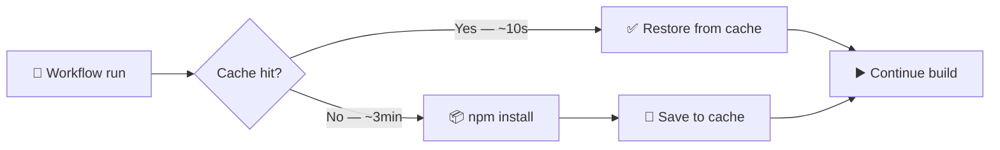
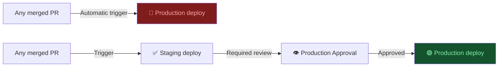

# D2: GitHub Actions & CI/CD

> **Exam weight**: 33% · **Questions**: ~28 in the bank

## Overview

GitHub Actions runs your code, often with your secrets and a token that can write to your repository. This domain covers how to make that safe: least-privilege tokens, secrets and OIDC instead of long-lived keys, pinned dependencies, and treating untrusted input as data. It also covers making pipelines fast and maintainable, with caching, reusable workflows, composite actions, environments and deployment gates, concurrency and timeouts.

> 💡 **Human Angle**: Automation is only as trustworthy as the controls around it. A misconfigured workflow isn't a safety net; it's a door with your keys hanging in the lock.

<div class="note-important"><strong>Workflows run with access to secrets and repository write permissions.</strong> A single workflow with an overly broad token, an unpinned third-party action or an injectable script can compromise your repository, your packages or your production environment.</div>

---

## 2.1 GITHUB_TOKEN and Least-Privilege Permissions

### Key Concept

**Give every job the smallest token that still works; when you list one permission, all unlisted ones drop to none.**

At the start of each job GitHub creates a `GITHUB_TOKEN`, an installation access token scoped to the repository that contains the workflow. It expires when the job finishes (or at its maximum lifetime). Its default permissions come from the repository or organization setting, which is either *permissive* (read/write on most scopes) or *restricted* (read-only contents and packages). Setting restricted as the default is the documented good practice.

The `permissions` key overrides the default at workflow or job level. If you specify access for any scope, every scope you didn't specify is set to `none`; `permissions: {}` disables them all. For `pull_request` events from forks, GitHub changes any write permissions to read-only. **Think of the token like a hotel key card**: it opens only the rooms you were assigned, and it stops working at checkout.

### The Story: "The Leaked Token"

A team publishes an npm package. Their release workflow has `permissions: write-all` because the engineer copied it from a forum answer, and it uses `some-org/changelog-action@v2`. That action's maintainer account is compromised and the `v2` tag is moved to code that reads `secrets.NPM_TOKEN` and posts it to an external server. The next push to main runs the poisoned action with the write-all token and the npm token in reach. The attacker publishes a malicious version of the package.

**Root causes:**
1. `write-all` permissions gave every step far more access than it needed.
2. A tag reference let someone else change the code that ran.
3. A long-lived publishing token sat in a secret available to every job.

```yaml
# ❌ WRONG: every job and every action gets write access to everything
permissions: write-all

# ✅ CORRECT: read-only default, elevated per job
permissions:
  contents: read

jobs:
  test:
    runs-on: ubuntu-latest
    steps: [...]
  comment:
    runs-on: ubuntu-latest
    permissions:
      contents: read
      pull-requests: write   # post PR comments only
    steps: [...]
```

### In Practice

**What breaks without this**: One compromised action in any job gets a token that can push to branches, rewrite releases and move tags. The blast radius of every dependency becomes "the whole repository".

**Decision trigger**: Ask: "What is the single most powerful thing this job needs to do?" Grant exactly that scope on that job (`contents: write` to create a release, `id-token: write` for OIDC, `packages: write` to push to GHCR) and keep the workflow default at `contents: read`.

**When you'd choose differently**: Some operations can't be done with `GITHUB_TOKEN` at all. Events it creates generally don't trigger new workflow runs (except `workflow_dispatch` and `repository_dispatch`), and it can't reach other repositories. For those, use a GitHub App installation token scoped to the target repos, not a personal access token.

### Exam Trap ⚠️

<div class="note-trap">
"Fork PRs get the write-all token" is false: under <code>pull_request</code>, fork runs are downgraded to read-only and don't get repository secrets. The real danger of broad permissions is in <em>trusted</em> runs (push, <code>pull_request_target</code>, <code>workflow_run</code>, schedules) where a compromised action or injected script inherits the full token. Also: the token is limited to its own repository, not to "every repo in the organization".
</div>

---

## 2.2 Secrets, Variables and Their Hierarchy

### Key Concept

**Secrets hold credentials, variables hold configuration, and the most specific scope wins when names collide.**

Secrets exist at organization, repository and environment level. When the same name exists at several levels, the lowest level takes precedence: environment over repository, repository over organization. Environment secrets are only available to jobs that reference that environment, and if the environment requires reviewers the job can't read them until someone approves. Configuration variables (`vars` context) are for non-sensitive values and are not masked.

Secrets are redacted in logs, but redaction can fail for structured data such as a JSON blob stored as one secret, and values derived from a secret aren't masked automatically (use `::add-mask::`). Dependabot-triggered runs read **Dependabot secrets**, not Actions secrets. **Think of the hierarchy like dress codes**: the company sets a default, the department can override it, and the specific event's rule beats both.

| Level | Scope | Use for |
|---|---|---|
| **Organization secrets** | All or selected repos | Shared registry credentials, org-wide tooling |
| **Repository secrets** | One repo, all workflows | Repo-specific tokens, staging keys |
| **Environment secrets** | Jobs that declare `environment: <name>` | Production credentials behind approval |
| **Dependabot secrets** | Dependabot-triggered runs | Private registry access for Dependabot |
| **Variables (`vars`)** | Org / repo / environment | Non-sensitive config: hostnames, flags, regions |

### In Practice

**What breaks without this**: A production database password stored as a repository secret is readable by every workflow in the repo, including a test workflow that a contributor can modify in a PR from a branch. Environment secrets behind required reviewers would have kept it out of reach.

**Decision trigger**: Ask: "Which jobs need this value, and should a human approve before they get it?" If only deploy jobs need it, make it an environment secret. If it isn't sensitive, make it a variable so it shows in logs and is easy to debug.

**When you'd choose differently**: The best secret is no secret. For cloud deploys, use OIDC (next section) and store nothing. For GitHub API automation across repos, use a GitHub App so tokens are minted per run instead of stored for months.

### Exam Trap ⚠️

<div class="note-trap">
Precedence is environment → repository → organization (most specific wins), not "organization always wins" or "most recently created wins". And workflow YAML is committed to the repo, so <code>env:</code> blocks in YAML are never a place for credentials.
</div>

---

## 2.3 OpenID Connect (OIDC): Deploying Without Stored Cloud Keys

### Key Concept

**OIDC swaps stored cloud keys for a short-lived token the cloud provider issues to one job, on conditions you define.**

With OIDC, a job with `permissions: id-token: write` asks GitHub's OIDC provider for a signed JWT describing the run (repository, ref, environment, workflow). The job presents it to the cloud provider (AWS STS, Azure Entra ID, GCP), which checks the token's claims against the trust conditions on a role and returns a short-lived access token that is valid only for that job. `id-token: write` only allows *requesting* the JWT; it grants no write access to repository resources.

Security lives in the trust conditions. GitHub says you must define at least one condition so untrusted repositories can't get tokens for your cloud resources; typically you check `aud` together with `sub`. **Think of it like a guest list at a venue**: the ID card (JWT) proves who you are, but the bouncer (trust policy) still decides whether that name is on tonight's list.

| Context | Default `sub` claim format |
|---|---|
| Job references an environment | `repo:ORG/REPO:environment:ENV_NAME` |
| Pull request (no environment) | `repo:ORG/REPO:pull_request` |
| Branch (no environment, not a PR) | `repo:ORG/REPO:ref:refs/heads/BRANCH` |
| Tag (no environment, not a PR) | `repo:ORG/REPO:ref:refs/tags/TAG` |

```yaml
jobs:
  deploy:
    runs-on: ubuntu-latest
    environment: production          # sub becomes repo:my-org/my-repo:environment:production
    permissions:
      id-token: write                # request the OIDC JWT
      contents: read
    steps:
      - uses: aws-actions/configure-aws-credentials@<full-sha>  # vX.Y.Z
        with:
          role-to-assume: arn:aws:iam::123456789012:role/deploy-prod
          aws-region: eu-west-1
```

### In Practice

**What breaks without this**: `AWS_ACCESS_KEY_ID` stored as a secret works until it leaks, and then it keeps working for the attacker until someone notices and rotates it. Even with OIDC, a trust policy that only checks `aud = sts.amazonaws.com` lets *any* GitHub workflow anywhere that requests that audience assume your role.

**Decision trigger**: Ask: "Does this cloud provider support OIDC federation?" If yes, use it, and pin the trust condition to the narrowest `sub` that works (prefer the environment form so the approval gate and the credential gate coincide).

**When you'd choose differently**: Targets that can't federate (some SaaS APIs, legacy on-prem systems) still need stored secrets. Put them in environment secrets behind reviewers and rotate them. Organizations with many repos can customize the `sub` template (for example to include `job_workflow_ref`) so trust is pinned to a specific reusable workflow, but the cloud-side condition must be updated first or tokens will be rejected.

### Exam Trap ⚠️

<div class="note-trap">
"Store the keys in an environment secret instead" improves scoping but still leaves a long-lived key; OIDC removes it. "Use <code>id-token: read</code>" is not a thing; the permission is <code>id-token: write</code>, and it doesn't let the job write to the repo. A trust policy with no <code>sub</code> condition is the most common OIDC misconfiguration.
</div>

---

## 2.4 Supply Chain: Pinning and Governing Actions

### Key Concept

**A tag is a pointer someone else can move; a full-length commit SHA is not.**

Every `uses:` runs someone else's code with your token and secrets in reach. GitHub's guidance is to pin actions to a **full-length commit SHA** (verified to come from the action's own repository, not a fork) and to pin to a tag only if you trust the creator. Organizations can enforce this: the allowed-actions policy can require SHA pinning, so any workflow that uses an unpinned action fails, and it can also allow-list or block specific actions.

Pinning isn't "set and forget". Dependabot version updates for the `github-actions` ecosystem raise PRs to bump pinned actions, and Dependabot security updates fix actions with known vulnerabilities. In 2026 GitHub added **workflow dependency lockfiles** (`.github/workflows/actions.lock`, public preview), which record the exact commit of every action, including transitive dependencies, and which GitHub describes as superseding SHA pinning for repositories that adopt them. **Think of a tag like a street address and a SHA like a fingerprint**: anyone can move into the house at an address, but nobody else has your fingerprint.

```yaml
# ❌ The tag can be moved to different code at any time
- uses: actions/checkout@v4

# ✅ SHA-pinned; the comment keeps it readable and lets Dependabot update it
- uses: actions/checkout@11bd71901bbe5b1630ceea73d27597364c9af683  # v4.2.2
```

<div class="note-scribble">SHA pinning sounds paranoid until a popular action gets compromised, which has happened more than once. Pin, let Dependabot bump the SHAs, review the diffs, and protect <code>.github/workflows/</code> with CODEOWNERS so workflow changes always get a qualified reviewer.</div>

### In Practice

**What breaks without this**: A compromised action maintainer moves `v2` to malicious code, and every repository using `@v2` runs it on the next trigger, with secrets in scope. No change shows up in your repository's history, because your workflow file didn't change.

**Decision trigger**: Ask: "If this action's repository were compromised tonight, would our next run execute the new code?" If yes, pin it, and at organization scale turn on SHA-pinning enforcement in the allowed-actions policy.

**When you'd choose differently**: Actions you own in the same repository (`uses: ./.github/actions/setup`) change with your own reviewed commits, so pinning adds nothing. Some teams also allow tag references for GitHub-authored actions (`actions/*`) as a risk trade-off, though enforcement policies don't distinguish.

### Exam Trap ⚠️

<div class="note-trap">
"Use <code>@latest</code>" or "use a verified creator" are distractors: neither makes the reference immutable. "Copy the action into the repo" works but leaves you maintaining a copy without update tooling. The exam answer is a full-length SHA with a version comment, kept current by Dependabot, and enforced org-wide by the allowed-actions SHA-pinning option.
</div>

---

## 2.5 Untrusted Input: Script Injection and Dangerous Triggers

### Key Concept

**Never interpolate untrusted `${{ }}` values into a script; pass them through an environment variable.**

Expressions are expanded into the script text *before* the shell runs. So `run: echo "${{ github.event.issue.title }}"` with a title like `"; curl …; echo "` executes the attacker's command. Issue titles and bodies, PR titles and branch names, commit messages, and review comments are all attacker-controllable. GitHub's preferred mitigation is an intermediate environment variable, or passing the value to an action as an input.

Triggers matter too. `pull_request_target` and `workflow_run` run in the *base* repository's context, with secrets and a write-capable token. GitHub advises avoiding `pull_request_target` unless necessary, and workflows using these triggers must not check out and run untrusted PR code. Artifacts from other workflows should also be treated with caution. **Think of `${{ }}` like copy-pasting a stranger's text into your terminal**: the shell doesn't know which part you typed and which part they did.

```yaml
# ❌ Vulnerable: title is pasted into the script before bash runs
- run: echo "Triaging ${{ github.event.issue.title }}"

# ✅ Safe: title arrives as data in an environment variable
- env:
    TITLE: ${{ github.event.issue.title }}
  run: echo "Triaging $TITLE"
```

| Trigger | Runs in context of | Secrets / write token for fork PRs? | Safe use |
|---|---|---|---|
| `pull_request` | Merge of PR into base | No: read-only token, no secrets | Build and test untrusted code |
| `pull_request_target` | Base branch | Yes | Label or comment only; never run PR code |
| `workflow_run` | Default branch | Yes | Post-process results; treat artifacts as untrusted |

### In Practice

**What breaks without this**: A "label new issues" workflow interpolates the issue title into `run:`, and anyone on the internet can now execute commands on your runner, with whatever token and secrets that job has.

**Decision trigger**: Ask: "Could anyone outside the team influence this string?" If yes, it goes through `env:` and is quoted in the shell, and the job's permissions are minimized in case something slips through.

**When you'd choose differently**: Values that come from trusted, fixed sources (`github.sha`, `github.run_id`, your own job outputs computed from trusted data) are safe to interpolate. The rule is about untrusted input, not every expression.

### Exam Trap ⚠️

<div class="note-trap">
"Wrap the expression in quotes" doesn't fix injection; the attacker supplies their own quote. "Mask it" only hides log output. "Set read-only permissions" reduces impact but the command still runs. And <code>pull_request_target</code> plus <code>actions/checkout</code> of the PR head SHA is the classic critical misconfiguration.
</div>

---

## 2.6 Runners: GitHub-Hosted vs Self-Hosted

### Key Concept

**Self-hosted runners should almost never run public-repository workflows.**

GitHub-hosted runners give each job a fresh, isolated VM that is discarded afterwards. Self-hosted runners are your machines: they can persist state between jobs and often sit inside your network with access to caches, credentials and internal services. On a public repository, anyone can open a PR that runs code on them.

The safe pattern for self-hosted runners is ephemeral, just-in-time runners (one job, then destroyed), organized into runner groups restricted to specific repositories, used only for private or internal repositories. **Think of a self-hosted runner as lending someone your office for an hour**: fine for a colleague, reckless for a stranger, and either way you want the room reset afterwards.

### In Practice

**What breaks without this**: A fork PR to an open-source project runs on a shared persistent runner, plants a modified tool in the toolcache, and steals credentials from the next private-repo job that runs there.

**Decision trigger**: Ask: "Who can cause a job to run on this machine, and what can that machine reach?" If the answer includes "the public" or "production networks", the runner needs to be ephemeral and tightly scoped, or replaced with a GitHub-hosted (or larger GitHub-hosted) runner.

**When you'd choose differently**: Self-hosted runners are the right call for private repos that need special hardware (GPUs, ARM boards), on-prem network access, or very long builds, provided they are ephemeral and in a restricted runner group.

### Exam Trap ⚠️

<div class="note-trap">
GitHub doesn't <em>forbid</em> self-hosted runners on public repos; it strongly advises against them. "Self-hosted runners can't use org secrets" is false. The risk the exam wants is persistence plus network access plus untrusted code.
</div>

---

## 2.7 Dependabot Configuration

### Key Concept

**Dependabot alerts tell you, security updates fix what's vulnerable, version updates keep everything current.**

There are three features. **Dependabot alerts** fire when the dependency graph contains a package with a known advisory. **Security updates** automatically open PRs that raise a vulnerable dependency to the minimum patched version; they need the dependency graph and alerts enabled, but no `dependabot.yml`. **Version updates** open PRs on a schedule for any newer version, and they *are* configured in `.github/dependabot.yml`, per ecosystem and directory.

Grouping reduces noise. Grouped security updates combine fixes per ecosystem (never across ecosystems, and never mixed with version updates), and version-update groups can bundle, say, all patch bumps. Dependabot never auto-merges on its own; you build that with a workflow. **Think of it like a car's service light, a recall notice and a maintenance schedule**: three different triggers, all useful, and confusing them is how cars end up unserviced.

### Why it matters: the unmaintained dependency problem

A service runs `lodash@4.17.4`. A command-injection vulnerability (CVE-2021-23337) affects versions before 4.17.21. Nobody on the team knows, because nothing is watching, and it sits unfixed for 14 months until an audit finds it.

```yaml
# .github/dependabot.yml (version updates)
version: 2
updates:
  - package-ecosystem: "npm"
    directory: "/"
    schedule:
      interval: "weekly"
      day: "monday"
      time: "09:00"
    open-pull-requests-limit: 10
    labels: ["dependencies", "automated"]
    groups:
      npm-patch:
        update-types: ["patch"]

  - package-ecosystem: "github-actions"   # keeps SHA-pinned actions current
    directory: "/"
    schedule:
      interval: "weekly"

  - package-ecosystem: "docker"
    directory: "/"
    schedule:
      interval: "weekly"
```

<div class="note-important"><strong>Always include <code>github-actions</code> as a Dependabot ecosystem.</strong> It keeps pinned action SHAs current, which makes SHA pinning practical instead of a slow drift towards outdated actions. To route Dependabot PRs to reviewers, use CODEOWNERS; the <code>reviewers</code> option in dependabot.yml was removed in 2025 in favour of CODEOWNERS.</div>

```yaml
# Auto-merge patch updates only (GitHub's documented pattern)
on: pull_request
permissions:
  contents: write
  pull-requests: write
jobs:
  automerge:
    runs-on: ubuntu-latest
    if: github.event.pull_request.user.login == 'dependabot[bot]'
    steps:
      - id: metadata
        uses: dependabot/fetch-metadata@<full-sha>  # vX.Y.Z
      - if: steps.metadata.outputs.update-type == 'version-update:semver-patch'
        run: gh pr merge --auto --merge "$PR_URL"
        env:
          PR_URL: ${{ github.event.pull_request.html_url }}
          GH_TOKEN: ${{ secrets.GITHUB_TOKEN }}
```

### In Practice

**What breaks without this**: A critical CVE is published for a library you use, and you find out from a customer's security scan months later instead of from a PR the next morning.

**Decision trigger**: Ask: "Do we want PRs only when something is vulnerable, or a steady stream to stay current?" Turn on alerts and security updates everywhere (org-wide via a security configuration). Add version updates with grouping where the team can absorb the PR volume.

**When you'd choose differently**: For a frozen, end-of-life service, version updates are pure noise. Keep alerts and security updates on, and turn version updates off. When the target branch uses a merge queue, the built-in token can't add PRs to the queue, so auto-merge needs a GitHub App token.

### Exam Trap ⚠️

<div class="note-trap">
"Security updates require dependabot.yml" is false; only version updates do. "Dependabot auto-merges by default" is false. And <code>open-pull-requests-limit: 0</code> doesn't mean "needs review"; it means "don't open PRs" for version updates.
</div>

---

## 2.8 Workflow Caching Strategy

### Key Concept

**Key the cache on a hash of the lockfile, and remember that branches can read their parents' caches but not their siblings'.**

`actions/cache` (or the built-in `cache:` option of the `setup-*` actions) saves a path under a key and restores it on later runs. The key should include `hashFiles('**/package-lock.json')` (or the ecosystem's lockfile), so the cache changes exactly when dependencies do. `restore-keys` offer prefix fallbacks; `cache-hit` is true only for an exact key match. Caches are immutable: you can't overwrite a key, only create a new one.

Scope is a security boundary. A run can restore caches created on its own branch or the default branch, and PR runs can also use the base branch's caches. Runs can't restore caches from child or sibling branches. Unused entries are evicted after 7 days, and each repository gets 10 GB by default. **Think of the cache like a family recipe box**: children can borrow from their parents' box, but nobody can slip a card into their sibling's.



```yaml
# Node.js with npm
- uses: actions/cache@v4
  with:
    path: ~/.npm
    key: ${{ runner.os }}-node-${{ hashFiles('**/package-lock.json') }}
    restore-keys: |
      ${{ runner.os }}-node-

# Python with pip
- uses: actions/cache@v4
  with:
    path: ~/.cache/pip
    key: ${{ runner.os }}-pip-${{ hashFiles('**/requirements.txt') }}
    restore-keys: |
      ${{ runner.os }}-pip-

# Docker layer caching via buildx and the GitHub Actions cache backend
- uses: docker/setup-buildx-action@v3
- uses: docker/build-push-action@v6
  with:
    cache-from: type=gha
    cache-to: type=gha,mode=max
```

### In Practice

**What breaks without this**: A cache keyed on branch name keeps restoring old packages after a dependency upgrade, and tests pass locally but fail in CI (or worse, the reverse). A cache keyed on `github.run_id` never hits at all.

**Decision trigger**: Ask: "What input, when it changes, should invalidate this cache?" Hash exactly that, plus `runner.os` for platform-specific content.

**When you'd choose differently**: Release builds that must be reproducible and tamper-resistant often skip restoring caches entirely (or use only the default branch's cache), trading speed for a clean dependency fetch. Caching `node_modules/` directly is fragile across OS and Node versions; cache the package manager's download cache instead.

### Exam Trap ⚠️

<div class="note-trap">
Caches flow <em>down</em> (default branch → feature branch, base branch → PR), never sideways or up. A feature branch can't seed a cache that main or a sibling branch will use, which prevents cache poisoning across branches. "Branch name as key" and "run ID as key" are both distractors.
</div>

---

## 2.9 Code Scanning with CodeQL

### Key Concept

**Code scanning finds vulnerabilities in your code; it only blocks merges once you make it a required gate.**

Code scanning (SAST) analyses source for issues such as SQL injection, command injection, path traversal and unsafe deserialization, and raises alerts in the Security tab and on PRs. **Default setup** enables CodeQL with no workflow file. **Advanced setup** uses a workflow you control (languages, queries, build steps). Third-party tools can feed the same alert system by uploading SARIF with `github/codeql-action/upload-sarif`. Code scanning is free on public repositories; private repositories need GitHub Code Security.

Blocking is a separate decision. Use a ruleset's **Require code scanning results** rule to block merges on alerts at chosen severities (or when a required tool hasn't run), or make the code scanning check a required status check. **Think of code scanning like a smoke detector**: it's essential, but it only prevents a fire if it's wired to the sprinklers.

```yaml
# .github/workflows/codeql.yml (advanced setup)
name: CodeQL
on:
  push:
    branches: [main]
  pull_request:
    branches: [main]
  schedule:
    - cron: '0 6 * * 1'  # weekly, catches new queries against unchanged code

jobs:
  analyze:
    runs-on: ubuntu-latest
    permissions:
      security-events: write
      contents: read
    strategy:
      matrix:
        language: [javascript-typescript, python]
    steps:
      - uses: actions/checkout@11bd71901bbe5b1630ceea73d27597364c9af683  # v4.2.2
      - uses: github/codeql-action/init@v4
        with:
          languages: ${{ matrix.language }}
      - uses: github/codeql-action/analyze@v4
        with:
          category: "/language:${{ matrix.language }}"
```

### In Practice

**What breaks without this**: CodeQL runs, flags a SQL injection on the PR, and the PR merges anyway, because the result was informational. The team believes it has a security gate when it has a security report.

**Decision trigger**: Ask: "Which severities should stop a merge?" Encode that in a ruleset's code scanning rule (for example, block on high or higher security alerts) rather than relying on reviewers to read the annotations.

**When you'd choose differently**: Start with default setup for breadth across many repos. Move a repo to advanced setup only when it needs custom build steps, extra query packs or a monorepo-specific configuration.

### Exam Trap ⚠️

<div class="note-trap">
"There's a <code>block: true</code> parameter" and "raise the severity threshold" are distractors; blocking comes from a required check or the ruleset code scanning rule. The SARIF upload action is <code>github/codeql-action/upload-sarif</code>, not <code>actions/upload-sarif</code>, and it needs <code>security-events: write</code>.
</div>

---

## 2.10 Reusable Workflows and Composite Actions

### Key Concept

**Reuse whole jobs with reusable workflows; reuse steps with composite actions.**

A **reusable workflow** is a workflow with `on: workflow_call`, declaring typed `inputs` and `secrets`. A caller uses it at *job* level (`jobs.x.uses: org/repo/.github/workflows/file.yml@ref`), and it runs as its own job or jobs. A **composite action** is an `action.yml` with `runs.using: composite`. It is used as a *step*, runs inline on the caller's runner, and shares its workspace.

Both turn a fix in one place into a fix everywhere, which is also why their `@ref` should be pinned or protected like any other dependency. **Think of a reusable workflow as a franchise kitchen and a composite action as a house spice blend**: one is the whole operation run to a standard, the other is a recipe component you mix into your own cooking.

```yaml
# .github/workflows/reusable-test.yml (in a shared repo)
on:
  workflow_call:
    inputs:
      node-version:
        required: false
        type: string
        default: '20'
    secrets:
      NPM_TOKEN:
        required: true

jobs:
  test:
    runs-on: ubuntu-latest
    permissions:
      contents: read
    steps:
      - uses: actions/checkout@11bd71901bbe5b1630ceea73d27597364c9af683  # v4.2.2
      - uses: actions/setup-node@v4
        with:
          node-version: ${{ inputs.node-version }}
      - run: npm ci && npm test
        env:
          NPM_TOKEN: ${{ secrets.NPM_TOKEN }}
```

```yaml
# Caller: reusable workflows are used at JOB level
jobs:
  test:
    uses: your-org/shared-workflows/.github/workflows/reusable-test.yml@<sha-or-protected-tag>
    with:
      node-version: '22'
    secrets:
      NPM_TOKEN: ${{ secrets.NPM_TOKEN }}
```

```yaml
# .github/actions/setup-node-cache/action.yml: composite actions are used at STEP level
name: 'Setup Node with cache'
inputs:
  node-version:
    required: false
    default: '20'
runs:
  using: composite
  steps:
    - uses: actions/setup-node@v4
      with:
        node-version: ${{ inputs.node-version }}
        cache: npm
```

| | Reusable workflow | Composite action | Workflow template |
|---|---|---|---|
| Used at | Job level (`jobs.<id>.uses`) | Step level (`steps[*].uses`) | Copied when creating a workflow |
| Runs | As separate job(s), own runners | Inline, caller's runner and workspace | N/A (it's a copy) |
| Secrets | Declared `secrets:` or `secrets: inherit` | Via inputs/env from caller | N/A |
| A fix propagates? | Yes, to callers on that ref | Yes, to callers on that ref | No, copies diverge |

### In Practice

**What breaks without this**: Five repositories each carry a copy of the deploy workflow. A security fix lands in two of them, and the other three keep the vulnerable step for months.

**Decision trigger**: Ask: "Am I reusing a whole pipeline stage (with its own runner, environment and secrets), or a few setup steps?" Stage → reusable workflow. Steps → composite action.

**When you'd choose differently**: Workflow templates are right when teams *should* diverge after day one (starter CI for new repos). A reusable workflow referenced at `@main` means any push to that branch changes every caller instantly, so pin to a SHA or a protected release tag when stability matters.

### Exam Trap ⚠️

<div class="note-trap">
"Reusable, parameterized multi-step sequence used inside a job" means a composite action, not a reusable workflow. "Share logic via Environments" is a distractor: environments share secrets, variables and protection rules, not steps.
</div>

---

## 2.11 Environments and Deployment Protection Rules

### Key Concept

**An environment's rules only guard jobs that name the environment, and its secrets stay locked until those rules pass.**

A job opts in with `environment: production`. Before it is sent to a runner, every deployment protection rule must pass: **required reviewers** (up to six users or teams, any one can approve, with an option to block self-review), a **wait timer** (1 to 43,200 minutes), **deployment branches and tags** (all, protected only, or selected patterns), and custom deployment protection rules from GitHub Apps. Admins can bypass by default unless that is turned off for the environment.

Plan limits matter. On GitHub Free, environment secrets and protection rules work only in public repositories; on Pro and Team, required reviewers and wait timers are still limited to public repositories, while private repositories need GitHub Enterprise for them. **Think of an environment like a bank vault with a time lock and two keyholders**: the cash (secrets) is inside, and the door only opens when the clock and the people agree.



```yaml
jobs:
  deploy-staging:
    environment: staging        # no reviewers; auto-deploys
    runs-on: ubuntu-latest
    steps: [...]

  deploy-production:
    needs: deploy-staging
    environment:
      name: production          # must match the environment name in Settings exactly
      url: https://app.example.com
    runs-on: ubuntu-latest
    steps: [...]
```

Settings → Environments → `production`:
- Required reviewers: `@team-leads` (any one approves); prevent self-review on
- Wait timer: 5 minutes
- Deployment branches and tags: `main` only
- Allow administrators to bypass: **off**

### In Practice

**What breaks without this**: A bad merge on Friday at 5 pm auto-deploys to production, and the only "stop" button is disabling the workflow. With a required-reviewer environment, the deploy waits for a person, and the production credentials aren't even readable until they approve.

**Decision trigger**: Ask: "Should a human, a clock or a branch rule stand between this job and its target?" If yes, that target is an environment with protection rules, and its credentials are environment secrets (or an OIDC `sub` pinned to that environment).

**When you'd choose differently**: Teams with mature progressive delivery (canaries, automatic rollback, feature flags) often replace human approval with custom deployment protection rules that query monitoring, keeping a human gate only for high-risk changes.

### Exam Trap ⚠️

<div class="note-trap">
Protection rules don't apply to a job that doesn't declare the environment, even if the job deploys to production. "Branch protection deployment checks" gate <em>merging</em>, not <em>deploying</em>. And a job can't read an environment's secrets until its required reviewers approve.
</div>

---

## 2.12 Workflow Control: Concurrency, Timeouts, Matrices and Outputs

### Key Concept

**Most pipeline problems have a built-in key; reach for it before writing glue code.**

`concurrency` with a group name allows one run per group, and `cancel-in-progress: true` cancels the older run when a newer one starts. `timeout-minutes` exists at job level (default 360) and step level; there is no workflow-level timeout. `strategy.matrix` fans one job definition out into every combination (`os × node-version`), and `max-parallel` limits matrix concurrency. Jobs without `needs:` run in parallel. Values pass between jobs through `outputs` set via `$GITHUB_OUTPUT` and read as `needs.<job>.outputs.<name>`, because each job runs on a fresh runner.

Triggers and conditions finish the picture. `on: push: branches: [main]` filters the whole workflow, while `if: github.ref == 'refs/heads/main'` skips one job. `workflow_dispatch` with typed `inputs` (`choice`, `string`, `boolean`, `environment`) gives you a manual run form. **Think of these keys as the switches on a fuse board**: each one controls exactly one circuit, and knowing which switch does what beats rewiring the house.

```yaml
concurrency:
  group: deploy-${{ github.ref }}
  cancel-in-progress: true

jobs:
  build:
    runs-on: ubuntu-latest
    timeout-minutes: 30
    outputs:
      image-tag: ${{ steps.tag.outputs.image-tag }}
    steps:
      - id: tag
        run: echo "image-tag=sha-${GITHUB_SHA::7}" >> "$GITHUB_OUTPUT"

  test:
    strategy:
      matrix:
        os: [ubuntu-latest, windows-latest, macos-latest]
        node-version: [20, 22]
    runs-on: ${{ matrix.os }}
    steps: [...]

  deploy:
    needs: [build, test]
    if: github.ref == 'refs/heads/main'
    runs-on: ubuntu-latest
    steps:
      - run: ./deploy.sh "${{ needs.build.outputs.image-tag }}"
```

### In Practice

**What breaks without this**: Three merges in two minutes start three eight-minute deploys that race each other, and a hung test fixture holds a runner for six hours because nobody set a job timeout.

**Decision trigger**: Ask: "Is this a scheduling problem (concurrency, needs, matrix), a lifetime problem (timeout), or a data-passing problem (outputs, artifacts)?" Each has a native key.

**When you'd choose differently**: For production deploys, `cancel-in-progress: true` can interrupt a deploy halfway through. Many teams use a concurrency group *without* cancellation for deploys (queueing them) and *with* cancellation for PR CI.

### Exam Trap ⚠️

<div class="note-trap">
"Set <code>timeout-minutes</code> at the workflow level" is wrong; it's a job or step key. "Share files in the workspace between jobs" is wrong; each job has a fresh runner, so use outputs or artifacts. And a trigger branch filter stops <em>every</em> job, so when only deploy should be limited, use a job-level <code>if:</code>.
</div>

---

## Deep Dive: Making Actions Security Click

### 1. The connective narrative

Every workflow run is a small, temporary computer that holds three valuable things: a **token** that can act on your repository, **secrets** that can act on other systems, and **network access** from wherever the runner lives. Every control in this domain shrinks one of those, or controls *whose code* gets to run next to them.

Least-privilege `permissions` shrink the token. Environment secrets and OIDC shrink the secrets: environment secrets by hiding them until approval, OIDC by removing them entirely and issuing a per-job credential that the cloud provider grants only when the trust policy's `sub` matches. Ephemeral runners and runner groups shrink the network exposure. On the other side, SHA pinning, allowed-actions policies, lockfiles and Dependabot control *whose code* runs; the env-var pattern and careful use of `pull_request_target` keep *attacker-supplied text* from becoming code.

The performance and maintainability features (caching, reusable workflows, composite actions, concurrency, timeouts) follow the same logic. A shared, reviewed reusable workflow is one place to get security right instead of fifty. Cache scope rules exist so a feature branch can't poison main's builds. Environments are both the deployment gate and the secret vault.

### 2. Worked scenario

> **Scenario.** An open-source project's release workflow runs on `push` to main with `permissions: write-all`, uses `third-party/changelog@v3`, reads `NPM_TOKEN` and `AWS_SECRET_ACCESS_KEY` from repository secrets, and has a triage workflow with `run: echo "${{ github.event.issue.title }}"`.
>
> **Step 1: Shrink the token.** Set the workflow default to `permissions: contents: read`. The release job alone gets `contents: write` (to create the GitHub Release) and `id-token: write` (for OIDC). The triage job gets `issues: write` only.
>
> **Step 2: Remove the AWS key.** Create an IAM OIDC identity provider for `token.actions.githubusercontent.com`. The role trust policy requires `aud = sts.amazonaws.com` **and** `sub = repo:proj/proj:environment:release`. The release job declares `environment: release` with one required reviewer and deployment branches limited to `main`. Delete `AWS_SECRET_ACCESS_KEY`.
>
> **Step 3: Contain the npm token.** npm publishing still needs a credential here, so move `NPM_TOKEN` from repository secrets to the `release` environment. Now no other workflow can read it, and the release job can't read it until the reviewer approves.
>
> **Step 4: Pin the supply chain.** Replace `@v3` with the full commit SHA plus a `# v3.x.y` comment, add a `github-actions` entry to dependabot.yml, and add `/.github/workflows/ @maintainers` to CODEOWNERS.
>
> **Step 5: Fix the injection.** Move the title into `env: TITLE: ${{ github.event.issue.title }}` and use `"$TITLE"`.
>
> **Outcome:** A compromised changelog action can no longer change code that runs (pinned), and if a malicious SHA were ever merged it would find a read-only token and no secrets outside the approved release job. The AWS credential no longer exists to steal.

### 3. Memory aid

**PINS-OE**: the questions to ask of every workflow:

- **P**ermissions: minimal, per job; `contents: read` default
- **I**nput: untrusted `${{ }}` goes through `env:`
- **N**o tags: actions pinned to full SHAs (enforced by policy, kept fresh by Dependabot)
- **S**ecrets: scoped to environments, never in YAML
- **O**IDC: federate to cloud; `sub` condition pinned
- **E**nvironments: reviewers, branch rules and secrets on the deploy job

### 4. Exam strategy for this domain

- **Watch the trigger.** `pull_request` from a fork means a read-only token and no secrets; `pull_request_target` and `workflow_run` mean a privileged context. Many questions hinge on this one distinction.
- **"Most secure" means least privilege plus removing the secret,** not "rotate more often" or "encrypt it yourself".
- **Native keys beat glue code:** concurrency, `timeout-minutes` (job/step), matrix, outputs, environments, allowed-actions policy.
- **Look-alikes:** reusable workflow (job level) vs composite action (step level) vs template (copy); Dependabot security updates (no config file) vs version updates (dependabot.yml); `id-token: write` (request JWT) vs write access (none).
- Five minutes before the exam: *Shrink the token, remove the secret, pin the code, and never let a stranger's text become a command.*

---

## Cheat Sheet 📋

| Control | Check | Key rule |
|---|---|---|
| Token permissions | `permissions:` at workflow and job level | Listing any scope sets the rest to `none`; default org/repo to restricted |
| Fork PRs | `pull_request` from forks | Read-only token, no secrets |
| Privileged triggers | `pull_request_target`, `workflow_run` | Never check out and run PR code |
| Script injection | `run:` steps | Untrusted `${{ }}` goes into `env:` |
| Secrets precedence | Env > repo > org | Env secrets locked until reviewers approve |
| OIDC | `id-token: write` + cloud trust policy | Always add a `sub` condition |
| Action pinning | Full-length SHA + version comment | Org allowed-actions policy can enforce; lockfiles (preview) go further |
| Dependabot | alerts / security updates / version updates | Only version updates need `dependabot.yml`; include `github-actions` |
| Caching | `actions/cache` keyed on lockfile hash | Own branch, default branch, PR base branch only; 7-day eviction; 10 GB |
| Code scanning | CodeQL default or advanced setup | Block via ruleset "Require code scanning results" or required check |
| SARIF upload | `github/codeql-action/upload-sarif` | Needs `security-events: write` |
| Reuse | `workflow_call` (job) / composite (step) | Pin `@ref` of shared workflows |
| Environments | `environment:` on the job | Up to 6 reviewers; wait timer up to 30 days; admin bypass can be disabled |
| Concurrency | `concurrency.group` + `cancel-in-progress` | Queue deploys, cancel PR CI |
| Timeouts | `jobs.<id>.timeout-minutes` (default 360) | No workflow-level timeout |
| Self-hosted runners | Private repos only, ephemeral | Never for public fork PRs |
