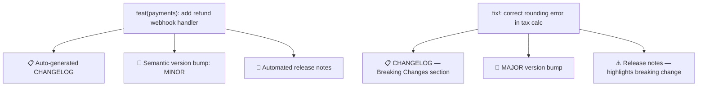
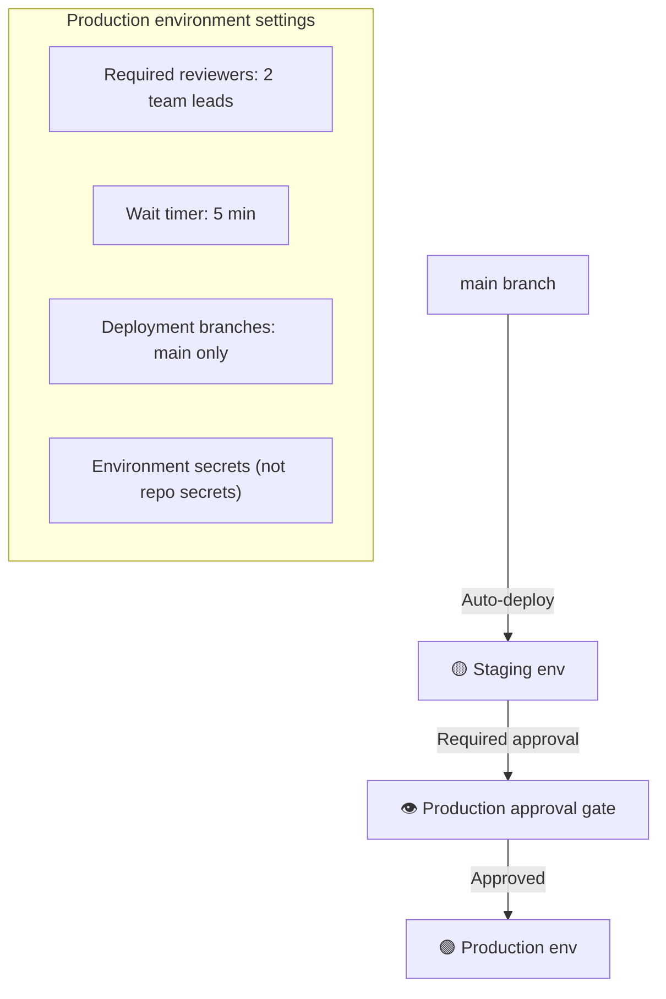

# D3: Repository Security & Governance

> **Exam weight**: 34% · **Questions**: ~28 in the bank

## Overview

A repository is more than a code store. It is an access-control boundary, an audit trail and a collaboration protocol. This domain covers the security features that watch it (secret scanning and push protection, Dependabot and dependency review, code scanning, and how GitHub packages them as Secret Protection and Code Security), how to enforce them at scale with security configurations, and the governance files and settings that make collaboration predictable: templates, security policy and private vulnerability reporting, commit conventions, visibility, archiving, machine identities and the audit log.

> 💡 **Human Angle**: Governance gaps compound like interest. No template, no owner, no policy: each looks minor on its own, and together they add up to a compliance failure.

<div class="note-important"><strong>Repository governance gaps compound over time.</strong> No PR template leads to inconsistent reviews. No CODEOWNERS means the wrong people review critical changes. No security policy or private reporting means vulnerabilities get reported in public issues. Each gap seems minor; together they create a compliance failure.</div>

---

## 3.1 Repository Structure Essentials

### Key Concept

**The files in a repository's root and `.github/` folder are its operating manual and its first line of defence.**

A production repository needs a README (what it is and how to run it), a LICENSE (the legal terms), a `.gitignore` (what must never be committed), CONTRIBUTING.md (how to work here), SECURITY.md (how to report vulnerabilities), CODEOWNERS (who reviews what), and `dependabot.yml` if it uses version updates. GitHub surfaces several of these automatically. The community profile checks for them, and SECURITY.md populates the Security tab's policy.

A missing `.gitignore` is a security issue, not a style issue. Once a secret is committed it lives in history even if the next commit deletes it. **Think of `.gitignore` like a "do not pack" list for airport security**: it's far easier to leave the knife at home than to explain it at the gate.

| File | Location | Purpose |
|---|---|---|
| `README.md` | Root (or `.github/`, `docs/`) | What it is, how to run it, how to contribute |
| `LICENSE` | Root | Legal terms for use and modification |
| `.gitignore` | Root | Keeps secrets, build artifacts and IDE files out of commits |
| `CODEOWNERS` | `.github/`, root or `docs/` | Auto-requests reviewers by path |
| `SECURITY.md` | Root, `.github/` or `docs/` | How to report vulnerabilities confidentially |
| `CONTRIBUTING.md` | Root, `.github/` or `docs/` | Workflow, standards and setup for contributors |
| `dependabot.yml` | `.github/` | Dependabot version updates configuration |

```gitignore
# Environment & secrets: NEVER commit these
.env
.env.*
!.env.example      # The example is OK to commit
*.pem
*.key
*_rsa
*_dsa

# Dependencies
node_modules/
vendor/
__pycache__/
*.pyc
.venv/
venv/

# Build outputs
dist/
build/
*.log
coverage/
.nyc_output/

# IDE & OS files
.DS_Store
Thumbs.db
.idea/
.vscode/*
!.vscode/extensions.json   # This one is useful to share
*.suo
*.user
```

Organization-wide defaults for community files (issue templates, SECURITY.md, CONTRIBUTING.md) can live in a public repository named `.github` in the organization. They apply to any repository that doesn't have its own.

### In Practice

**What breaks without this**: A developer runs `git add .` with a `.env` file present, and production credentials go into a commit that every clone now carries forever.

**Decision trigger**: Ask: "Could a new contributor set this up, contribute and report a security problem using only what's in the repo?" If not, the missing file is the gap.

**When you'd choose differently**: Small internal repositories inherit community files from the organization's `.github` repository instead of copying them, which keeps one version of the truth. `.gitignore` is different: it must exist per repository, because it's specific to the stack.

### Exam Trap ⚠️

<div class="note-trap">
"Delete the file in the next commit" doesn't remove a committed secret; the earlier commit still holds it. The first response is to <strong>revoke and rotate</strong> the secret, and only then, if needed, rewrite history.
</div>

---

## 3.2 Secret Scanning and Push Protection

### Key Concept

**Secret scanning finds leaked secrets after the fact; push protection stops supported secrets before they land.**

**Secret scanning** scans repository history (and issues, PRs and discussions) for known secret formats from partner providers, plus custom patterns and AI-detected generic secrets, and raises alerts. For public repositories, many partner secrets are also reported to the issuing provider. **Push protection** checks content *at push time*, covering command-line pushes, web UI commits, file uploads and REST API requests, and rejects pushes that contain supported secrets.

By default, a contributor with write access can bypass a block by giving a reason. "It's used in tests" and "It's a false positive" create *closed* alerts, while "I'll fix it later" creates an *open* alert. Every bypass is logged in the audit log and emailed to owners, security managers and repository admins who watch the repository. **Delegated bypass** turns that self-service into a request that designated reviewers must approve. **Think of push protection as a metal detector at the door and secret scanning as the CCTV**: one stops things coming in, the other shows you what's already inside.

| | Push protection for repositories | Push protection for users |
|---|---|---|
| Scope | Pushes to that repository / org / enterprise | Your personal account's pushes to public repos on GitHub.com |
| Default | Off until enabled | On by default |
| Requires | GitHub Secret Protection (private/internal repos) | Nothing |
| Bypass creates alert? | Yes | No, unless repo-level push protection is also on |

### Removing a leaked secret: the order matters

1. **Revoke and rotate** the credential with its provider. Assume it is compromised the moment it was pushed.
2. Check the provider's logs for misuse during the exposure window.
3. If history must be cleaned, rewrite it with `git-filter-repo` (the recommended successor to `git filter-branch`), force-push, and have collaborators re-clone.
4. Ask GitHub Support to remove cached views and references in pull requests, which a rewrite alone doesn't clear.
5. Close the secret scanning alert as revoked, and add a `.gitignore` entry or push protection so it can't happen again.

### In Practice

**What breaks without this**: An AWS key is pushed to a public repo, and automated scrapers that watch public pushes find it within minutes, long before the next day's code review would have.

**Decision trigger**: Ask: "If someone pasted a production credential into a commit right now, what would stop it?" If the answer is "a reviewer might notice", turn on push protection, and consider delegated bypass for repos holding high-value credentials.

**When you'd choose differently**: Repositories that legitimately store test fixtures with fake credential-shaped strings generate false positives. Use the bypass reason "used in tests", or exclude test fixture paths, rather than turning push protection off for the whole repo.

### Exam Trap ⚠️

<div class="note-trap">
"Secret scanning blocked the push" is wrong: <em>push protection</em> blocks, secret scanning alerts. "Bypass requires an admin's approval" is only true when delegated bypass is configured. "History rewrite fixes the leak" is wrong too: rotation fixes the leak, and the rewrite is only clean-up.
</div>

---

## 3.3 GitHub Secret Protection, Code Security and Security Configurations

### Key Concept

**GitHub Advanced Security is sold as two products, Secret Protection and Code Security, and enforced at scale with security configurations.**

**GitHub Secret Protection** includes secret scanning, push protection, AI-detected secrets, custom patterns, delegated bypass for push protection and delegated alert dismissal. **GitHub Code Security** includes code scanning (CodeQL or third-party via SARIF), Copilot Autofix, dependency review, custom auto-triage rules for Dependabot and security campaigns. Both include security overview, and both require a GitHub Team or GitHub Enterprise plan for private repositories. Public repositories get many features free; code scanning and secret scanning, for example, are enabled for public repositories by default.

**Security configurations** apply a chosen set of security enablement settings to many repositories at once, either GitHub's recommended configuration or a custom one. A custom configuration's policy can **Enforce configuration**, which blocks repository owners from changing any feature it enables or disables (features left unset aren't enforced). New enterprise-level options (September 2026) can also stop organization owners from overriding them. **Think of security configurations as a building's fire code**: individual tenants can decorate as they like, but they can't remove the sprinklers.

### In Practice

**What breaks without this**: A team disables secret scanning on a noisy repository "temporarily", and nobody notices for a year because each repository's settings were managed by hand.

**Decision trigger**: Ask: "Which features must be on for every repository in this class, regardless of what its owner prefers?" Put them in a custom security configuration, apply it to that class, and enforce it. Use security overview to track coverage and open alerts.

**When you'd choose differently**: For a small organization with a handful of repos and a single security-minded owner, per-repo settings plus the GitHub-recommended configuration may be enough. Enforcement pays off when the number of repo admins grows.

### Exam Trap ⚠️

<div class="note-trap">
"Push protection is part of Code Security" is wrong; it's in Secret Protection. "Security overview enforces settings" is wrong; it reports, and security configurations (with Enforce) enforce. "Push protection for users covers private repos" is wrong; it covers your pushes to public repositories only.
</div>

---

## 3.4 Dependency Review and License Compliance

### Key Concept

**Dependabot tells you about vulnerable dependencies you already have; dependency review stops a PR from adding new ones.**

The **dependency review action** (`actions/dependency-review-action`) compares the dependency changes in a pull request against the GitHub Advisory Database and fails the check when a change introduces a vulnerability at or above `fail-on-severity` (`low`, `moderate`, `high`, `critical`). It can scope failures with `fail-on-scopes` (`runtime`, `development`, `unknown`) and enforce licenses with **either** `allow-licenses` **or** `deny-licenses` (not both), using SPDX identifiers.

As with every gate, it only blocks when the check is **required**. Rulesets also offer a "Require license compliance results before merging" rule. **Think of dependency review as customs at the border, and Dependabot alerts as the recall notices for goods already in the country.**

```yaml
# .github/workflows/dependency-review.yml
name: Dependency Review
on: pull_request
permissions:
  contents: read
jobs:
  review:
    runs-on: ubuntu-latest
    steps:
      - uses: actions/checkout@11bd71901bbe5b1630ceea73d27597364c9af683  # v4.2.2
      - uses: actions/dependency-review-action@<full-sha>  # vX.Y.Z
        with:
          fail-on-severity: high
          allow-licenses: MIT, Apache-2.0, BSD-3-Clause, ISC
```

### In Practice

**What breaks without this**: A PR adds a package with a known critical CVE, CI is green because the tests pass, and the vulnerability reaches production before Dependabot raises an alert on main the next morning. Or a GPL-licensed package lands in a proprietary product and legal finds it during due diligence.

**Decision trigger**: Ask: "Do we want to *prevent* new risk at the PR, or only *learn* about existing risk?" Prevention means dependency review as a required check. Learning means Dependabot alerts.

**When you'd choose differently**: Teams with a dedicated SCA tool (for example, one that already gates PRs) may skip the action and upload results elsewhere. Still, keep Dependabot alerts on, because they keep watching after merge when new advisories are published.

### Exam Trap ⚠️

<div class="note-trap">
"Enable Dependabot alerts so the PR is blocked" is wrong: alerts don't block PRs. "Code scanning checks dependencies" is wrong: it analyses your code, not your dependency manifests. And "Dependabot flags license violations" is wrong: license gating comes from dependency review (or a ruleset license rule).
</div>

---

## 3.5 Pull Request and Issue Templates

### Key Concept

**Templates move the questions reviewers and triagers always ask to the moment the author is filling in the form.**

A PR template (`.github/pull_request_template.md`, or several under `.github/PULL_REQUEST_TEMPLATE/`) pre-fills the PR description. Issue forms (`.github/ISSUE_TEMPLATE/*.yml`) render real form fields with validation, so "Steps to reproduce" can be required. A `config.yml` in the same folder can turn off blank issues and link to discussions or the security policy.

Templates don't enforce code quality, but they make missing context visible. **Think of a template as the airline's pre-flight checklist for authors**: it doesn't fly the plane, but it makes skipping a step a conscious choice.

### The Story: "The Description-Free PR"

A 2,000-line PR lands in the queue. Title: "Fix stuff." No description, no linked issue, no test plan. A reviewer has to read every line to work out the intent. Did this change the authentication flow on purpose? Why was this configuration changed?

Two hours later the reviewer gives up and approves it with "LGTM", because the sprint ends today. The next week the change causes a production incident that takes four hours to diagnose, because nobody understood the original intent.

```markdown
<!-- .github/pull_request_template.md -->

## What does this PR do?
<!-- One paragraph describing the change and why -->

## Linked Issue
Closes #<!-- issue number -->

## Type of Change
- [ ] Bug fix (non-breaking)
- [ ] New feature (non-breaking)
- [ ] Breaking change
- [ ] Refactor (no behaviour change)
- [ ] Documentation update
- [ ] Security fix

## How was this tested?
- [ ] Unit tests added/updated
- [ ] Integration tests pass
- [ ] Manual testing: <!-- describe steps -->

## Checklist
- [ ] Code follows team style guidelines
- [ ] Self-reviewed my own code
- [ ] No hardcoded secrets or credentials
- [ ] Documentation updated (if needed)

## Screenshots (if UI change)
<!-- Before / After -->
```

<div class="note-scribble">The checklist is the most valuable part. It makes the author consciously confirm each step. "Have I added tests?" is easy to skip in a hurry; ticking a box takes the same time but makes the omission visible.</div>

```yaml
# .github/ISSUE_TEMPLATE/bug-report.yml
name: Bug Report
description: Report a reproducible bug
labels: [bug, triage]
body:
  - type: markdown
    attributes:
      value: "Before opening, search for existing issues."

  - type: textarea
    id: description
    attributes:
      label: What happened?
      description: A clear description of the bug
    validations:
      required: true

  - type: textarea
    id: reproduction
    attributes:
      label: Steps to reproduce
      placeholder: |
        1. Go to '...'
        2. Click on '...'
        3. See error
    validations:
      required: true

  - type: textarea
    id: expected
    attributes:
      label: Expected behavior
    validations:
      required: true

  - type: input
    id: version
    attributes:
      label: Version
      placeholder: "v2.3.1"
    validations:
      required: true
```

```yaml
# .github/ISSUE_TEMPLATE/config.yml
blank_issues_enabled: false
contact_links:
  - name: Report a security vulnerability
    url: https://github.com/OWNER/REPO/security/advisories/new
    about: Please report security issues privately, not as public issues.
```

### In Practice

**What breaks without this**: Triage turns into a loop of "which version?" and "can you share steps?" before anyone can start fixing, and the team spends 30% of its time on it.

**Decision trigger**: Ask: "What do we ask for in the first reply to almost every new issue or PR?" Those questions belong in the template as required fields.

**When you'd choose differently**: Very small or internal-only repositories with two maintainers often find a long PR template becomes boilerplate that nobody reads. A three-line template (what, why, how tested) is better than an ignored twenty-line one.

### Exam Trap ⚠️

<div class="note-trap">
A "word-count check on PR descriptions" or a "PR size limit" is a distractor when the question is about missing <em>context</em>; the native answer is a PR template. And issue <em>forms</em> (YAML) can make fields required, while Markdown issue templates can't.
</div>

---

## 3.6 Security Policy and Private Vulnerability Reporting

### Key Concept

**Private vulnerability reporting gives researchers a confidential channel; SECURITY.md tells them how you'll handle what they send.**

When owners or admins enable **private vulnerability reporting** on a public repository, reporters can submit details privately from the Security tab as a draft security advisory, and maintainers are notified immediately. It doesn't depend on a SECURITY.md file. **SECURITY.md** is the repository's security policy: supported versions, how to report, and what response time to expect. Without either, researchers often fall back to public issues.

Maintainers then work in a **repository security advisory**: discuss privately, collaborate on a fix (optionally in a temporary private fork), request a CVE ID, and publish the advisory alongside the release. **Think of private reporting as the hospital's side entrance for emergencies**: it exists so the urgent case doesn't have to queue through the public waiting room.

```markdown
# Security Policy

## Supported Versions

| Version | Security Updates |
|---------|-----------------|
| 2.x     | ✅ Supported     |
| 1.x     | ❌ End of life   |

## Reporting a Vulnerability

**Do not open a public GitHub issue for security vulnerabilities.**

Use GitHub's private vulnerability reporting:
1. Go to the Security tab of this repository
2. Click "Report a vulnerability"
3. Fill in the details

We aim to acknowledge reports within 48 hours and provide a remediation timeline within 7 days.

## What to Include
- Description of the vulnerability
- Steps to reproduce
- Potential impact assessment
- Suggested remediation (if known)
```

<div class="note-important"><strong>Enable private vulnerability reporting <em>and</em> publish a SECURITY.md.</strong> Reporting works without the file, but the policy sets expectations (supported versions, response times) and is what researchers look for first. Correction: an earlier version of these notes said the "Report a vulnerability" button needs both; it needs only the feature to be enabled.</div>

### In Practice

**What breaks without this**: A researcher posts "SQL injection in the query builder, with a working exploit" as a public issue, search engines index it within the hour, and every user is exposed before a patch exists.

**Decision trigger**: Ask: "If someone found a critical bug in this project today, where would they tell us, and who would see it first?" If the answer is "a public issue", enable private vulnerability reporting now.

**When you'd choose differently**: Organizations with an established bug bounty or a central security inbox may point SECURITY.md there instead. Even then, enabling private reporting gives researchers who stay on GitHub a safe path.

**If it already happened**: limit further exposure (lock or hide the issue, contact the reporter privately), fix and release, then publish an advisory, with a CVE if appropriate. Enable private reporting so the next report arrives privately. Deleting the issue doesn't undo indexing, and making the repository private breaks every user's dependency.

### Exam Trap ⚠️

<div class="note-trap">
"Private vulnerability reporting requires a SECURITY.md" is false. "Reports go to GitHub's security team" is false; they go directly and privately to the repository's maintainers. And the harm of having neither is <em>premature public disclosure</em>, not "the report isn't tracked".
</div>

---

## 3.7 Commit Message Standards

### Key Concept

**Conventional Commits turn commit messages into machine-readable release instructions.**

The format is `<type>(<scope>): <description>`, with an optional body and footers. `feat` maps to a MINOR version bump and `fix` to a PATCH. A breaking change, marked with `!` after the type or scope (`feat!:`) or a `BREAKING CHANGE:` footer, maps to a MAJOR bump in tools such as semantic-release. Squash merging pairs well with this, because each PR becomes one well-formed commit on main.

Enforcement can live in CI (commitlint as a required check) or in a ruleset metadata restriction that requires commit messages to match a pattern. **Think of commit types as shipping labels**: the warehouse robot (release tooling) can't read your handwriting, but it can read a barcode.

| Type | Meaning | Example |
|---|---|---|
| `feat` | New feature (MINOR) | `feat(auth): add OAuth2 login` |
| `fix` | Bug fix (PATCH) | `fix(api): handle null response from payments endpoint` |
| `docs` | Documentation | `docs: update API reference for v2 endpoints` |
| `chore` | Maintenance | `chore(deps): upgrade axios to 1.7.0` |
| `refactor` | Restructure, no behaviour change | `refactor(db): extract query builder` |
| `test` | Tests only | `test(auth): cover token expiry edge cases` |
| `ci` | CI/CD configuration | `ci: add CodeQL scanning workflow` |
| `!` / `BREAKING CHANGE:` | Breaking API change (MAJOR) | `feat!: remove deprecated v1 endpoints` |



```yaml
# .github/workflows/commitlint.yml
name: Commit Message Lint
on:
  pull_request:
    branches: [main]
permissions:
  contents: read
jobs:
  lint:
    runs-on: ubuntu-latest
    steps:
      - uses: actions/checkout@11bd71901bbe5b1630ceea73d27597364c9af683  # v4.2.2
        with:
          fetch-depth: 0
      - uses: wagoid/commitlint-github-action@<full-sha>  # v6.x
```

### In Practice

**What breaks without this**: Release notes are written by hand from a history of "fix", "wip" and "stuff", so version numbers stop meaning anything, and consumers get breaking changes in minor releases.

**Decision trigger**: Ask: "Do we want versions and changelogs generated from history?" If yes, adopt Conventional Commits, squash-merge with the PR title as the commit message, and lint PR titles or commits as a required check.

**When you'd choose differently**: Applications that deploy continuously and never publish versions get less from strict commit types. A lighter "imperative summary + issue link" convention is often enough.

### Exam Trap ⚠️

<div class="note-trap">
<code>feat!:</code> is MAJOR, not MINOR, because the <code>!</code> overrides the type. A <code>BREAKING CHANGE:</code> footer does the same. Watch for distractors that read only the type prefix.
</div>

---

## 3.8 Visibility, Archiving, Topics and Custom Properties

### Key Concept

**Visibility controls who can see a repository; archiving freezes it; topics and custom properties make it findable and governable.**

There are three visibility levels: **public** (everyone), **private** (only people and teams granted access), and **internal**, which is available with GitHub Enterprise and visible to all members of the enterprise but not to the public or outside collaborators. Internal is the inner-source default. **Archiving** makes the whole repository read-only, including code, issues, PRs and the wiki, and labels it as archived, while it stays viewable and cloneable.

**Topics** are public, free-form labels for discovery (`org:acme topic:terraform`). **Custom properties** are organization-defined, typed metadata (for example `tier: critical`, `owner-team: payments`) that rulesets and security configurations can target. **Think of topics as hashtags and custom properties as the fields on an asset register**: one helps people find things, the other lets policy act on them.

Recommended topic taxonomy:

```
# Technology stack
python, node, react, golang, terraform, kubernetes

# Type of project
microservice, library, framework, tool, documentation, infrastructure

# Status
active, maintained, deprecated, archived, experimental

# Domain
payments, auth, notifications, data-pipeline, ml-platform
```

### In Practice

**What breaks without this**: An internal tool is made public "so everyone can see it", which exposes it to the internet, or it's kept private, so every new team has to request access. Meanwhile, "apply this ruleset to every production service" is impossible because nothing records which repos are production services.

**Decision trigger**: Ask: "Will a policy ever need to select this group of repositories?" If yes, define a custom property and set it, ideally required, with a default. Use topics for discovery and custom properties for governance.

**When you'd choose differently**: To retire a single branch rather than a repository, use lock branch. To keep a repository but hide it from most people, change visibility or team access instead of archiving.

### Exam Trap ⚠️

<div class="note-trap">
"Private with an Everyone team" isn't the same as internal. "Lock all branches" isn't the same as archive, because issues and PRs stay open for activity. And organization rulesets target repositories by name or custom property, not by topic.
</div>

---

## 3.9 Machine Identities: GitHub Apps, Deploy Keys, PATs and OIDC

### Key Concept

**Automation should authenticate as itself, with short-lived and narrowly scoped credentials, never as a person.**

A **GitHub App** is the recommended identity for organization automation. It isn't tied to a user, doesn't consume a seat, uses fine-grained permissions on selected repositories, and authenticates with installation access tokens that expire after one hour. A **deploy key** is an SSH key for Git access to a single repository, read-only unless you grant write. Use one key per server, read-only by default; deploy keys don't expire automatically. **Personal access tokens** act as a person; fine-grained PATs can be limited to specific repositories, but they still break when that person leaves. **Machine accounts** are allowed by GitHub's Terms of Service, but they consume a seat and need a responsible human owner. **OIDC** removes stored cloud credentials entirely (see D2).

For GitHub Packages, classic PATs need `read:packages` to install and `write:packages` to publish. Repository read access alone isn't enough. In Actions, prefer `GITHUB_TOKEN` with `packages: write`. **Think of a GitHub App as a company car with a fuel card limited to work routes**: it belongs to the organization, not to whoever happens to be driving.



| Credential | Scope | Lifetime | Use when |
|---|---|---|---|
| `GITHUB_TOKEN` | Current repository, per job | Ends with the job | Anything inside this repo's workflows |
| GitHub App installation token | Selected repos, fine-grained permissions | 1 hour | Cross-repo automation, bots, release tooling |
| Deploy key | One repository, Git over SSH | Until removed | A server that only needs to `git pull` (read-only) |
| Fine-grained PAT | Selected repos, as a user | Expiry you set | Personal scripts and testing; not shared automation |
| Repository / environment secret | Workflows / jobs naming the environment | Until rotated | Credentials for systems that can't federate |
| OIDC (federated identity) | Cloud role trust policy | Per job | AWS / Azure / GCP deploys: **preferred over stored keys** |

<div class="note-important"><strong>OIDC federation removes long-lived cloud credentials entirely.</strong> Instead of storing <code>AWS_ACCESS_KEY_ID</code> as a secret, the job exchanges a GitHub-issued JWT for temporary cloud credentials, which the cloud provider grants only if the token's claims (repository, environment, branch) match its trust policy.</div>

### In Practice

**What breaks without this**: The release pipeline runs on a departed engineer's PAT. Their account is deactivated on their last day and releases stop, or worse, the token keeps working from their laptop after they've left.

**Decision trigger**: Ask: "If the person who set this up left tomorrow, would this automation keep working, and would their access end?" If the automation would break, or their access would survive, switch to a GitHub App (GitHub API), a read-only deploy key per server (Git pull), or OIDC (cloud).

**When you'd choose differently**: A one-off migration script run by an admin from their own machine is a legitimate PAT use. Set a short expiry and minimal repository scope.

### Exam Trap ⚠️

<div class="note-trap">
"A bot account is against GitHub's Terms" is false; machine accounts are permitted, they're just a worse fit than GitHub Apps. A deploy key "with write access shared across servers" combines two separate risks: excess privilege and key reuse. A 401 from GitHub Packages with read access to the repo usually means the PAT lacks <code>read:packages</code>.
</div>

---

## 3.10 Audit Log and Webhook Integrity

### Key Concept

**The audit log records who changed what in your organization; webhook signatures prove a payload really came from GitHub.**

The organization **audit log** records security-relevant events with actor and timestamp: membership and permission changes, repository creation, visibility and deletion, branch protection and ruleset changes, secret creation and updates, app and OAuth authorizations, push protection bypasses, and more. On GitHub Enterprise Cloud it can be **streamed** to a SIEM for retention and alerting, and Git events (clones, pushes) are available at enterprise level.

Outbound **webhooks** should be configured with a secret. GitHub then signs each payload with HMAC-SHA256 in the `X-Hub-Signature-256` header, and the receiver recomputes the HMAC over the raw body and compares the two in constant time before trusting anything. **Think of the audit log as the building's sign-in book and the webhook signature as the wax seal on a letter**: one tells you who came in, the other tells you the message wasn't forged.

```python
import hmac, hashlib

def verify(secret: bytes, body: bytes, header: str) -> bool:
    expected = "sha256=" + hmac.new(secret, body, hashlib.sha256).hexdigest()
    return hmac.compare_digest(expected, header)
```

### In Practice

**What breaks without this**: After a breach, nobody can say when a deploy key was added or who turned off a branch protection rule, because the audit log was never retained or reviewed. Separately, an internal deploy system accepts any POST that claims to be a GitHub push event, so anyone who can reach it can trigger a deployment.

**Decision trigger**: Ask: "Could we reconstruct the last 90 days of permission and protection changes, and could a forged request trigger our automation?" If either answer is no, stream the audit log and verify webhook signatures.

**When you'd choose differently**: IP allowlisting of GitHub's published webhook ranges is a reasonable *additional* layer, but never a substitute for signature verification, since the ranges are shared and they change.

### Exam Trap ⚠️

<div class="note-trap">
TLS protects the payload in transit but doesn't prove who sent it. The <code>X-GitHub-Event</code> header can be set by anyone. Only the HMAC signature authenticates the sender. And the git log records commits, not access or permission events; for those, use the audit log.
</div>

---

## Deep Dive: Making Repository Governance Click

### 1. The connective narrative

Repository governance has two halves that people often treat separately: **security features that watch the code** and **conventions that shape how people work**. They solve the same problem from two directions. Push protection, dependency review and code scanning catch dangerous changes mechanically. Templates, CODEOWNERS, commit conventions and security policy make sure the humans in the loop have the context to catch what machines can't.

The security features line up along a time axis. **Before the commit**: `.gitignore` and local pre-commit scanners. **At push**: push protection and push rulesets. **At the PR**: dependency review, code scanning results and required reviews. **After merge**: secret scanning alerts, Dependabot alerts and security updates, and scheduled code scanning. **After disclosure**: private vulnerability reporting and security advisories. A mature repository has something at every point, and the exam often asks which point a given control acts at.

Scale is the final piece. One well-configured repo is easy; four hundred are not. Custom properties describe repositories, security configurations (with Enforce) and organization rulesets act on those descriptions, security overview measures the result, and the audit log records every exception. GitHub Apps and OIDC keep the automation that does all this from depending on any one person's credentials.

### 2. Worked scenario

> **Scenario.** A 300-repository organization on GitHub Enterprise Cloud has these findings: secret scanning disabled on 60 private repos by their owners; an AWS key pushed to a private repo last month; two public libraries with no way to report vulnerabilities privately; a release pipeline using a departed engineer's PAT; and nobody can say who disabled branch protection on `billing-api`.
>
> **Step 1: Describe the estate.** Define a custom property `tier` (`critical`, `standard`, `sandbox`) and set it on every repository.
>
> **Step 2: Enforce the baseline.** Create a custom security configuration: dependency graph, Dependabot alerts and security updates, secret scanning, push protection, and private vulnerability reporting (which applies to public repos). Apply it to `tier=critical` and `tier=standard`, with policy **Enforce configuration**. The 60 repos are re-enabled, and owners can no longer turn the features off.
>
> **Step 3: Handle the leaked key correctly.** Revoke and rotate the AWS key first, then check CloudTrail for use during the exposure window. Only then decide whether rewriting history is worth the disruption. The rotation is the fix; the rewrite is hygiene. Configure delegated bypass for push protection on critical repos, so the next bypass needs a security reviewer.
>
> **Step 4: Open a private channel.** On the two public libraries, enable private vulnerability reporting and add SECURITY.md files listing supported versions and response times.
>
> **Step 5: Replace the human credential.** Register a "release-bot" GitHub App with `contents: write` on the release repositories only. Its one-hour installation tokens are minted per run, and the departed engineer's PAT is revoked.
>
> **Step 6: Make changes attributable.** Stream the audit log to the SIEM and alert on `protected_branch` and ruleset changes. The `billing-api` question is answered from the log, and the next such change raises an alert in real time.
>
> **Outcome:** Each finding maps to one mechanism: properties describe, configurations enforce, rotation remediates, private reporting channels disclosure, Apps replace people, and the audit log attributes changes.

### 3. Memory aid

**SHIELD**: the layers of repository governance:

- **S**ecrets: `.gitignore`, push protection, secret scanning; rotate first
- **H**ygiene files: README, LICENSE, CONTRIBUTING, templates
- **I**dentities: GitHub Apps, read-only deploy keys, OIDC, no personal PATs
- **E**nforcement at scale: custom properties, security configurations (Enforce), org rulesets
- **L**ogs: audit log streaming, signed webhooks
- **D**isclosure and dependencies: private vulnerability reporting, SECURITY.md, Dependabot, dependency review

### 4. Exam strategy for this domain

- **Place the control on the timeline.** "Before it reached GitHub" means push protection. "Before the PR merged" means dependency review or code scanning as a required gate. "After it's already in the repo" means secret scanning alerts or Dependabot alerts.
- **Know which product a feature belongs to.** Secret Protection covers secrets and push protection; Code Security covers code scanning, Autofix and dependency review. Questions about buying "just enough" hinge on this.
- **Report vs enforce.** Security overview, the dependency graph and Dependabot alerts *report*; security configurations with Enforce, rulesets and required checks *enforce*.
- **Remediation order.** For leaked secrets, rotate first; history rewriting is clean-up, never the fix.
- **Absolute-language distractors.** "GitHub requires SECURITY.md for private reporting", "bot accounts violate the Terms", "deleting the issue removes the disclosure" are all wrong.
- Five minutes before the exam: *Detect early, enforce centrally, rotate first, and never let automation borrow a person's identity.*

---

## Cheat Sheet 📋

| Item | Location / setting | Key rule |
|---|---|---|
| `.gitignore` with secrets/artifacts excluded | Root | Critical; prevents the commit entirely |
| Push protection | Security settings / security configuration | Blocks at push; bypass reasons create closed or open alerts |
| Secret scanning | Security settings | Alerts on secrets already in history |
| Leaked secret | Provider + repo | Rotate first, then optionally `git-filter-repo` + GitHub Support |
| Secret Protection vs Code Security | Billing / licensing | Secrets + push protection vs code scanning + Autofix + dependency review |
| Security configurations | Org settings → Code security | "Enforce configuration" blocks owner changes |
| Dependency review | `actions/dependency-review-action` | Required check; `fail-on-severity`; `allow-licenses` or `deny-licenses` |
| SARIF from third-party tools | `github/codeql-action/upload-sarif` | `security-events: write` |
| PR template | `.github/pull_request_template.md` | Structures context |
| Issue forms | `.github/ISSUE_TEMPLATE/*.yml` | Can require fields; `config.yml` disables blank issues |
| Security policy | `SECURITY.md` | Recommended; not required for private reporting |
| Private vulnerability reporting | Repo settings (public repos) | Reports go privately to maintainers as draft advisories |
| Conventional Commits | commitlint / ruleset metadata | `feat!` or `BREAKING CHANGE:` = MAJOR |
| Visibility | Public / private / internal | Internal = enterprise members only |
| Archive | Repo settings → Danger zone | Whole repo read-only, including issues/PRs |
| Custom properties | Org settings | Targets for rulesets and security configurations |
| GitHub Apps | Org-owned app | 1-hour installation tokens; no seat; fine-grained |
| Deploy keys | Repo settings | One per server, read-only by default; no expiry |
| Packages auth | Classic PAT scopes | `read:packages` / `write:packages` |
| Audit log | Org / enterprise settings | Stream to SIEM on Enterprise Cloud |
| Webhooks | Webhook secret | Verify `X-Hub-Signature-256` HMAC-SHA256 |
